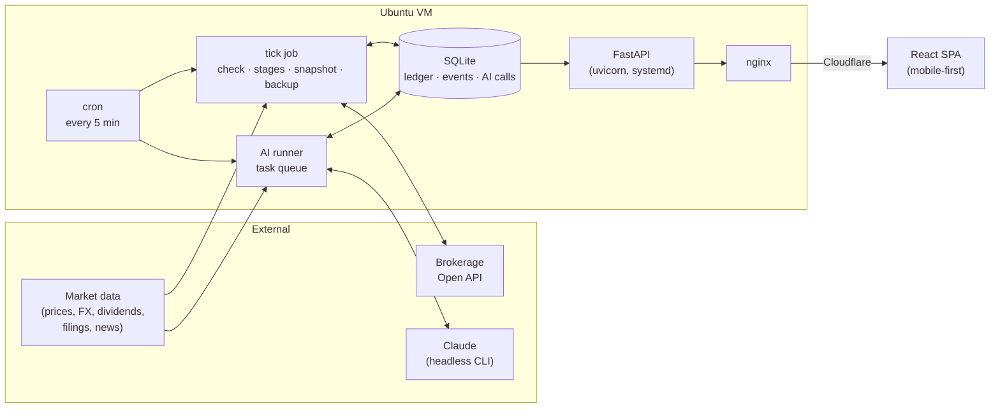

# quant-dashboard

A self-hosted engine and dashboard that runs my personal portfolio across the Korean and US
markets. It collects market data, applies portfolio rules on a fixed daily schedule, asks an LLM
for the judgment calls that code can't make on its own, sends the orders to a broker, and shows
every step of that on a mobile-first web app.

This is a personal project for my own money. It is not a product, a service or investment advice.

## Highlights

- **One engine, two ledgers.** A paper ledger (simulated fills at the session open) and a live
  ledger (real orders through a brokerage API) share the same planner, stage runner and
  reconciliation code.
- **Rules as data.** A rule is a JSON definition plus display hints. The engine executes it, and the
  web app draws it as allocation tiles or as a flow of decision lanes, so a new strategy shows up
  on screen without new UI code.
- **LLM judgment, kept on a leash.** Model calls answer narrow, schema-bound questions about
  packets the code builds. Money moves only when independent answers agree, and every call is
  recorded with its token usage.
- **Everything visible.** Asset trend, composition, drift against targets, the day's plan,
  per-day event timelines, rule flows and source health are drawn as charts and gauges instead of
  log lines.
- **Built to be left alone.** Cron wakes the jobs every 5 minutes, the code decides what is due in
  market time, and failures turn into retries or a visible to-do instead of silent gaps.

## How the rules were found

The portfolio rules running today were chosen from more than 10,000 backtested variants over
10+ years of daily Korean and US market history. Fees, FX spreads, taxes and dividends were
modelled, and candidates were checked out of sample before anything was trusted with real money.

In short, there are two kinds of rule:

- **Fixed allocation.** Target weights across a few instruments, rebalanced when drift leaves a
  band.
- **AI-assisted discovery.** A long-horizon stock sleeve. Candidates and their conditions come
  from model judgment, while the conditions themselves are checked by code against measured
  numbers every trading day.

The details of the rules are deliberately left out. The point of this repository is the platform
that runs and shows a rule, whatever the rule is.

## Architecture



### The daily loop

All times live in code (Korea time, and New York time for the US session with daylight saving),
not in cron fields. Every 5 minutes the tick asks what is due and runs it at most once a day.

1. **Collect.** Prices, FX, dividends and filings are pulled from several sources, with
   fallbacks, retries and a freshness record per source.
2. **Check.** Before the market opens, each rule compares the ledger against its targets and
   conditions and writes a plan.
3. **Stages.** Orders go out in stages tied to each market's session: Korean equities, then FX,
   then US equities at the NYSE open. A stage waits on the ones before it, and a failed stage is
   retried on the next trading day before it becomes a manual to-do.
4. **Reconcile.** On the live ledger the broker's account is read every 5 minutes and matched
   against the engine's own records.
5. **Snapshot.** After the close, positions are valued, metrics and tax estimates are updated,
   and the database is backed up.

### AI tasks

A separate runner takes AI tasks one at a time, cheapest and most urgent first. Each task is
`prepare → call → record → apply`: the code assembles the evidence packet, the model answers
against a JSON schema, the call and its tokens are written down before anything else can fail,
and the effects are applied in one transaction.

| Task | Model tier | What the answer is used for |
| --- | --- | --- |
| Extract | Haiku | Reads figures out of filings into a metric table |
| Screen | Haiku | Decides whether a new filing matters to a holding |
| Buy / sell confirmation | Sonnet × 2 | Two independent calls; both must agree before money moves |
| Monthly review | Sonnet | Re-evaluates each holding and rewrites its conditions |
| Switch | Sonnet × 2 | Weighs swapping one holding for another, net of costs |
| Discovery | Opus + web search | Proposes new candidates on a quarterly cycle |

How the calls are made:

- The model runs through the headless CLI (`claude -p --output-format json --json-schema …`) on a
  subscription login, with pinned model IDs (`claude-haiku-5-5`, `claude-sonnet-5-5`,
  `claude-opus-5-5`) and a reasoning effort chosen per task.
- Prompts and their output schemas are versioned files under `autotrade/ai/prompts/`.
- The CLI runs in an empty working directory with a scrubbed environment (no API keys, cloud
  credentials or repository secrets), with tools off except where a task needs the web.
- Tokens are counted against a monthly budget that shows up on the health screen. Going over the
  budget never blocks a sale.
- Failures are sorted: a source that is down waits an hour, a bad answer counts as an attempt, and
  a bug fails at once with its traceback logged. One broken task never stops the others.

### Safety around real money

- **Two keys for live orders.** An environment flag on the cron line, plus the "live" mode, which
  can only be switched on from the app with a PIN. Without both, the live ledger only reads the
  account.
- Every amount is an exact `Decimal`. Orders carry idempotency keys, and the broker's token is
  shared carefully so that two processes never revoke each other.
- The web app sits behind a PIN with a `__Host-` session cookie, a strict CSP, same-origin checks
  on writes, and a lockout after repeated wrong PINs.
- The API never migrates the database. Only the deploy step does, after a backup, and until then
  the API answers `503 schema`.
- The service runs as a hardened systemd unit: read-only code, a private `/tmp`, no capabilities,
  and no access to backups or broker tokens.

## Tech stack

| Layer | Tools |
| --- | --- |
| Engine & API | Python 3.10, FastAPI, Starlette, Pydantic v2, uvicorn, pandas, NumPy |
| Storage | SQLite with versioned migrations, nightly backups |
| AI | Claude (Haiku / Sonnet / Opus 5.5) through the headless CLI, JSON-schema structured output |
| Broker | Toss Securities Open API (token-bucket rate limiting per API group, injected transport) |
| Web | React 19, TypeScript 6, Vite 8, TanStack Query 5, React Router, CSS Modules |
| Charts | Hand-built SVG components (line, gauge, waterfall, drift band, composition bar, calendar) driven by pure, unit-tested geometry modules; no chart library |
| Design | Tokens in `web/design/tokens.json`, generated into CSS; Pretendard, Lucide icons |
| Infra | Ubuntu VM, systemd, cron + `flock`, nginx behind Cloudflare, logrotate |
| Quality | pytest, ruff, mypy (strict), Vitest, Testing Library, Playwright e2e with axe accessibility checks, ESLint (jsx-a11y), Prettier |

## Screens

| Screen | Shows |
| --- | --- |
| Home | Total assets and their trend, composition by asset and currency, today's plan |
| Plan | Drift against targets as gauges, order stages and their schedule |
| History | Asset history, a run calendar and a filterable event list |
| Day | One day replayed: the check, each stage, AI judgments, fills |
| Rules | Each rule drawn as allocation tiles or as a decision flow |
| Health | Data-source freshness, the job and AI runner heartbeats, open to-dos, token budget |
| Mode | Paper vs. live, side by side, and the guarded switch between them |
| Account | PIN, sessions and devices, notification settings |

## Repository layout

```
autotrade/          engine and API (Python 3.10)
  api/              FastAPI app, routes, view models, auth, release helper
  engine/           check, stage runner, reconciliation, valuation, snapshots
  domain/           weights, planner, ledger, money, tax, conditions
  rules/            rule model and rule definitions
  ai/               CLI client, task flows, evidence packets, prompts + schemas
  jobs/             cron entry points (tick, ai, migrate, backup) and the scheduler
  broker/           paper executor and live broker client
  market/           data sources, exchange calendars, freshness
  db/               SQLite schema, migrations, repositories
  dev/              scripted market "worlds" for local development
web/                React + Vite app
  src/charts/       SVG charts and their geometry
  src/screens/      one folder per screen
  src/fixtures/     scripted API responses for every screen state
tests/autotrade/    engine, API and deploy-file tests
deploy/             deploy script, systemd unit, cron block, nginx, logrotate
```

Production data (`data/`: the database, broker token cache, backups and logs) lives on the
server and is never committed.

## Development

```bash
# Python 3.10 (the server's version)
python -m pytest tests/autotrade -q
ruff check --config autotrade/pyproject.toml autotrade tests/autotrade
mypy --config-file autotrade/pyproject.toml autotrade tests/autotrade

# Web
cd web && npm ci && npm run lint && npm run typecheck && npm test
npm run e2e          # Playwright against fixture states
```

`autotrade/pyproject.toml` has pinned `uv run` one-liners for the same checks.

There are two ways to see the app without touching a market or a model:

- **Fixture mode.** `npm run dev`, then open any screen with `?fixture=<state>`. Each loading,
  empty, error, stale and permission state has a scripted bundle. Production builds can't import
  this code.
- **Dev worlds.** `python -m autotrade.jobs dev-seed --db <path> --world <name>` replays the real
  engine, tick by tick, over a scripted market, with a scripted model answering the AI tasks. The
  result is a full database the API can serve.

The suite has more than 1,200 automated tests across the engine, the API, the deploy files and
the web app. They run against fake market sources, a fake broker and a fake CLI, and never reach
the network.

## Deployment

```bash
./deploy/deploy.sh autotrade                       # build web → ship code → back up + migrate DB → switch web → restart + health check
./deploy/deploy.sh                                 # push and pull only, no restart
./deploy/deploy.sh rollback [<commit>] [--yes]     # roll back to a previous release
```

Each step and its rollback rules are documented at the top of `deploy/deploy.sh`. The install
steps for the systemd unit, the cron block, nginx and logrotate are at the top of each file.
