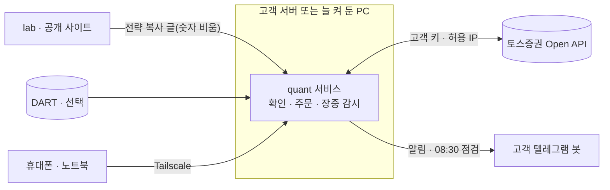

# product · quant 서비스와 lab

이 폴더는 두 제품의 기획 · 규칙 · 그림 · 코드를 담아요. **기획과 그림은 v2 완성본(2026-11-01)이고, 코드는 아직 MVP v1(모의투자 전용)이에요.** v2 개발은 `service/TASKS.md`의 첫 항목부터 시작해요.

> 레포 뿌리의 `autotrade/` · `web/` 등은 운영 중인 다른 앱이에요. 이 폴더의 개발은 그쪽을 건드리지 않아요(`DEVELOPING.md` 1절).

## 1. 제품 둘

| | quant 서비스 | lab(실험실) |
|---|---|---|
| 무엇 | 고객이 설치해 자기 토스 계좌로 **실전 운용**하는 앱 | 누구나 전략을 실험해 보는 **공개 웹사이트** |
| 누가 · 어디에 | 고객이 자기 서버(고정 IP 클라우드)나 늘 켜 둔 PC에 설치. 화면은 Tailscale 사설망으로만. 사용자 본인도 자기 것을 따로 설치 | 사용자(운영자)가 배포 |
| 데이터 | 고객의 토스 Open API 키 + DART 키(선택) | 운영자 자료(상장폐지 종목 포함) |
| 하는 일 | 단계 블록 편집 · 백테스트 · 모의투자 · 실전 주문 · 할 일 · 텔레그램 알림 · 기록 | 블록 편집 · 백테스트 · 매일 추적 · 전략 복사 글 만들기 |
| 서로 | lab의 **전략 복사 글 하나**(`quant-strategy/3`, 숫자 · 종목 · 섹터 비움)만 받아요. 운영자에게 아무것도 보내지 않아요 | 복사 글을 내보내기만. 앱에 접속하지 않고 키 · 계좌 · 결과를 받지 않아요 |
| 문서 | [service/SPEC.md](service/SPEC.md) | [lab/SPEC.md](lab/SPEC.md) |

## 2. 지금 상태 (2026-11-02)

| 무엇 | 상태 | 남은 것 |
|---|---|---|
| quant 서비스 기획 v2 | 완성 · 검토 반영(기획 1회 · 다른 길 1회 · 디자인 2회) | 토스 · DART를 불러 봐야 정해지는 것 8개 · 법률 확인 7개 · 열린 결정 13개(2개는 답함 · `service/OPEN-QUESTIONS.md`) |
| quant 서비스 그림 v2 | Figma 'quant 서비스' 페이지 · 화면 섹션 35개 · 프레임 1440 193장 + 390 89장(2026-11-02 최종 내보내기) | 그림은 제품 주인이 갱신해요(`service/design/FIGMA.md`) |
| quant 서비스 코드 | **MVP v1**: 모의투자 전용 · 캔버스 v1 · 야후 일봉 · 127.0.0.1만. 실전 주문 코드 없음 | v2 전부(`service/TASKS.md` 8묶음 · 32항목) |
| lab 기획 · 그림 | v2와 맞춤 · Figma 'lab' 페이지 화면 9개 · 프레임 11장 + 목차 | 코드 없음 · 공개 권리 · 법률 확인 · 서명 · 받는 쪽 결정 |
| 실제 주문 확인 | 하지 않음 | 개발이 끝난 뒤 **사용자가 소액으로 직접** |

## 3. 문서 지도

| 문서 | 무엇 | 언제 읽나 |
|---|---|---|
| [DEVELOPING.md](DEVELOPING.md) | 개발 안내 · 정답의 순서 · 안전 규칙 · 실행 · 시험 · 일하는 방식 | 개발을 시작할 때 맨 먼저 |
| [service/SPEC.md](service/SPEC.md) | quant 서비스 v2 기획서 완성본(정답) · 부록 A 규칙 · 부록 B 예시 시간표 | 모든 일의 기준 |
| [service/ENGINE-RULES.md](service/ENGINE-RULES.md) | 엔진 규칙만(경로 · 블록 · 판정 · 실행 방식 · 매매 방식 · 신호 강도 · 매도 대금 · 보호 매도 · 변환 · 복사 글 v3) + 강도 식 · 목표 금액 · 백테스트 적용 규칙 · 복사 글 v3 항목 id 사전 + 시험 예 | 엔진 · 시험을 짤 때 |
| [service/DATA-CATALOG.md](service/DATA-CATALOG.md) | 조건 카탈로그 + 토스 · DART 자료 출처 조사(Sources 포함) | 조건 · 데이터를 다룰 때 |
| [service/GLOSSARY.md](service/GLOSSARY.md) | 낱말 규칙 · 쓰는 말 · 쓰지 않는 말 · 금지어 · 말투 | 화면 글을 쓸 때 |
| [service/TASKS.md](service/TASKS.md) | 개발 할 일(순서 · 체크 · '다 됐다' 기준 · 시험) | 매일 |
| [service/OPEN-QUESTIONS.md](service/OPEN-QUESTIONS.md) | 토스 · DART 확인 · 법률 · 열린 결정 | 막힐 때 |
| [service/DECISIONS.md](service/DECISIONS.md) | 결정 기록(날짜 · 무엇 · 이유 · 바꾼 것) | '왜'가 궁금할 때 |
| [service/vendor/README.md](service/vendor/README.md) · [service/examples/](service/examples/copy-v3-example.txt) | 토스 OpenAPI 1.2.28 명세 · DART 응답 견본(가짜 응답의 꼴) · 복사 글 v3 예시 | 가짜 응답 · 복사 글 시험을 만들 때 |
| [service/design/FIGMA.md](service/design/FIGMA.md) | Figma 링크 · 화면 → 상태 → 그림 표 · 흐름 여섯 · 부품 | 화면을 만들 때 |
| [service/app/README.md](service/app/README.md) | 지금 MVP 코드 설명(v1 그대로) | 코드를 읽을 때 |
| [lab/SPEC.md](lab/SPEC.md) · [lab/design/FIGMA.md](lab/design/FIGMA.md) | lab 기획 · 그림 | lab 쪽 일 |
| [history/MVP-V1.md](history/MVP-V1.md) | MVP v1 경과 · 검증 결과 · v2로 바뀐 것 · 지운 결정 보드 | 배경이 궁금할 때 |

## 4. Figma

- 파일: [quant.jsyoo.dev](https://www.figma.com/design/ygAxFnxi4jeiw4vMxS1Xbm/quant.jsyoo.dev)
- 페이지 [quant 서비스](https://www.figma.com/design/ygAxFnxi4jeiw4vMxS1Xbm/quant.jsyoo.dev?node-id=331-169405) · 목차와 흐름 지도 섹션 [345:428013](https://www.figma.com/design/ygAxFnxi4jeiw4vMxS1Xbm/quant.jsyoo.dev?node-id=345-428013)
- 페이지 [lab](https://www.figma.com/design/ygAxFnxi4jeiw4vMxS1Xbm/quant.jsyoo.dev?node-id=343-172871)
- 그림 파일은 `service/design/frames/`(283장 · 흐름 지도 1장 포함) · `lab/design/frames/`(12장 · 목차 1장 포함). 이름 꼴 `<화면번호>__<상태>__<폭>__<노드id>.png`

## 5. 개발을 이어서 하는 법

1. [DEVELOPING.md](DEVELOPING.md)를 읽어요(특히 3절 안전 규칙).
2. `service/app/`에서 지금 MVP의 시험을 돌려 모두 통과하는지 봐요(DEVELOPING 4절).
3. [service/TASKS.md](service/TASKS.md)를 위에서부터 해요. 항목마다 체크 · 결과 한 줄 · 커밋.
4. 정답은 SPEC > ENGINE-RULES > 그림 > 지금 코드. 모르는 것은 OPEN-QUESTIONS에 적고 가정으로 진행.
5. **변환 일치 시험(TASKS T-24)이 통과하기 전에는 화면 · 모의투자 · 실전으로 넘어가지 않아요.**
