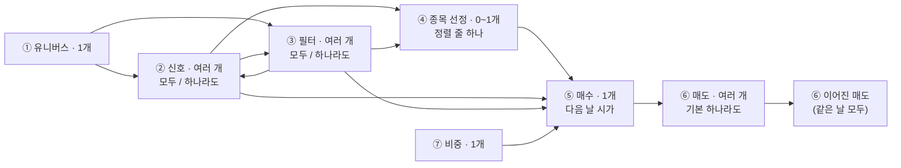

# 엔진 규칙 (v2 · 2026-11-02)

엔진 · 백테스트 · 모의투자 · 실전이 같이 따르는 규칙만 모았어요. 시험을 짜는 사람이 이 문서 하나로 '무엇이 맞는 결과인지'를 정할 수 있게 규칙마다 번호(`R-…`)와 시험 예를 붙였어요.

- 정답은 `SPEC.md`예요. 이 문서는 SPEC 4절 · 5절 · 6절과 부록 A에서 엔진 규칙만 옮기고, SPEC이 '식'까지는 적지 않은 곳(강도 식 · 목표 금액 · 복사 글 v3 사전)을 정한 거예요. 다른 곳이 있으면 SPEC을 따르고 `OPEN-QUESTIONS.md`에 적어요.
- 바탕은 v1 캔버스 규칙이에요. v2에서 바뀐 것은 '노드 하나 = 조건 하나'가 '블록 하나 = 단계 하나 + 조건 줄 여러 개'가 된 것이고, 경로 규칙은 그대로예요. 'v1 식'이라고 적은 곳은 지금 코드(`app/engine.py` · `app/graph.py`)의 식이에요.
- 숫자 기본값(−3% · 40% · 2,000만 원 · ±10% · 1분 · −2호가 등)은 근거 없는 제안값이에요(SPEC 10-3). 상수 한 곳에 모아 두고 시험은 그 상수를 읽게 해요.

## 0. 한눈에



| 묶음 | 규칙 번호 |
|---|---|
| 1. 전략 모양(블록 · 줄 · 경로 · 잇기) | R-G1 ~ R-G12 |
| 2. 문제 목록(저장은 되고 실행은 막힘) | R-P1 ~ R-P12 |
| 3. 조건 줄 판정 | R-J1 ~ R-J10 |
| 4. 매매 방식 · 신호 강도 · 정렬 · 목표 금액 | R-M1 ~ R-M12 |
| 5. 매도 실행 방식 · 조건주문 | R-X1 ~ R-X10 |
| 6. 주문 · 돈(매도 분류 · 매도 대금 · 한도) | R-O1 ~ R-O14 |
| 7. 놓친 확인 · 대조 · 멈추기 | R-L1 ~ R-L11 |
| 8. 모의투자 | R-V1 ~ R-V5 |
| 9. 백테스트에 적용하는 규칙 | R-B1 ~ R-B3 |
| 10. 복사 글 · 전략 파일 · 옛 전략 변환 | R-C1 ~ R-C10 |
| 11. 복사 글 v3 규격(항목 id 사전 · 코드 · 예시) | 11-1 ~ 11-6 |

## 1. 전략 모양

| 번호 | 규칙 | 시험 예 |
|---|---|---|
| R-G1 | 전략 = 단계 블록 + 연결선(방향 있는 그래프, 순환 없음). 블록 하나 = 단계 하나(① ~ ⑦) + 조건 줄 목록 + 머리 토글(모두 / 하나라도) + 캔버스 위치 | 블록 · 줄 · 선을 저장 → 다시 읽기 → 같음 |
| R-G2 | 블록 개수: ① 1 · ④ 0~1 · ⑤ 1 · ⑦ 1 · ② ③ ⑥ 여러 개. 블록 최대 20개, 블록당 줄 최대 10줄(가정) | ⑦ 두 번째 → '비중 단계는 하나만 놓을 수 있어요' · 21번째 블록 → 거절 |
| R-G3 | 머리 토글은 ② ③ ⑥만. 기본은 ② ③ '모두', ⑥ '하나라도'. ① ④ ⑤ ⑦은 토글 없음(① ⑦은 늘 모두 · 함께 적용) | 새 ⑥ 블록의 match = any · 새 ② 블록의 match = all |
| R-G4 | 블록마다 들어갈 수 있는 항목은 `DATA-CATALOG.md` 1절의 '블록' 열(= 11-2 사전의 '블록' 열)이에요. ② 신호: 시세 · 기술적 · 수급 · 이벤트 · 수익성(흑자 · 적자 · 흑자전환 · 적자전환). ③ 필터: 시세 · 기술적 · 가치 · 수익성 · 성장성 · 안정성 · 수급 · 종목 정보(섹터 · 상장 기간) · 이벤트 · 시장. ⑥ 매도: 보유 · 시세 · 기술적 · 가치 · 수익성(흑자 · 적자 · 흑자전환 · 적자전환) · 안정성 · 수급 · 이벤트 · 시장 | ② 블록에 PER 줄 넣기 → 거절 · ⑥에 흑자전환 줄 → 받음 |
| R-G5 | ① 유니버스: 종목 직접 지정이 있으면 나머지 줄은 그 목록을 다시 걸러요 | 직접 지정 3종목(코스피 2 · 코스닥 1) + 시장=코스닥 → 1종목 |
| R-G6 | ④ 종목 선정은 정렬 줄 하나 '[항목] [높은 순 · 낮은 순] 상위 [n]종목' | ④에 줄 두 번째 → 거절 |
| R-G7 | ⑤ 매수는 '다음 날 시가 매수'(고정) + '판 뒤 다시 사지 않는 기간 [n]거래일'(0~20). **새 전략과 가져온 전략은 1거래일로 채워져 있어요**(제품 기본값 없음 원칙의 예외). 변환한 v1 전략은 0(v1 동작 · R-J5) | 새 전략 ⑤ = 1 · 복사 글 가져오기 ⑤ = 1 · v1 변환 ⑤ = 0 |
| R-G8 | ⑦ 비중은 블록 하나에 줄 종류마다 하나: 동일 비중 · 종목당 최대 비중 · 리밸런싱 주기 | 동일 비중 줄 두 번째 → 거절 |
| R-G9 | **진입 경로** = ①에서 ⑤까지 가는 경로(② ③ ④를 지남). 종목은 진입 경로 가운데 **하나라도** 그 위 블록이 모두 통과하면 매수 후보예요(경로 안 AND · 경로끼리 OR). 블록 통과 = 머리 토글대로(모두: 모든 줄 맞음 / 하나라도: 한 줄 이상 맞음) | 갈래 둘 중 하나만 통과 → 후보 · '하나라도' 블록에서 한 줄만 맞음 → 통과 |
| R-G10 | **매도 경로** = ⑤에서 나가 끝(나가는 선 없는 블록)까지. 그 위는 ⑥만. 보유 종목은 매도 경로 가운데 **하나라도** 그 위 블록이 모두 통과하면 팔아요. ⑥ → ⑥로 이으면 '같은 날 모두' | 손절 블록 → 익절 블록(이어짐) → 같은 날 둘 다 맞아야 팔림 |
| R-G11 | ⑦은 ⑤로 들어가는 선으로만 이어요. 이어진 ⑦ 줄은 모두 함께 적용 | ⑦ → ⑥ 잇기 → 거절 |
| R-G12 | 잇기 규칙(어기면 선이 생기지 않고 그 자리에 빨간 선 + 이유): ①은 하나 · 들어오는 선 없음 / ⑤는 하나 / ④는 하나까지, 있으면 ⑤로 들어가는 진입 선은 ④에서 오는 하나뿐, ④ 뒤에는 ⑤만 / ② ③ ④는 ①과 ⑤ 사이에만 / ⑥은 ⑤ 뒤에만 / ⑦은 ⑤로 들어가는 선만 / 순환 금지 / 같은 두 블록 사이 선은 하나 / 진입 경로 · 매도 경로 각 20개까지. 뒤에 올 수 있는 단계: ① → ②③④⑤ · ② → ②③④⑤ · ③ → ②③④⑤ · ④ → ⑤ · ⑤ → ⑥ · ⑥ → ⑥ · ⑦ → ⑤(④가 있으면 ②③ → ⑤ 막음). ⑥ → ⑥은 이을 때 확인 창(SPEC 4-4) | 21번째 진입 경로 → '경로가 너무 많아요 · 진입 경로는 최대 20개예요' · 순환 → '선이 이미 지나온 조건으로 돌아가면 안 돼요' |

- 블록을 삭제하면 그 블록의 선도 삭제하고, 앞뒤를 자동으로 잇지 않아요(끊긴 곳은 문제로 보여요).

## 2. 문제 목록 (저장은 되고, 문제가 있으면 백테스트 · 모의투자 · 실전 운용 시작이 막혀요)

| 번호 | 문제 | 화면 문구 | 시험 예 |
|---|---|---|---|
| R-P1 | 빈칸 · 범위 밖(줄 단위) | '[PER] 값이 비어 있어요' · 'PER은 0~1,000배로 입력해요' | PER 1,200 → 범위 밖 문제 1 |
| R-P2 | 사이 값 순서 | '앞 값이 뒤 값보다 커요' | 사이 20 ~ 10 → 문제 |
| R-P3 | 빈 단계 | '조건이 없는 단계예요 · 조건을 추가하거나 단계를 삭제해요' | 줄 0개 ③ → 문제 |
| R-P4 | 잠긴 조건(DART 키 없음) | '[PER]은 DART를 연결해야 써요 · 연결 ›' | DART 없음 + PER 줄 → 문제 |
| R-P5 | 같은 날 함께 맞을 수 없는 조건: 같은 경로나 '모두' 블록에서 손절 + 익절, 같은 선의 위 + 아래, 같은 항목 '이상 a' + '이하 b'(a > b) | '같은 날 함께 맞을 수 없는 조건이에요 · [손절 −7%]와 [익절 +15%] · 이 경로로는 팔지 않아요' | '모두' ⑥에 손절 + 익절 → 문제 |
| R-P6 | 진입 경로에 신호 없음: 조건 충족 시 매매는 진입 경로마다 ②가 하나 이상. 순위 교체는 ④ 정렬이 신호 강도일 때만 요구 | '진입 경로 n에 신호가 없어요 · 신호 없이 연결하면 매일 모든 종목이 매수 후보가 돼요' | 순위 교체 + 'PER 낮은 순' + 신호 없음 → 문제 아님 |
| R-P7 | 꼭 있어야 하는 단계: 모든 방식에 ① · ⑤ · ⑦ 동일 비중. 조건 충족 시 매매 · 순위 교체에 ④(v1 규칙 · `OPEN-QUESTIONS.md` Q-D1). 리밸런싱 방식에 리밸런싱 주기 줄. 조건 충족 시 매매는 매도 경로가 하나 이상 | '필요한 조건 · …' | 조건 충족 시 매매 + ⑥ 없음 → 문제 |
| R-P8 | 방식에 못 쓰는 단계: 목표 비중 리밸런싱에서 ⑥ | '목표 비중 리밸런싱에서는 매도 단계를 쓰지 않아요' | 목표 비중 + ⑥ → 문제 |
| R-P9 | 리밸런싱 방식 빈칸 | 빈칸 문제 | how = null → 문제 |
| R-P10 | 연결 없음 · ⑤에 닿지 않는 진입 경로 | '선으로 연결해야 전략에 들어가요' | 떨어진 ③ → 문제 |
| R-P11 | (경고 · 문제 아님) ⑥ '모두' 블록이나 이어진 ⑥에서 손절 · 트레일링이 다른 줄과 함께 있음 | 노란 경고 '손절이 다른 조건과 같은 날 맞아야 팔려요 · −7%보다 내려가도 안 팔릴 수 있어요' | '모두' ⑥에 손절 + 최대 보유 → 경고 1 · 문제 0 |
| R-P12 | (문제 아님) 데이터 받는 중 | 백테스트 단추 옆 'DART 재무를 받는 중이에요 · 40% · 끝나면 백테스트할 수 있어요' | 받는 중 → 문제 0 · 백테스트 단추 꺼짐 |

## 3. 조건 줄 판정

| 번호 | 규칙 | 시험 예 |
|---|---|---|
| R-J1 | 값이 없으면 그 줄은 '아니다'. 기록에 '값 없음'을 남겨요(적자라 PER 없음, 상장한 지 얼마 안 됨 등) | 적자 종목 + 'PER 15 이하' → 통과 안 함 + 이유 '값 없음' |
| R-J2 | 돌파 = 직전 판단 때 아래 · 이번 판단 때 위. **같은 값은 '아래'**(상향 돌파 = 직전 종가 ≤ 선 · 이번 종가 > 선, v1 식). 하향 돌파는 거꾸로(직전 종가 ≥ 선 · 이번 종가 < 선). 한 종목에 하루 한 번 | 어제 종가 = 20일선 · 오늘 종가 > 20일선 → 맞음 · 오늘 종가 = 20일선 → 안 맞음 |
| R-J3 | 늦게 확정되는 값(수급 · 외국인 지분율)은 **어제 확정치**. 줄에 '어제까지' | 11/2 판단에 11/2 수급 값을 쓰면 실패 |
| R-J4 | 이미 보유한 종목과 매수 · 매도 계획이 걸린 종목은 매수 후보에서 빼요(v1 식) | 보유 중 종목 신호 → 후보 아님 |
| R-J5 | 판 종목은 ⑤의 기간 n거래일 동안 다시 사지 않아요. 셈: **매도가 체결된 날(그날 포함)부터 n거래일의 확인**에서 후보로 보지 않아요. n = 0이면 판 날 확인부터 후보(v1 동작) | n=1: 11/3 시가에 매도 → 11/3 확인 제외 · 11/4 확인부터 후보 → 11/5 매수 가능. n=0: 11/3 확인부터 후보 |
| R-J6 | 동점(강도 · 정렬 값이 같거나 둘 다 없음): 거래대금 큰 순 → 종목 코드 순. **변환한 v1 전략은 v1 규칙**: 유니버스 순서(종목 직접 지정에 적은 순서) | v3: 강도 같은 두 종목 → 거래대금 큰 쪽 먼저 · v1 변환: 먼저 적은 종목 먼저 |
| R-J7 | 수량은 1주 단위로 내림해요. 호가 단위는 수량이 아니라 지정가에 맞춰요(R-O3). 0주면 '매수 안 함 · 1주도 못 사요' | 목표 50,000원 · 시가 60,000원 → 0주 · 매수 안 함 |
| R-J8 | 같은 날 손절과 익절에 둘 다 닿으면 손절로 봐요. 트레일링의 최고가는 전날까지로 셈해요 | 저가 −8% · 고가 +16%(손절 −7 · 익절 +15) → 손절 |
| R-J9 | 공시 조건은 DART 접수일 **다음 거래일**부터 맞아요. 재무 값도 접수일 다음 거래일부터 써요(연결 우선, 없으면 별도, 최근 4분기 합) | 11/2 접수 → 11/3 판단부터 |
| R-J10 | 잠긴 줄(DART 키 없음)이 있으면 실행을 거절해요. '실전에서만 적용' 줄(거래정지 · 정리매매 · 투자경고 · 투자위험 제외)은 백테스트에 반영하지 않고 표시만 해요. 시작 가능 날짜(예: DART 재무는 2016-04-01)보다 앞 기간은 못 골라요 | 잠긴 줄 + 백테스트 → 거절 · 시작일 2015-01-02 → 거절 |

## 4. 매매 방식 · 신호 강도 · 정렬 · 목표 금액

| 번호 | 규칙 | 시험 예 |
|---|---|---|
| R-M1 | 매매 방식: ⑤에 이어진 ⑦ 블록에 '리밸런싱 주기' 줄이 없으면 **조건 충족 시 매매**, 있으면 그 줄의 방식(**목표 비중 리밸런싱 / 순위 교체 리밸런싱**). 저장하지 않고 늘 계산해요 | 리밸런싱 줄 삭제 → 방식 바뀜 알림 |
| R-M2 | 돌파의 뜻: 조건 충족 시 매매에서는 넘은 그날만, 리밸런싱 방식에서는 위(아래)에 있는 날 모두 | 같은 그래프 두 방식 → 신호 날짜 다름 |
| R-M3 | 줄의 신호 강도는 아래 **강도 식 표**를 따라요. 줄은 '강도 있음'(숫자) 또는 '강도 없음'이에요. 값은 비율(0.034 = 3.4%) | 아래 표의 시험 예 |
| R-M4 | 강도 없음: 이벤트 줄 · 그 밖의 '이상 · 이하 · 사이' 같은 문턱 줄(거래대금 · 주가 · 수급 등) · 순위 비교(상위 n · 하위 n%) · 상태 비교(정배열 · n일 연속 · 흑자 등) | ② 블록에 [돌파 3%] + [거래대금 이상] → 블록 강도 0.03 |
| R-M5 | 블록 강도: 모두 = 강도 있는 줄의 평균(강도 없음 줄은 평균에서 빼요), 하나라도 = 맞은 줄 가운데 강도 있는 줄의 최댓값. **강도 있는 줄이 없으면 블록은 강도 없음** | '모두' 블록 [돌파 0.02] + [RSI 미만 0.10] → 0.06 · [거래대금 이상]만 → 강도 없음 |
| R-M6 | 경로 강도 = 경로 위 ② 블록 가운데 강도 있는 블록의 평균(없으면 강도 없음). 최종 = 통과한 경로 가운데 최댓값(같으면 앞 경로). 강도 없음은 어떤 숫자보다 작게 봐요. 블록에 줄이 하나고 경로가 하나면 v1 값과 같아요(알려진 한계: 신호 종류마다 강도 크기가 달라 경로끼리 큰 값을 고르면 RSI 경로가 이기기 쉬워요) | 줄 하나 블록 = v1 노드 값 |
| R-M7 | ④ 정렬 항목: 신호 강도(v1 · 기본) · n일 수익률 · 거래대금 · 시가총액 · PER · PBR · PSR · 배당수익률 · ROE · 영업이익률 · 매출액 증가율 · 변동성. **값 없음(강도 없음 포함)은 정렬에서 맨 뒤**(높은 순 · 낮은 순 모두) | 'PER 낮은 순' + 적자 종목 → 맨 뒤 |
| R-M8 | 이유 글: 통과한 경로(강도가 가장 큰 것)의 블록마다 맞은 줄('③ PER 12.3배 · 15배 이하'). 매도는 맞은 매도 경로 위 줄 모두(겹치면 한 번) | 갈래 둘 통과 → 강도 큰 갈래의 줄만 |
| R-M9 | **조건 충족 시 매매의 목표 금액**(v1 식): 판단한 날 종가로 평가액 E(현금 + 보유 평가)를 셈해요. n = ④ 상위 n(없으면 1). 빈자리 = n − (매도 계획을 뺀 보유 수 + 매수 계획 수). 후보를 강도 순으로 빈자리만큼 골라 종목마다 목표 금액 = min(E ÷ n, E × 종목당 최대 비중) | E 1,000만 · n 5 · 보유 3(매도 예정 1) → 빈자리 3 · 종목당 200만 |
| R-M10 | **순위 교체 리밸런싱**(v1 식): 리밸런싱 날 = 시작 뒤 판단 회차를 0부터 세어 회차 ÷ 주기의 나머지가 0인 날(첫 판단 날 포함). 그날 통과한 종목을 강도 순 상위 n으로 골라요. 그 안에 없는 보유(그날 일봉이 있는 것)는 전량 매도('상위 n종목 이탈'), 새 종목은 목표 금액 min(E ÷ n, E × 종목당 최대 비중)으로 매수. 계속 보유하는 종목은 비중을 다시 맞추지 않아요. 리밸런싱 날이 아니어도 ⑥ 매도는 매일 판단 | 주기 20 → 판단 1 · 21 · 41번째 날 |
| R-M11 | **목표 비중 리밸런싱**(v1 식): 리밸런싱 날(R-M10과 같은 셈)에 통과한 종목을(② 신호가 있으면 강도 순으로) 상위 n까지 골라요. 비중 w = 1 ÷ 고른 수(종목당 최대 비중이 있으면 그보다 크지 않게). 고르지 않은 보유는 전량 매도. 고른 종목마다 차이 = E × w − 보유 수량 × 종가 → 차이 ≤ −종가면 ⌊−차이 ÷ 종가⌋주 매도, 차이 ≥ 종가면 차이만큼 매수 | 고른 4종목 · E 1,000만 → 종목당 목표 250만 |
| R-M12 | 실전에서는 E = **운용 자산**(운용 현금 + 전략 보유의 20:10 확인 때 종가 평가)이고, 목표 금액에 종목당 한도(운용 금액의 40%)와 운용 현금 한도를 더 걸어요(R-O8). 직접 관리 종목은 E에 넣지 않아요 | 운용 금액 1,000만 · 직접 관리 종목 500만 → E에 500만 없음 |

**강도 식 표(R-M3):**

| 항목 · 비교 | 강도 | 식 | 시험 예 |
|---|---|---|---|
| 이동평균선 · 지수이동평균선 상향 돌파 · 위 | 있음 | 종가 ÷ 선 − 1 (v1 `ma_cross_up`) | 종가 10,300 · 선 10,000 → 0.03 |
| 이동평균선 · 지수이동평균선 하향 돌파 · 아래 | 있음 | 1 − 종가 ÷ 선 | 종가 9,700 · 선 10,000 → 0.03 |
| n일 최고가(신고가) 상향 돌파 | 있음 | 종가 ÷ 직전 n일(오늘 빼고) 고가의 최고치 − 1 (v1 `high_breakout`) | 종가 10,500 · 최고 10,000 → 0.05 |
| n일 최저가(신저가) 하향 돌파 | 있음 | 1 − 종가 ÷ 직전 n일 저가의 최저치 | 종가 9,500 · 최저 10,000 → 0.05 |
| RSI 미만 · 이하 | 있음 | (기준 − RSI) ÷ 기준 (v1 `rsi_below`) | 기준 30 · RSI 24 → 0.2 |
| RSI 상향 돌파 | 있음 | (RSI − 기준) ÷ 기준 | 기준 50 · RSI 55 → 0.1 |
| RSI 하향 돌파 | 있음 | (기준 − RSI) ÷ 기준 | 기준 50 · RSI 45 → 0.1 |
| RSI 이상 | 없음 | — | — |
| n일 수익률 이상 | 있음 | (수익률 − 기준) ÷ 100 (둘 다 % 값) | 수익률 18% · 기준 10% → 0.08 |
| 이동평균선 교차 골든크로스 | 있음 | 단기선 ÷ 장기선 − 1 | 단기 10,200 · 장기 10,000 → 0.02 |
| 이동평균선 교차 데드크로스 | 있음 | 1 − 단기선 ÷ 장기선 | 단기 9,800 · 장기 10,000 → 0.02 |
| MACD 시그널선 상향 · 하향 돌파 | 있음 | (MACD − 시그널) ÷ 종가 · (시그널 − MACD) ÷ 종가 | MACD 120 · 시그널 100 · 종가 10,000 → 0.002 |
| MACD 0선 상향 · 하향 돌파 | 있음 | MACD ÷ 종가 · −MACD ÷ 종가 | MACD 50 · 종가 10,000 → 0.005 |
| 볼린저밴드 상단 상향 돌파 · 하단 하향 돌파 | 있음 | 종가 ÷ 상단 − 1 · 1 − 종가 ÷ 하단 | 종가 10,400 · 상단 10,000 → 0.04 |
| 이벤트(공시 있음 · 없음) | 없음 | — | 공시 줄만 있는 ② → 강도 없음 |
| 그 밖의 '이상 · 이하 · 사이'(주가 · 등락률 · 52주 최고가 대비 · 거래량 · 거래대금 · 거래량 비율 · 이격도 · 변동성 · 수급 · 지분율) | 없음 | — | — |
| 상위 n · 상위 n% · 하위 n% · 정배열 · 역배열 · n일 연속 · 시가 갭 · 흑자 · 적자 · 흑자전환 · 적자전환 | 없음 | — | — |

## 5. 매도 실행 방식 · 조건주문

| 번호 | 규칙 | 시험 예 |
|---|---|---|
| R-X1 | 실행 방식은 셋: **장중 감시**(`intraday`) · **조건주문(토스)**(`broker`) · **종가 확인**(`close`) | exec 'trailing' → 거절 · 새 ⑥ 손절 줄(혼자 정하는 자리) → intraday |
| R-X2 | 장중 감시와 조건주문은 그 줄이 **혼자 매도를 정할 때만**: ① 블록이 '하나라도'이거나 줄이 하나 ② 그 블록으로 들어오는 **모든** 선이 ⑤에서 바로 옴(⑤에서 바로도 오고 다른 ⑥을 거쳐서도 오는 꼴이면 아님) ③ 그 블록 뒤에 이어진 ⑥ 없음. 하나라도 어기면 자동으로 종가 확인('다른 조건과 함께 맞아야 해서 종가로 확인해요') | '모두' 블록의 손절 → 종가 확인 · ⑤ → ⑥a → ⑥b와 ⑤ → ⑥b가 함께 있는 ⑥b의 손절 → 종가 확인 |
| R-X3 | 쓸 수 있는 줄: 장중 감시 = 손절 · 익절 · 트레일링 스톱. 조건주문 = 고정 % 손절 · 익절(트레일링 불가). 종가 확인 = 모든 매도 줄. 새 줄은 쓸 수 있는 자리면 장중 감시가 기본 | 트레일링 + 조건주문 → 고를 수 없음 |
| R-X4 | 백테스트 · 모의 계산: 장중 감시 · 조건주문 = 그날 저가 · 고가가 감시가에 닿으면 감시가에 팔아요. 시가가 이미 넘었으면 시가. 종가 확인 = 종가로 판단 → 다음 거래일 시가 | 갭 하락 시가 < 감시가 → 시가에 팔림 |
| R-X5 | 실전 장중 감시: 장중 1분마다 현재가 확인 → 닿으면 장중 매도 길(R-O6). 앱이 꺼지거나 연결이 끊기면 동작 안 함 | 가짜 토스 현재가 −7.1% → 1분 안에 매도 주문 |
| R-X6 | 조건주문 묶기: 같은 종목에 '조건주문' 손절 줄과 익절 줄이 있고 각각 혼자 매도를 정하면 **OCO 하나**(다른 ⑥ 블록이어도). 하나뿐이면 SINGLE. 손절 지정가 = 감시가 −3%(가정) | 손절 블록 · 익절 블록이 따로 ⑤ 뒤 → OCO 1건 |
| R-X7 | 수량 묶임: 한 종목에 장중 감시 줄과 조건주문 줄이 섞이면 장중 감시로 팔기 **전에 그 종목의 조건주문을 취소**하고 내요. 일반 매도 · 리밸런싱 매도 · 멈추기로 팔 때도 먼저 취소. 체결 · 권리 변동 · 전략 변경으로 수량이나 감시가가 바뀌면 취소 후 다시 걸기 | 트레일링(장중) 발동 → 취소 요청이 매도 요청보다 먼저 |
| R-X8 | 조건주문 만료: 만료일은 최대 1년. **만료 30일 전에 다시 걸어요** | 만료 29일 남음 → 다시 걸기 1건 |
| R-X9 | 조건주문 발동 뒤: 감시가에 닿은 뒤 **15분 안에 체결이 없으면**(앱이 켜져 있을 때 토스 주문 내역으로 확인) 조건주문을 취소하고 보호 매도 길(R-O6)로 이어서 팔아요. 앱이 꺼져 있던 동안 체결된 것은 켤 때 내역으로 대조해 기록('조건주문 체결 · 앱이 멈춰 있을 때') | 발동 16분 뒤 미체결 → 취소 + 보호 매도 |
| R-X10 | 손절 없음 = 혼자 매도를 정하는 손절 · 트레일링 줄이 없음 → 실전 운용 시작에 빨간 카드 + 체크 하나 더 | '모두' 블록에만 손절 → 손절 없음 |

## 6. 주문 · 돈

| 번호 | 규칙 | 시험 예 |
|---|---|---|
| R-O1 | 하루 흐름: 20:10 확인(토스 일봉 · DART · 수급 어제 확정) → 계획 → 다음 거래일 08:30 장 시작 전 점검(토큰 · 허용 IP · 잔고 · 미체결 · 시계) → 08:35 시가 단일가 주문 → 09:00 체결 → 장중 감시. 모든 시각은 토스 market-calendar로 그날 장 시간에 맞춰 옮겨요(수능일 · 새해 첫 거래일은 늦춤 · 휴장일 건너뜀) | 개장이 1시간 늦은 날 → 점검 09:30 · 주문 09:35 |
| R-O2 | **매도 대금은 다음 거래일 매수부터** 써요(그날 시가에 판 돈은 그날 밤 확인부터). 엔진 · 백테스트 · 모의 · 실전이 같아요 | 같은 날 매도 → 그 돈으로 같은 날 매수 0 |
| R-O3 | 매수 주문(실전): 다음 거래일 시가 단일가 지정가. 지정가 상한 = 확인 때 종가 × 1.1을 **호가 단위로 내림**. **수량 = ⌊목표 금액 ÷ 상한⌋**. 묶이는 돈 ≤ 운용 현금. 시가가 상한보다 높으면 '매수 안 함 · 시가가 종가보다 12% 높았어요' | 종가 10,000 · 목표 1,000,000 → 상한 11,000 → 90주 |
| R-O4 | **매도 분류**: 그날 맞은 매도 경로 가운데 하나라도 **보호 줄**(손절 · 트레일링 스톱 · 이벤트(공시) 줄)이 있으면 그 매도는 **보호 매도**, 그 밖(신호 · 리밸런싱 · 익절 · 최대 보유 등)은 **일반 매도**. 전부 팔고 끝내기는 보호 매도 | '모두' 경로 [손절 + 최대 보유] 종가 확인 매도 → 보호 매도 |
| R-O5 | 시가 단일가 매도: 보호 매도 = **가격 하한 없음**(하한가 지정가 = 사실상 시가). 일반 매도 = 지정가 하한 종가 × 0.9(시가가 더 낮으면 안 팔리고 다음 확인에서 다시 정함) | 시가 −15% 갭 손절 → 팔림 · 같은 갭 최대 보유 매도 → 안 팔림 |
| R-O6 | 장중 매도 길: 현재가 −2호가 지정가 → 3분 뒤 미체결이면 −5호가 → 3분 뒤 시장가(가정). **보호 매도**는 이대로. **장중 감시 익절**은 같은 순서를 쓰되 가격이 지정가 하한(전날 종가 × 0.9)보다 낮아지면 하한 지정가로 내고 시장가 단계는 쓰지 않아요 | 가짜 토스 미체결 → 단계별 넓힘 · 익절은 하한 아래로 안 내려감 |
| R-O7 | 백테스트 설명 줄(엔진 숫자는 그대로): '시가가 종가보다 10% 넘게 높아 실전에서 안 샀을 매수 n회 · 10% 넘게 낮아 안 팔렸을 매도 n회예요 · 손절은 가격 하한 없이 팔아요'. '안 팔렸을'은 일반 매도만 세요 | 갭 +12% 매수 1건 → 매수 n=1 · 갭 −12% 손절 → 매도 n=0 |
| R-O8 | 한도(실전 · 모의): 하루 손실 한도 = 운용 자산(전날 평가액) 기준 −3%(입출금 · 운용 금액 변경 빼고 셈) → 넘으면 다음 거래일 새 매수 0 · 매도 계속 · 그다음 날 다시 사요. 종목당 한도 = 운용 금액의 40%(넘는 매수는 줄임). 주문 크기 한도 = 주문 하나 2,000만 원(최대 9,999만 원 · 넘으면 보내지 않고 할 일) | −3.1% → 다음 날 매수 0 · 종목당 목표 500만(운용 금액 1,000만) → 400만으로 줄임 |
| R-O9 | 고정: 하루 주문 40건(넘으면 매도 먼저, 매수는 순위 순, 남는 것은 '매수 안 함 · 하루 주문 40건'). 1억 원 이상 주문은 나눠 내지 않고 할 일 | 매도 10 + 매수 후보 35 → 매수 30건만 |
| R-O10 | 매도 수량 ≤ min(이 앱이 산 수량, 토스 매도 가능 수량). 계좌 수량 < 이 앱 수량이면 그 종목 '계좌 불일치' · 주문 0. 직접 관리 종목은 사지도 팔지도 않아요('매수 안 함 · 직접 관리 종목'). 실전 운용을 시작할 때 계좌에 있던 보유는 모두 직접 관리 종목 | 앱 10주 · 계좌 8주 → 그 종목 주문 0 + 할 일 |
| R-O11 | 주문 번호 = 운용 · 날짜 · 종목 · 방향 · **회차**. 다시 낼 때마다 회차 +1(토스 10분 중복 막기와 충돌하지 않게) | 같은 주문 다시 → 회차 2 |
| R-O12 | 결과 모르는 주문: ① 같은 주문 번호로 토스 주문 내역 · 체결을 2분 동안 3번 찾음 → 찾으면 기록 ② 없다고 확인되면 회차 +1로 다시 ③ 그래도 모르면 그 종목 새 주문 0 · 손절 감시는 계좌 수량 기준으로 계속 · 할 일(사람이 '체결됐어요(수량 · 가격)' / '주문이 없어요') | 가짜 토스가 응답을 끊고 내역에도 없음 → 회차 2로 다시 · 둘 다 모름 → 할 일 1 |
| R-O13 | 거부 · 미체결 · 일부 체결: 거부된 매수는 그날 안 사요 · 보호 매도는 장중 다시 내기 · 일반 매도는 다음 확인. 미체결 매수는 취소. 일부 체결은 체결된 만큼 기록 · 남은 매수 취소. 같은 매도가 이틀 실패하면 할 일 | 17주 중 10주 체결 → 기록 '일부 체결 10/17주' · 7주 취소 |
| R-O14 | 응답 이상: 가격 0 · 전일 대비 ±30% 초과 · 필요한 필드 없음 → 그 종목 주문 0. 응답 꼴 자체가 다르면 전체 주문 멈춤 + 장중 감시 손절 · 익절도 멈춤(조건주문만 동작) | 가짜 토스가 필드를 빼면 → 머리 칩 '주문 멈춤 · 응답 이상' |

## 7. 놓친 확인 · 대조 · 멈추기

| 번호 | 규칙 | 시험 예 |
|---|---|---|
| R-L1 | 놓친 20:10 확인: 놓친 거래일마다 그날 데이터로 다시 돌려 신호를 찾아요. 지난 날 매수는 내지 않아요. 찾은 매도 신호는 다음 거래일 시가에 내요. 가장 최근 거래일 확인은 평소처럼 계획을 만들어요. **08:30 점검 전에 끝나면** 그날 08:35 주문에 들어가요 | 3거래일 꺼짐 → 매도 신호만 다음 시가 · 지난 매수 0 |
| R-L2 | 08:50이 지나 켜지면 그날 시가 주문은 건너뛰고 할 일 '시가 주문을 놓쳤어요'. 장중 감시는 켜지는 순간 현재가로 판단해 닿았으면 보호 매도 | 09:10에 켬 · 손절 닿음 → 보호 매도 1 · 시가 매수 0 |
| R-L3 | 점검 실패: 그날 주문 0(대조 실패면 그 종목만). 08:50까지 5분마다 다시 점검, 통과하면 그때 보내요. 허용 IP · 토큰 실패면 장중 감시 손절 · 익절도 멈춤(조건주문만) | 08:30 실패 · 08:40 통과 → 08:40에 주문 |
| R-L4 | 오늘 확인 실패: 다음 거래일 새 매수 0 · 손절 · 익절은 계속 · 10분마다 자동으로 다시(08:30 점검까지) | 20:10 실패 · 20:20 성공 → 계획 생김 |
| R-L5 | 두 번째 실행 막기: 같은 컴퓨터는 실행 중 표시(잠금 파일). 같은 키를 다른 곳이 쓰면(토큰이 예상 밖으로 끊김) 다시 로그인을 반복하지 않고 할 일 + 실전 주문 0 | 잠금 파일 있음 → 시작 거절 |
| R-L6 | 켤 때 · 매일 대조: 토스의 오늘 주문 · 보유 · 현금을 이 앱 기록과 맞춰요. 기록에 없는 이 앱 주문 번호가 있으면 주문 0 + 할 일. 재부팅 · 업데이트 뒤에는 대조를 끝낸 뒤 주문 | 모르는 주문 번호 1건 → 주문 0 + 할 일 |
| R-L7 | 운용 현금 = 운용 금액 + 매도 대금 − 매수 대금 − 수수료 · 세금(토스 체결 값). 계좌 현금보다 크면 깎고 정보 할 일. 설명되지 않는 현금 증가가 (이 앱 보유 수량 × DART 주당 배당금 × (1 − 15.4%))와 맞으면 배당으로 더해요. 입금은 늘 운용 밖 현금 | 100주 × 1,000원 배당 → 운용 현금 +84,600원 |
| R-L8 | 권리 변동(분할 · 병합 · 무상증자 · 감자)이 보이면 그 종목 0 + 할 일. 새 수량 · 단가 · 감시가를 계산해 보이고, 사람이 맞추면(비밀번호) 조건주문을 다시 걸어요 | 1:5 분할 → 수량 ×5 · 단가 ÷5 · 감시가 ÷5 제안 |
| R-L9 | 멈추기 셋: 새 매수 멈춤(새 매수 0 · 미체결 매수 취소 · 매도 · 손절 계속 · 조건주문 그대로 · 로그인만 · 텔레그램 `/멈춤`) / 운용 끝내기 · 보유 그대로(손절 · 익절도 멈춤 · 조건주문 취소 · 보유 → 직접 관리 종목 · 비밀번호) / 전부 팔고 끝내기(장중이면 앱이 바로 보호 매도 길 · 장 밖이면 다음 거래일 08:35 시가 단일가 · 다 팔릴 때까지 손절 계속 · 계좌 수량 < 앱 수량이면 팔지 않고 불일치로 남김 · 비밀번호) | `/멈춤`이 켜는 쪽으로 가는 길 0 |
| R-L10 | 전략 변경 · 운용 설정 변경은 다음 20:10 확인부터 적용, 보유는 이어받고, 조건주문은 새 규칙에 맞춰 다시 걸거나 취소. 이 앱에서 백테스트한 버전만. 운용 중 계좌번호 변경 거절. 복원 · 다른 컴퓨터로 옮김은 '새 매수 멈춤'으로 시작 | 운용 중 계좌번호 변경 → 거절 |
| R-L11 | **실전 운용 시작 직후 첫 확인**: 시작한 시각이 그날 20:10 확인 뒤이거나 휴장일이면, 시작 직후 바로 마지막 완성 일봉으로 확인 → 다음 거래일 주문. 거래일 20:10 전에 시작하면 그날 20:10이 첫 확인 | 10/5(휴장) 20:30 시작 → 10/2 종가로 바로 확인 → 10/6 08:35 주문 |

## 8. 모의투자

| 번호 | 규칙 | 시험 예 |
|---|---|---|
| R-V1 | 데이터 · 확인 시각(20:10) · 한도 · 가격 상한 · 매도 대금 규칙은 실전과 같아요 | 모의 하루 손실 −3.1% → 다음 날 모의 매수 0 |
| R-V2 | 체결은 다음 거래일 일봉 시가로 모의 체결. 장중 감시 · 조건주문 손절은 그날 고가 · 저가로 계산(백테스트와 같음) | 저가가 감시가 아래 → 감시가에 모의 체결 |
| R-V3 | 전략마다 하나(여러 전략 동시에). 가상 시작 금액 10만 원 ~ 100억 원. 직접 관리 종목 없음. 비밀번호 필요 없음 | 같은 전략 두 번째 시작 → '이 전략은 이미 모의투자 중이에요' |
| R-V4 | 앱이 꺼진 날은 다음 확인에서 하루씩 이어서 채워요(실전은 지난 날 주문 없음) | 3거래일 꺼짐 → 모의는 3일치 체결 |
| R-V5 | 모의 숫자는 모의투자 탭 밖(자산 · 계획 · 기록 · 머리 칩 · 할 일 배지)에 0건 | 모의 체결 1 → 할 일 배지 0 |

## 9. 백테스트에 적용하는 규칙

| 번호 | 적용해요 | 적용하지 않아요(실전 · 모의만) | 시험 예 |
|---|---|---|---|
| R-B1 | 거래비용: 수수료 0.015%(사고팔 때) · 매도 세금 0.18% · 평균 단가에 매수 수수료 포함(v1 값. 토스 `commissions` 응답으로 바뀔 수 있음 · `OPEN-QUESTIONS.md` Q-D12) · 수량 = ⌊min(목표 금액, 그때 쓸 수 있는 현금) ÷ (시가 × (1 + 수수료))⌋(v1 식) · 매도 먼저 체결, 그다음 매수 · 매도 대금은 다음 거래일 매수부터(R-O2) · 판 뒤 다시 사지 않는 기간(R-J5) · 동점 · 값 없음 규칙(R-J1 · R-J6 · R-M7) · 장중 감시 · 조건주문은 고가 · 저가(R-X4) · 같은 날 손절 먼저(R-J8) · 공시 다음 거래일(R-J9) · ⑦ 종목당 최대 비중 · 일봉이 없는 날은 계획을 넘기되 세 번까지(v1) | 지정가 상한 · 하한 ±10%(백테스트는 시가에 체결하고, '실전이었다면' 줄로만 보여요 · R-O7) · 호가 단위 · 한도 3줄(하루 손실 −3% · 종목당 40% · 주문 2,000만 원) · 하루 40건 · 1억 원 할 일 · 운용 금액 · 직접 관리 종목 · 결과 모르는 주문 · 응답 이상 | 매수 100주 × 10,000원 → 비용 150원 · 평균 단가 10,001.5원 · 시가 +15% 갭에도 시가에 체결 |
| R-B2 | 비교 기준 코스피(토스 지수 일봉) · 시작 금액은 입력값 | — | 결과의 비교 선 = 같은 기간 코스피 지수 |
| R-B3 | **v1에서 변환한 전략**은 v1 엔진과 같은 비용 · 수량 식을 써요(R-B1과 같음). 다른 것은 매도 대금 규칙(R-O2)뿐이에요 | — | 같은 날 갈아타기 없는 v1 전략 → 비용 · 수량까지 같음(R-C10) |

## 10. 복사 글 · 전략 파일 · 옛 전략 변환

| 번호 | 규칙 | 시험 예 |
|---|---|---|
| R-C1 | 복사 글 `quant-strategy/3`: 첫 줄 `quant-strategy/3 app>=1.0`, 본문 JSON(11절), 끝 줄 `check: <12자리>` | `examples/copy-v3-example.txt` 읽기 → 성공 |
| R-C2 | 비우는 것: 모든 숫자(기간 포함) · 종목 직접 지정의 종목 · 섹터 선택 → **`null`**(칸 · 키는 남김). 남기는 것: 항목 · 비교 · 실행 방식 · 연결 · 이름 · 위치 · 리밸런싱 방식 같은 고르기 값 | 내보낸 글의 `value` · `value2` · 숫자 `params` 모두 null |
| R-C3 | 받기: v3는 그대로. v1(`slots`)과 v2(`graph` 노드)는 읽을 때 v3로 바꿔요(R-C8) | v2 글 → v3 블록 |
| R-C4 | 거절: 모르는 항목 id → '이 앱 버전에 없는 조건이 있어요 · [항목]'. `app>=`가 더 높으면 → '앱을 새 버전으로 바꿔야 가져올 수 있어요'. 형식이 아니거나 검사 값이 다르면 → '복사한 전략 글이 아니에요'. 64KB 넘음 → 같은 글 | item 'foo' → 거절 · `app>=2.0` → 거절 · check 한 글자 바꿈 → 거절 |
| R-C5 | 연결 검사: 잇기 규칙(R-G12 · 단계 순서 · 순환 · 개수)을 어기면 거절('복사한 전략 글의 연결이 맞지 않아요 · [어긴 규칙]'). 끊긴 선 · 빈칸만 있으면 받고 문제로 보여요 | ⑥ → ② 선 → 거절 · 끊긴 ③ → 받고 문제 1 |
| R-C6 | 가져온 전략의 ⑤ 다시 사지 않는 기간은 1거래일로 채워요 | 가져온 뒤 ⑤ = 1 |
| R-C7 | 전략 파일(.json): 숫자까지 담은 내 전략 내보내기 · 가져오기(옮기기 · 보관). 꼴은 복사 글 본문과 같고 숫자를 비우지 않아요. 앱이 숫자를 채운 전략을 주지 않아요 | 내보내기 → 가져오기 → 같음 |
| R-C8 | 변환표(v1 → v3, 11-3 '별칭'): manual_list → ① `manual_list` · ma_cross_up(n) → ② `ma` `cross_up` · rsi_below → ② `rsi` `lt` · high_breakout(n) → ② `high_n` `cross_up` · min_turnover → ③ `turnover` `gte` · min_price → ③ `price` `gte` · top_n → ④ `top_n`(by = strength) · next_open → ⑤ `next_open`(값 0 · R-J5) · stop_loss · take_profit · max_hold → ⑥ 같은 id · 종가 확인 · **ma_break_down → ⑥ `ma` `below` · 종가 확인** · equal · max_per_stock · rebalance_every → ⑦ 블록 하나 | ma_break_down → `below` |
| R-C9 | 노드 하나 = 줄 하나짜리 블록(머리 '모두'), 선은 그대로. ⑦ 노드 여럿은 ⑦ 블록 하나로 합쳐요(그 블록으로 들어가는 선은 하나) | v1 그래프 → 블록 수 = 노드 수 − (⑦ 노드 수 − 1) |
| R-C10 | **변환 일치(다음 단계로 가는 문턱 · TASKS T-24).** v1 엔진은 `app/engine_v1.py`(필요한 v1 코드와 함께)로 그대로 복사해 고정해요(시험에서만 써요). 대상: 레포 안 `tests/regression` 사례(일곱 칸 본문 백테스트 252건 · 모의투자 10건) + v1 예시 4개 + 무작위 그래프. 제품 주인 컴퓨터에 저장된 전략은 대상이 아니에요. 같은 일봉(시험용 가짜 일봉)으로 v1 엔진과 v3 엔진을 돌려 거래(날짜 · 종목 · 매수/매도 · 수량 · 가격)를 비교해요. **같은 날 매도 대금으로 갈아타는 거래가 없는 전략**은 모두 같아야 해요. **있는 전략**은 '첫 차이가 나는 날까지 거래가 모두 같고, 그 첫 차이가 R-O2 때문에 하루 늦어진 매수'인지까지만 봐요(그 뒤는 현금 · 수량이 달라져 비교하지 않아요) | 갈아타기 없는 252건 중 n건 → 완전 일치 |

## 11. 복사 글 v3 규격

앱과 lab이 문서로만 함께 쓰는 규격이에요. 앱 · lab · 시험이 이 절을 그대로 따라요.

### 11-1. 꼴

```
quant-strategy/3 app>=1.0
{ 본문 JSON }
check: <12자리 16진수>
```

- 본문: `{"name": 문자열, "graph": {"blocks": [블록…], "edges": [{"from": 블록 id, "to": 블록 id}…]}, "source"?: {"from","id","title","version"}}`
- 블록: `{"id": 문자열, "stage": 단계 코드, "match": "all" | "any", "rows": [줄…], "x": 숫자, "y": 숫자}`. 토글이 없는 단계는 `"all"`.
- 줄: `{"item": 항목 id, "op": 비교 코드, "params": {키: 값}, "value": 값 | null, "value2": 값 | null, "exec": 실행 방식 코드 | null}`. `params`는 기간 같은 매개변수(11-2 사전의 키만), `value`는 비교 값(사이면 `value` ~ `value2`), `exec`는 ⑥ 줄만(나머지는 null).
- 숫자를 비울 때는 키를 남기고 값을 `null`로 써요. 종목 목록 · 섹터 목록도 비우면 `null`.
- 글자: UTF-8. 본문은 `json.dumps(…, ensure_ascii=False, indent=2)` 꼴(키 순서는 위 순서)로 써요.
- 크기 상한 64KB.

### 11-2. 단계 · 비교 · 실행 방식 코드

| 종류 | 코드 |
|---|---|
| 단계 `stage` | `universe`(①) · `signal`(②) · `filter`(③) · `select`(④) · `buy`(⑤) · `sell`(⑥) · `weight`(⑦) |
| 비교 `op` | `gte`(이상) · `lte`(이하) · `lt`(미만) · `between`(사이 · value ~ value2) · `cross_up`(상향 돌파) · `cross_down`(하향 돌파) · `above`(위) · `below`(아래) · `top_n`(상위 n) · `top_pct`(상위 n%) · `bottom_pct`(하위 n%) · `consec`(n일 연속) · `within_days`(최근 n일 안에 있음) · `not_within_days`(없음) · `exclude`(제외) · `pick`(고르기) · `aligned_up`(정배열) · `aligned_down`(역배열) · `fixed`(정해진 비교: 손절 · 익절 · 트레일링 · 최대 보유 · 다음 날 시가 · 동일 비중 · 종목당 최대 비중 · 리밸런싱 주기) |
| 실행 방식 `exec` | `intraday`(장중 감시) · `broker`(조건주문(토스)) · `close`(종가 확인) |

### 11-3. 항목 id 사전

v1의 조건 id 15개는 v3에서도 받아요. 그 가운데 9개(`manual_list` · `top_n` · `next_open` · `stop_loss` · `take_profit` · `max_hold` · `equal` · `max_per_stock` · `rebalance_every`)는 v3 항목 id로 그대로 이어 쓰고, 6개는 읽을 때 '별칭' 열대로 바꿔요(R-C8). v3 글을 쓸 때는 이 표의 id만 써요. 강도 열은 R-M3 표예요.

| id | 이름 | op | params 키 | value · 단위 | 블록 | 강도 | 별칭(v1 id) |
|---|---|---|---|---|---|---|---|
| `manual_list` | 종목 직접 지정 | pick | — | 종목 코드 배열(1~30) | ① | — | manual_list |
| `market` | 시장 | pick | — | `["KOSPI","KOSDAQ"]` 가운데 | ① | — | |
| `security_type` | 종목 유형 | pick | — | `stock` · `etf` · `etn` · `reit` 배열 | ① | — | |
| `exclude_preferred` | 우선주 제외 | exclude | — | null | ① | — | |
| `exclude_leveraged` | 레버리지 · 인버스 ETF 제외 | exclude | — | null | ① | — | |
| `listed_days` | 상장 기간 | gte | — | 일 | ① ③ | 없음 | |
| `sector` | 섹터 | pick · exclude | `level`(`large` · `mid` · `small`) | 토스 섹터 id 배열 | ① ③ | 없음 | |
| `exclude_warning` | 거래정지 · 정리매매 · 투자경고 · 투자위험 제외 | exclude | — | null | ① | — | |
| `price` | 주가 | gte · lte · between | — | 원 | ② ③ ⑥ | 없음 | min_price(gte) |
| `change_pct` | 등락률(전일 대비) | gte · lte | — | % | ② ③ ⑥ | 없음 | |
| `return_n` | n일 수익률 | gte · lte · top_pct · bottom_pct | `n`(1~250) | %(순위면 %) | ② ③ ⑥ · ④ | gte만 있음 | |
| `high_n` | n일 최고가(신고가) | cross_up | `n`(5~250) | null | ② | 있음 | high_breakout |
| `from_52w_high` | 52주 최고가 대비 | gte · lte | — | % | ② ③ ⑥ | 없음 | |
| `low_n` | n일 최저가(신저가) | cross_down | `n`(5~250) | null | ② ⑥ | 있음 | |
| `gap` | 시가 갭 | gte | `dir`(`up` · `down`) | % | ② ⑥ | 없음 | |
| `volume` | 거래량 | gte · lte | — | 주 | ② ③ | 없음 | |
| `turnover` | 거래대금 | gte · lte · top_n | — | 억 원(순위면 개수) | ② ③ · ④ | 없음 | min_turnover(gte) |
| `volume_ratio` | 거래량 비율(n일 평균 대비) | gte · lte | `n`(2~250) | % | ② ③ | 없음 | |
| `volatility` | 변동성(n일) | gte · lte · bottom_pct | `n`(5~250) | % | ③ · ④ | 없음 | |
| `ma` | 이동평균선 | cross_up · cross_down · above · below | `n`(2~250) | null | ② ③ ⑥ | 있음 | ma_cross_up(cross_up) · ma_break_down(below) |
| `ema` | 지수이동평균선 | cross_up · cross_down · above · below | `n`(2~250) | null | ② ③ ⑥ | 있음 | |
| `ma_cross` | 이동평균선 교차 | cross_up(골든) · cross_down(데드) | `short` · `long`(2~250) | null | ② ⑥ | 있음 | |
| `ma_align` | 이동평균선 배열 | aligned_up · aligned_down | `n1` · `n2` · `n3`(2~250) | null | ② ③ ⑥ | 없음 | |
| `disparity` | 이격도 | gte · lte | `n`(2~250) | %(50~200) | ② ③ ⑥ | 없음 | |
| `rsi` | RSI | gte · lte · lt · cross_up · cross_down | `period`(2~50) | 0~100 | ② ③ ⑥ | gte 빼고 있음 | rsi_below(lt · `level` → value) |
| `macd` | MACD | cross_up · cross_down | `fast` · `slow` · `signal`(2~100) · `line`(`signal` · `zero`) | null | ② ⑥ | 있음 | |
| `bollinger` | 볼린저밴드 | cross_up(상단) · cross_down(하단) | `n`(5~250) · `k`(0.5~5) | null | ② ⑥ | 있음 | |
| `streak` | 연속 상승 · 하락 | consec | `dir`(`up` · `down`) | 일(2~20) | ② ③ ⑥ | 없음 | |
| `market_cap` | 시가총액 | gte · lte · top_n · bottom_pct | — | 억 원 | ① ③ · ④ | 없음 | |
| `per` | PER(최근 4분기 합) | gte · lte · between · bottom_pct | — | 배 | ③ ⑥ · ④ | 없음 | |
| `pbr` | PBR | gte · lte · between · bottom_pct | — | 배 | ③ ⑥ · ④ | 없음 | |
| `psr` | PSR(최근 4분기 합) | gte · lte · between · bottom_pct | — | 배 | ③ ⑥ · ④ | 없음 | |
| `dividend_yield` | 배당수익률(전년 배당) | gte · lte · top_n | — | % | ③ · ④ | 없음 | |
| `roe` | ROE | gte · lte · top_pct | — | % | ③ · ④ | 없음 | |
| `op_margin` | 영업이익률 | gte · lte | — | % | ③ · ④ | 없음 | |
| `profit_state` | 흑자 · 적자 · 흑자전환 · 적자전환 | pick | `line`(`op_income` · `net_income`) | `profit` · `loss` · `turn_profit` · `turn_loss` | ② ③ ⑥ | 없음 | |
| `sales_growth` | 매출액 증가율(전년 동기 대비) | gte · lte · top_pct | — | % | ③ · ④ | 없음 | |
| `profit_growth` | 영업이익 · 순이익 증가율 | gte · lte | `line`(`op_income` · `net_income`) | % | ③ | 없음 | |
| `sales_growth_3y` | 최근 3년 평균 매출 증가율 | gte · lte | — | % | ③ | 없음 | |
| `debt_ratio` | 부채비율 | gte · lte | — | % | ③ ⑥ | 없음 | |
| `net_buy` | 외국인 · 기관 · 개인 순매수(어제까지 n일 합) | gte · lte · consec | `who`(`foreign` · `institution` · `individual`) · `n`(1~60) · `unit`(`shares` · `pct_volume`) · consec면 `side`(`buy` · `sell`) | 주 또는 % | ② ③ ⑥ | 없음 | |
| `foreign_ratio` | 외국인 지분율(어제 확정치) | gte · lte · consec(증가) | consec면 `n` | % | ③ | 없음 | |
| `disclosure` | 공시 | within_days · not_within_days | `kind`(`buyback` · `treasury_sale` · `rights_issue` · `bonus_issue` · `capital_reduction` · `cb` · `bw` · `merger` · `split` · `business_transfer` · `lawsuit` · `default` · `rehabilitation` · `dissolution` · `earnings`) | 일(1~60) | ② ③ ⑥ | 없음 | |
| `index_ma` | 코스피 · 코스닥 지수 이동평균선 | above · below · cross_up · cross_down | `index`(`KOSPI` · `KOSDAQ`) · `n`(2~250) | null | ③ ⑥ | 없음 | |
| `stop_loss` | 손절 | fixed | — | %(1~50 · 매수가보다 n% 내려가면) | ⑥ | — | stop_loss(`pct` → value) |
| `take_profit` | 익절 | fixed | — | %(1~500) | ⑥ | — | take_profit(`pct` → value) |
| `trailing_stop` | 트레일링 스톱 | fixed | — | %(1~50 · 매수 뒤 최고가보다) | ⑥ | — | |
| `max_hold` | 최대 보유 | fixed | — | 거래일(1~250) | ⑥ | — | max_hold(`n` → value) |
| `next_open` | 다음 날 시가 매수 · 판 뒤 다시 사지 않는 기간 | fixed | — | 거래일(0~20) | ⑤ | — | next_open(값 0) |
| `top_n` | 정렬 | top_n | `by`(`strength` · `return_n` · `turnover` · `market_cap` · `per` · `pbr` · `psr` · `dividend_yield` · `roe` · `op_margin` · `sales_growth` · `volatility`) · `order`(`desc` · `asc`) · by가 return_n · volatility면 `n` | 종목(1~30) | ④ | — | top_n(by = strength · desc · `n` → value) |
| `equal` | 동일 비중 | fixed | — | null | ⑦ | — | equal |
| `max_per_stock` | 종목당 최대 비중 | fixed | — | %(1~100) | ⑦ | — | max_per_stock(`pct` → value) |
| `rebalance_every` | 리밸런싱 주기 | fixed | `how`(`target` · `rank` · 고르기 값이라 비우지 않음) | 거래일(1~250) | ⑦ | — | rebalance_every(`n` → value) |

- 값 범위 · 단위는 `DATA-CATALOG.md` 1절과 같아요(다르면 SPEC 4-9가 이겨요).
- 사전에 항목을 더하면 앱 버전을 올리고(`app>=`), 그 항목을 쓴 글은 낮은 앱이 R-C4로 거절해요.

### 11-4. 검사 값 `check`

- 첫 줄과 끝 줄 사이의 본문을 줄마다 끝 공백을 지우고 `\n`으로 이은 글자를 UTF-8로 바꿔 **SHA-256**을 구하고, 16진수 앞 12자리를 써요.
- v1 코드(`app/strategy.py`의 `check_of`)와 같은 방식이에요. 본문을 다시 꾸미지(키 정렬 · 공백 빼기) 않고 **적힌 그대로**를 셈해요. 그래서 앱 · lab 모두 11-1의 꼴(`indent=2` · `ensure_ascii=False`)로 써야 같은 글이 나와요.

### 11-5. 예시 (대형주 돌파 · 숫자 비움)

전체 글: [`examples/copy-v3-example.txt`](examples/copy-v3-example.txt)(검사 값 `f6d308820f59`). 앞부분:

```
quant-strategy/3 app>=1.0
{
  "name": "대형주 돌파",
  "graph": {
    "blocks": [
      {
        "id": "b1",
        "stage": "universe",
        "match": "all",
        "rows": [
          {
            "item": "manual_list",
            "op": "pick",
            "params": {},
            "value": null,
            "value2": null,
            "exec": null
          }
        ],
        "x": 0,
        "y": 0
      },
      …
```

| 블록 | 단계 | 줄 |
|---|---|---|
| b1 | universe | `manual_list` pick(종목 비움) |
| b2 | signal | `high_n` cross_up(`n` 비움) |
| b3 | filter | `turnover` gte(값 비움) |
| b4 | select | `top_n`(by strength · desc · 개수 비움) |
| b5 | buy | `next_open` fixed(값 비움 · 가져오면 1로 채움) |
| b6 | sell · any | `stop_loss` intraday · `take_profit` intraday · `max_hold` close |
| b7 | weight | `equal` fixed |
| 선 | | b1 → b2 → b3 → b4 → b5 · b7 → b5 · b5 → b6 |

### 11-6. 시험

| 시험 | 기대 |
|---|---|
| 예시 글 읽기 | 성공 · 문제 = 빈칸만 · 가져온 ⑤ = 1 |
| 예시 글 다시 쓰기 | 글자 하나까지 같음(같은 check) |
| 본문 한 글자 바꿈 | '복사한 전략 글이 아니에요' |
| 사전에 없는 item | '이 앱 버전에 없는 조건이 있어요 · [항목]' |
| op가 그 항목에 허용되지 않음 | 같은 거절 |
| v1 · v2 글 | 별칭대로 바뀐 v3 |
