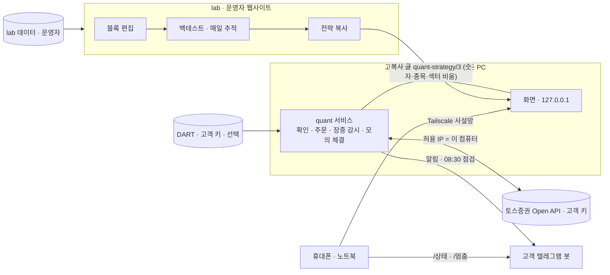
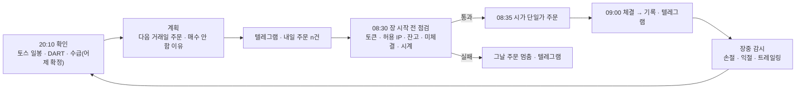

# quant 서비스 v2 기획서 (완성본 · 2026-11-01 · 문서 검토 반영 2026-11-02)

> 이 문서가 quant 서비스 v2의 정답이에요. 맨 끝 **부록 A · A-2**(검토 뒤 더한 규칙)는 본문에도 반영했고, 혹시 본문과 다른 곳이 남아 있으면 부록이 이겨요. 예시 날짜 · 숫자는 **부록 B**(예시 시간표)를 따라요.
>
> 결정(2026-11-01): 10-1의 열린 결정 4개는 제안대로 정했어요(텔레그램은 실전 운용 시작에 필수 · 전부 팔고 끝내기는 가격 하한 없음 · lab에만 있는 조건은 lab에서 '앱에서는 못 써요' 표시 · 판 뒤 다시 사지 않는 기간 기본 1거래일). 결정의 날짜와 이유는 `DECISIONS.md`에 있어요.

검토(기획 검토 1회 · 다른 길 검토 1회 · 디자인 검토 2회)의 지적을 모두 반영해 1~11절을 다시 쓴 완성본이에요. 개발하는 사람이 이 문서 하나로 일할 수 있게 썼어요. 엔진 규칙만 모은 것은 `ENGINE-RULES.md`, 낱말 규칙은 `GLOSSARY.md`, 그림은 `design/FIGMA.md`예요.

첫 초안에서 크게 달라진 것은 다섯 가지예요.
- **실행 위치와 접속:** 앱은 고객 서버나 늘 켜 둔 PC에서 돌고, 화면은 Tailscale 사설망으로만 열어요.
- **알림:** 고객 자신의 텔레그램 봇이 기본이에요. 매일 08:30 '장 시작 전 점검' 메시지가 안 오면 앱이 멈춘 거예요.
- **재부팅:** 서버의 키 파일로 키를 감싸 두어, 재부팅 뒤 로그인 없이 운용이 이어져요.
- **돈이 움직이는 길:** 주문 가격·수량, 매도 대금, 손절 같은 보호 매도, 결과 모르는 주문, 놓친 확인 규칙을 바로잡았어요.
- **편집기:** 블록 모델의 모호한 조합을 막았어요.

정할 것이 4개 있었고(10-1, 2026-11-01에 모두 제안대로 정함), 개발 때 토스 · DART를 불러 봐야 정해지는 것이 8개 있어요(10-2 · `OPEN-QUESTIONS.md` 1절).

- 낱말 메모: 'r25'는 v2 앞의 기획 기록(25판)이에요. `FEAT-*`(기능) · `DEC-*`(결정) · `SCR-*`(화면) · `RB-*`는 그 기록의 항목 id예요. '지금 디자인' 열의 노드 id(예: 331:166011)는 Figma 'quant 서비스' 페이지의 프레임이에요(`design/FIGMA.md`).

---

## 1. 제품 둘의 경계와 실행 위치

### 1-1. 두 제품

| | quant 서비스 | lab |
|---|---|---|
| 무엇 | 고객이 설치해 자기 토스 계좌로 실전 운용하는 앱 | 누구나 전략을 실험해 보는 공개 웹사이트 |
| 누가 · 어디에 | 고객이 자기 서버나 늘 켜 둔 PC에 설치해요. 사용자 본인도 자기 서버에 같은 앱을 따로 설치해요 | 사용자(운영자)가 배포해요 |
| 데이터 | 고객의 토스 키(시세 · 수급 · 섹터 · 계좌 · 주문)와 고객의 DART 키(재무 · 공시) | 운영자 쪽 데이터(상장폐지 종목 포함) |
| 하는 일 | 블록 편집, 백테스트, 모의투자, 실전 주문, 할 일 · 알림, 기록 | 블록 편집, 백테스트, 매일 추적, 전략 복사 글 만들기 |
| 주고받는 것 | **전략 복사 글 하나**만 받아요(`quant-strategy/3`, 숫자 · 종목 · 섹터 비움). 운영자에게는 아무것도 보내지 않아요 | 복사 글을 내보내기만 해요. 앱에 접속하지 않고, 키 · 계좌 · 결과도 받지 않아요 |
| 함께 쓰는 규격(문서로만) | 조건 카탈로그(항목 id · 이름), 블록 연결 규칙, 낱말 | 같음. 복사 글 첫 줄의 `app>=1.0`으로 호환을 확인해요 |
| 결과가 같나 | 아니오. 데이터 출처가 달라요. 앱 백테스트에는 상장폐지 종목이 없어서 lab보다 좋게 나올 수 있어요. 가져올 때 이 점을 알려요 | — |
| 하지 않는 것 | 운영형(회원가입, 우리 서버에서 대신 운용)은 하지 않아요(법 · 운영 부담, 사용자 결정) | — |

### 1-2. 실행 위치 · 접속 · 알림(사용자 결정 2026-11-01)

| 주제 | 규칙 |
|---|---|
| 실행 위치 | '늘 켜져 있는 컴퓨터' 하나에서 돌아요. **고객 명의 서버**(고정 IP 클라우드, 서울 권장)와 **집에 늘 켜 둔 PC**를 같은 무게로 안내해요 |
| 노트북 | 실전 운용 장소로 권하지 않아요. 설치 안내와 처음 실행에서 까닭을 보여요: '덮개를 닫거나 와이파이를 바꾸면 주문과 손절이 멈춰요' |
| 허용 IP | 서버는 고정 IP를 그대로 등록하면 돼요. PC는 '공인 IP가 바뀔 수 있어요'라고 안내하고, 바뀌면 할 일로 알려요 |
| 화면 접속 | 그 컴퓨터 안(127.0.0.1)과 고객의 **Tailscale 사설망**으로만 열어요. 서버는 Tailscale이 필수이고, PC는 선택(휴대폰으로 보려면 필요)이에요. 공개 인터넷에는 열지 않아요 |
| 로그인 강도 | 비밀번호 + Tailscale(기기 인증) 두 겹이에요. 돈이 움직이는 일은 비밀번호를 한 번 더 받아요. 패스키 · OTP는 다음 단계예요 |
| 키 보관 · 재부팅 | 토스 · DART · 텔레그램 키는 그 컴퓨터의 키 파일로 감싸 보관해요. 앱은 서비스로 등록돼 **재부팅 뒤 로그인 없이 자동으로 켜지고 운용이 이어져요**. 비밀번호는 화면 입장, 키 보기 · 바꾸기, 돈이 움직이는 설정 변경을 막아요 |
| 알림 | 고객 자신의 **텔레그램 봇** + 앱 안 알림함이에요. 텔레그램 명령은 `/상태`와 `/멈춤`(새 매수 멈춤) 둘뿐이고, 켜는 쪽 명령은 없어요 |
| 살아 있음 확인 | 거래일마다 08:30 '장 시작 전 점검' 메시지를 보내요. 이 메시지가 안 오면 앱이 멈춘 거예요. 설정 › 알림과 처음 실행에서 설명해요 |

- 앱 안에는 lab으로 가는 '실험실 열기 ↗' 링크 하나만 둬요.
- 앱 → lab 붙여 넣기는 형식이 같아서 기술로는 돼요. 받을지는 lab 쪽이 정해요(9절).

---

## 2. 정보 구조

### 2-1. 탭과 머리

| 자리 | 이름 | 담는 것 | 까닭 |
|---|---|---|---|
| 탭 1(첫 화면) | **자산** | 토스 계좌 전체, 실전 운용 카드, 다음 거래일 계획 요약, 보유(전략 / 직접 관리 종목) | 사용자가 정한 원칙 '첫 화면은 자산 변화 + 계획'(r25 FEAT-WATCH)이고, 운영 사이트 `copy.ts`와 지금 디자인이 같은 이름을 써서 새 낱말이 생기지 않아요 |
| 탭 2 | **계획** | 실전의 다음 거래일 주문, 매수 안 함 · 이유, 감시 중인 손절 | 지금 디자인을 실전용으로 써요 |
| 탭 3 | **기록** | 실제 주문 · 체결 · 실패, 실현 손익, 지난 운용 | 지금 디자인을 실전용으로 써요 |
| 탭 4 | **전략** | 목록 → 상세 → 편집 · 백테스트 | 그대로 |
| 탭 5 | **모의투자** | 모의투자 목록 → 하나를 고르면 그 안의 자산 · 계획 · 기록 | 별도 프로세스를 탭 하나에 가둬, 실전 숫자와 한 화면에 섞이지 않게 해요 |
| 머리 왼쪽 | 운용 상태 칩(실전 운용이 있을 때만) | 운용 중(초록) · 새 매수 멈춤(노랑) · **주문 멈춤 · [연결 끊김 / 점검 실패 / 확인 실패 / 응답 이상]**(빨강) · 끝남(회색) | 돈이 움직이는 상태를 늘 보여요. 누르면 자산의 운용 카드로 가요 |
| 머리 오른쪽 | 할 일 아이콘 + 배지 | 할 일 · 알림함 | 배지는 **실전 할 일만** 세요 |
| 머리 오른쪽 | 설정(톱니) | 연결 · 접속 · 알림 · 데이터 · 비밀번호 변경 · 사용 조건 · 앱 정보 · 잠그기 | — |

- 390에서는 탭 다섯을 아래 막대로 두고, 머리에는 상태 칩 · 할 일 · 설정만 둬요.
- **검토했다 뺀 안:**
  - 머리의 [실전 | 모의투자] 전환: 어느 쪽을 보는지 헷갈리면 실전 숫자를 모의로 오해해요.
  - 첫 탭 이름 '운용' · '홈': 새 낱말이거나 담는 것이 흐려져요.

### 2-2. 모의투자를 실전과 가르는 방법

| 장치 | 내용 |
|---|---|
| 들어가는 곳 | 모의투자 탭, 전략 상세의 '모의투자 시작', 백테스트 결과의 보조 단추 |
| 결과가 보이는 곳 | 모의투자 탭 안에서만이에요. 자산 · 계획 · 기록 탭, 머리 칩, 할 일 배지에는 모의 숫자가 0건이에요 |
| 표시 | 화면 제목 '모의투자', 금액 카드 이름 앞에 '가상', 체결은 '모의 체결', 텔레그램 첫 낱말 '모의', 알림함은 [실전 · 모의] 칩으로 나눠요 |
| 실전으로 | 모의투자 상세의 '이 설정으로 실전 운용 시작' → 실전 운용 시작 화면(버전과 한도는 채운 채, 운용 금액은 빈칸) |

### 2-3. 손으로 산 종목이 섞인 계좌(DEC-MIXED-ACCOUNT)

| 자리 | 보이는 것 |
|---|---|
| 자산 머리 막대 | 토스 계좌 총자산 = **전략 보유**(이 앱이 산 수량) + **직접 관리 종목**(손으로 산 것, 운용을 끝내며 넘긴 것) + **현금**(운용 현금 · 운용 밖 현금) |
| 보유 표 | 두 묶음으로 나눠요: '전략 보유 · [전략 이름] · 3종목' / '직접 관리 종목 · 이 앱은 사거나 팔지 않아요 · 4종목'. 같은 종목을 둘 다 가지면 그 행에 '전략 10주 · 직접 3주' |
| 평균 단가 | 전략 보유는 이 앱의 체결로 센 평균 단가예요(토스 평균 단가는 둘이 합쳐진 값이에요) |
| 규칙 | 매도 수량은 '이 앱이 산 수량'과 '토스 매도 가능 수량' 가운데 작은 쪽을 넘지 않아요. 계좌 수량이 이 앱 수량보다 적으면 그 종목은 '계좌 불일치'로 주문 0이에요. 직접 관리 종목은 전략이 사지 않아요('매수 안 함 · 직접 관리 종목'). 실전 운용을 시작할 때 계좌에 있던 보유는 모두 직접 관리 종목이 돼요 |

---

## 3. 여정

예시 날짜는 2026년 실제 요일 기준이에요(11/2 월 · 11/3 화).

| 단계 | 화면 | 하는 일 | 막힘 | 복구 |
|---|---|---|---|---|
| 0 설치(앱 밖) | 설치 안내 문서 | 서버: 설치 명령 한 줄 → Tailscale 로그인 → 화면 주소 받기. PC: 설치 파일 → 서비스 등록 | 클라우드 가입 · 결제 | 문서. 서버는 Tailscale에 붙은 기기에서만 화면이 열려요 |
| 1 처음 켜기 | V2-01 비밀번호 만들기 | 비밀번호 두 번, 만 19세 이상 · 사용 조건 동의 | 두 비밀번호가 달라요 | 그 자리 오류 줄 |
| 2 복구 코드 | V2-02 | 16자를 적어 두고 체크 | 체크 전에는 다음으로 못 가요 | — |
| 3 설치 위치 | V2-05 | 서버 / 늘 켜 둔 PC 고르기(노트북 비권장 줄) | — | 나중에 설정 › 접속에서 바꿀 수 있어요 |
| 4 Tailscale | V2-06 | 서버: 연결 상태 확인 + 휴대폰 추가하는 법. PC: 선택 | 서버인데 Tailscale이 안 보여요 | 다시 확인 · 설치 문서 › |
| 5 토스 연결(필수) | V2-07 | Client ID · Secret · 계좌번호 → 연결 확인(토큰 · 계좌 · 매수 가능 금액 · 삼성전자 현재가). 허용 IP 안내는 위치에 따라 달라요 | 키가 틀려요 / 허용 IP에 이 컴퓨터가 없어요 / 응답 없음 | 원인 한 줄 + 다음 행동. '나중에 연결'도 돼요 |
| 토스가 필요한 때 | — | 백테스트 실행 · 모의투자 시작 · 실전 운용 시작 · 자산의 계좌 보기 | 연결 전에 누르면 막혀요 | '토스 연결이 필요해요 · 시세와 계좌를 토스에서 받아요 · 연결 ›'. 전략 편집은 연결 없이도 돼요 |
| 6 텔레그램 | V2-08 | 봇 토큰 → 봇에게 /start → 대화방 연결 → 시험 보내기 | 토큰이 틀려요 / 대화방을 못 찾았어요 | 다시 찾기. 건너뛸 수 있지만 **실전 운용 시작에는 필요해요**(10절 결정 1) |
| 7 DART(선택) | V2-09 | 인증키 → 연결 확인 → 받기 시작 | 키 오류 / 하루 20,000건 넘음 | '내일 이어서 받아요'. 끝에 '가치 조건(시가총액 · PER · PBR · PSR · 배당수익률)은 주식 수를 받는 약 4일 뒤부터 써요 · 수익성 · 성장성 · 안정성 · 공시는 오늘 안에' |
| 8 전략 만들기 | 전략 목록 → 새 전략 시트 → 편집기 | 빈 캔버스 / 복사한 전략 붙여 넣기 / 전략 파일 가져오기 | 문제(빈칸 · 끊긴 경로 · 잠긴 조건 · 같은 날 함께 맞을 수 없는 조건) | 문제 목록을 누르면 그 줄로 가요. 문제가 있어도 저장은 돼요 |
| 9 백테스트 | V2-26 | 기간 · 시작 금액 → 실행 | 시세 받는 중(시장 전체면 처음 약 30분) / 시작일이 데이터보다 이름 / 문제 있음 | 진행 막대 · '이 전략은 2016-04-01부터 볼 수 있어요' · '문제 n · 편집 ›' |
| 10 모의투자(선택) | V2-42 → 모의투자 탭 | 가상 시작 금액 · 한도 → 시작 | 이 전략은 이미 모의투자 중이에요 | '그 모의투자 보기 ›' |
| 11 실전 운용 시작 | V2-30 | ① 확인할 것 ② 운용 금액 ③ 한도 ④ 손절 · 익절 실행 방식 ⑤ 첫 주문 미리 보기 ⑥ 위험 확인 + 비밀번호 | 운용 금액이 토스 매수 가능 금액보다 커요 / 이 버전으로 백테스트를 안 했어요 / 이미 실전 운용 중 / 텔레그램 없음 / 손절 조건 없음(빨간 경고 + 체크) | 줄마다 ✕ + '›'. 비밀번호를 5번 틀리면 5분 잠겨요 |
| 12 매일 | 자산 · 계획 · 기록 · 할 일 · 텔레그램 | 20:10 확인 → '내일 주문 n건' → 다음 거래일 08:30 점검 → 08:35 시가 단일가 주문 → 09:00 체결 → 장중 감시 | 점검 실패 / 연결 끊김 / 결과 모르는 주문 / 계좌 불일치 / 권리 변동 / 하루 손실 한도 | 5절 표. 할 일에서 해결해요 |
| 13 멈추기 · 끝내기 | V2-32 · 텔레그램 `/멈춤` · 토스에서 멈추기 | 새 매수 멈춤 / 운용 끝내기 · 보유 그대로 / 전부 팔고 끝내기 | 앱에 닿을 수 없어요 | V2-32와 할 일 도움말의 '토스에서 멈추기' 네 단계(5-7) |

---

## 4. 편집기 v2(블록 모델)

### 4-1. 무엇이 바뀌고 무엇이 그대로인가

| | v1(지금) | v2 |
|---|---|---|
| 캔버스 위 상자 | 조건 하나(조건 15개 중 하나) | **단계 블록**(① 유니버스 ~ ⑦ 비중) |
| 상자 안 | 숫자 칸 | **조건 줄 목록**(항목 · 비교 · 값 · 단위) + 머리 토글 '모두 맞으면 / 하나라도 맞으면' |
| 왼쪽 목록 | 조건 15개 끌어 오기 | 단계 7개 끌어 오기. 조건은 블록 안 '+ 조건 추가'로(Notion 자동화와 같은 꼴) |
| 선 · 경로 규칙 | v1 캔버스 규칙(`ENGINE-RULES.md` R-G9 · R-G10 · R-G12) | **그대로**: 한 경로 위의 조건은 모두 맞아야 하고, 경로끼리는 하나라도 통과하면 돼요 |
| 매매 방식 판정 | 리밸런싱 주기 조건으로 | 그대로(⑦ 블록 안 리밸런싱 주기 줄로) |
| 화면 낱말 | 조건 | 상자는 '단계'('신호 단계 추가'), 줄은 '조건'('+ 조건 추가'). '블록'은 화면에 쓰지 않아요(`GLOSSARY.md` 2절) |
| 새로 | — | **'문장으로 보기'**: 전략 전체를 한 문단으로 읽어 줘요(편집기 위 단추 · 전략 상세) |

- 사용자가 예로 든 '탐색 › PER 몇 이하'는 ③ 필터 단계의 '[PER] [이하] [15] 배'예요.
- '문장으로 보기' 예: '코스피 · 코스닥 보통주 가운데 20일 이동평균선을 상향 돌파하고 거래대금이 50억 원 이상인 종목을, 신호 강도가 높은 순으로 5종목까지 다음 날 시가에 사요. 손절 −7%(장중 감시)에 닿거나 20거래일이 지나면 팔아요. 같은 금액으로 나눠 사요.'
- '하나라도'를 만드는 길이 둘이에요. 기본 길은 블록 토글이고, 갈래 경로는 서로 다른 단계 조합을 나눌 때 써요. 이 차이를 경로 한 줄 도움말에 적어요.
  - 블록 토글 예: 같은 단계 안에서 손절 또는 익절
  - 갈래 경로 예: (신고가 돌파) 또는 (이동평균선 돌파 → 거래대금 필터)
- 처음 쓰는 사람이 이 두 길을 헷갈리는지는 개발 뒤 3명에게 과제를 줘서 관찰해요.

### 4-2. 단계 블록 종류

| 단계 | 개수 | 머리 토글 | 들어갈 수 있는 조건 분류 | 비고 |
|---|---|---|---|---|
| ① 유니버스 | 1개 | 없음(늘 모두) | 종목 정보, 가치(시가총액만) | 종목 직접 지정이 있으면 나머지 줄은 그 목록을 다시 걸러요 |
| ② 신호 | 여러 개 | 모두 / 하나라도(기본 모두) | 시세 · 기술적 · 수급 · 이벤트 · 수익성(흑자 · 적자 · 흑자전환 · 적자전환) | 줄마다 신호 강도(4-6) |
| ③ 필터 | 여러 개 | 모두 / 하나라도(기본 모두) | 시세 · 기술적 · 가치 · 수익성 · 성장성 · 안정성 · 수급 · 종목 정보(섹터 · 상장 기간) · 이벤트 · 시장 | — |
| ④ 종목 선정 | 0~1개 | 없음 | 정렬 줄 하나: '[항목] [높은 순 · 낮은 순] 상위 [n]종목' | 4-6 |
| ⑤ 매수 | 1개 | 없음 | '다음 날 시가 매수'(고정) + '판 뒤 다시 사지 않는 기간 [n]거래일' | 새 전략은 1거래일이 채워져 있어요(안전 규칙이라 예외, 10절 결정 4) |
| ⑥ 매도 | 여러 개 | 모두 / 하나라도(**기본 하나라도**) | 보유 · 시세 · 기술적 · 가치 · 수익성(흑자 · 적자 · 흑자전환 · 적자전환) · 안정성 · 수급 · 이벤트 · 시장 | 보유 줄에 실행 방식(4-5) |
| ⑦ 비중 | 1개 | 없음(늘 함께 적용) | 동일 비중 · 종목당 최대 비중 · 리밸런싱 주기(줄 종류마다 하나) | v1의 ⑦ 상자 여럿을 하나로 합쳐요(뜻은 같아요) |

- 한도(가정): 블록 20개, 블록당 조건 10줄. 진입 경로와 매도 경로는 각각 20개까지(그대로).

### 4-3. 조건 줄 문법과 판정 규칙

| 칸 | 꼴 | 예 |
|---|---|---|
| 항목 | 고르기. 기간 같은 매개변수가 있으면 항목 칩 안에 작은 칸 | '[RSI · 14일]', '[외국인 순매수 · 어제까지 5일 합]' |
| 비교 | 그 항목이 허용하는 것만(카탈로그) | 이상 · 이하 · 미만 · 사이(n 이상 ~ m 이하) · 상향 돌파 · 하향 돌파 · 위 · 아래 · 상위 n · 하위 n% · n일 연속 · 최근 n일 안에 있음 · 없음 · 제외 |
| 값 | 숫자(기본은 빈칸, 제품 기본값 없음) 또는 고르기 | '15', '코스피 · 코스닥' |
| 단위 | 항목이 정해요 | 배 · % · 억 원 · 원 · 주 · 일 · 거래일 · 종목 |
| 꼬리 칩 | 상태 | '실전에서만 적용' · '지금 섹터 기준' · '잠김 · DART' · '데이터 받는 중 · 40%' · '주식 수 근사' · 실행 방식(⑥) |

- 손절 · 익절 · 트레일링 스톱 · 최대 보유는 비교가 정해진 항목이라 비교 칸이 없어요('손절 −7%'). 부호를 직접 넣다 틀리는 일을 막아요.
- '+ 조건 추가'를 누르면 검색 칸과 이 단계에 들어갈 분류 목록이 나와요. 잠긴 분류에는 자물쇠와 'DART를 연결하면 쓸 수 있어요 · 연결 ›'이 붙어요.
- 오른쪽 패널(조건 줄을 골랐을 때): 도움말 · 출처 · 갱신 시각 · 백테스트 반영 여부 · 시작 가능 날짜 · (⑥이면) 실행 방식.

**판정 규칙(엔진 · 백테스트 · 모의 · 실전 공통):**

| 규칙 | 내용 |
|---|---|
| 값이 없으면 | 그 줄은 '아니다'예요. 기록에 '값 없음'을 남겨요(예: 적자라 PER 없음, 상장한 지 얼마 안 됨) |
| 돌파 | 직전 판단 때는 아래였고 이번 판단 때는 위예요. **같은 값은 '아래'로 봐요**(상향 돌파 = 직전 종가 ≤ 선 · 이번 종가 > 선, v1과 같음). 한 종목에 하루 한 번만 맞아요 |
| 늦게 확정되는 값 | 수급 · 외국인 지분율은 **어제 확정치**를 써요. 줄에 '어제까지'를 적어요 |
| 이미 보유한 종목 | 매수 후보에서 빼요 |
| 판 종목 | ⑤ 줄의 기간 n거래일 동안 다시 사지 않아요. 셈: 매도가 체결된 날(그날 포함)부터 n거래일의 확인에서 후보로 보지 않아요. n = 0이면 판 날 확인부터 다시 후보예요(v1 동작 = 0, 변환한 v1 전략의 값). 새 전략 · 가져온 전략은 1 |
| 동점 | 거래대금 큰 순, 그다음 종목 코드 순이에요. 변환한 v1 전략은 v1 규칙(강도가 같으면 유니버스 순서 = 종목 직접 지정에 적은 순서)을 따라요 |
| 수량 | 1주 단위로 내림해요(호가 단위는 수량이 아니라 지정가에 맞춰요 · 5-3). 0주면 '매수 안 함 · 1주도 못 사요' |
| 매도 대금 | **그날 시가에 판 돈은 그날 밤 확인부터, 곧 다음 거래일 매수부터 써요**(5-3) |
| 같은 날 고가 · 저가 | 같은 날 손절과 익절이 둘 다 닿으면 손절로 봐요. 트레일링의 최고가는 전날까지로 셈해요 |

### 4-4. 잇기 규칙과 문제 목록

| 규칙 · 문제 | v2 문구 | 바뀐 점 |
|---|---|---|
| ① · ④ · ⑤ · ⑦은 하나만 | '비중 단계는 하나만 놓을 수 있어요' | ⑦이 하나로 바뀌었어요 |
| 나머지 잇기 규칙 | v1 잇기 규칙 그대로(노드 → 블록 · `ENGINE-RULES.md` R-G12) | — |
| ⑥ → ⑥ 잇기 | 허용하되, 이을 때 확인 창이 떠요: '이어서 연결한 매도 조건은 같은 날 모두 맞아야 해요' · '하나라도 맞으면 팔려면 같은 단계 안으로 옮겨요' (· '그래도 연결하면 손절 −7%는 종가 확인으로 바뀌고, 최대 보유와 같은 날 맞아야 팔려요') [같은 단계로 옮기기] [그래도 연결] | 새로 |
| 같은 날 함께 맞을 수 없는 조건 | '같은 날 함께 맞을 수 없는 조건이에요 · [손절 −7%]와 [익절 +15%] · 이 경로로는 팔지 않아요' | 새로. 같은 경로나 '모두' 블록에서 손절 + 익절, 같은 선의 위 + 아래, 같은 항목의 '이상 a' + '이하 b'(a > b)를 잡아요 |
| 손절이 다른 조건과 함께 있음(경고 · 문제 아님) | 노란 경고 '손절이 다른 조건과 같은 날 맞아야 팔려요 · −7%보다 내려가도 안 팔릴 수 있어요' | 새로(부록 A). ⑥ '모두' 블록이나 이어진 ⑥에서 손절 · 트레일링이 다른 줄과 함께 있을 때예요. 백테스트 · 시작을 막지 않아요 |
| 빈 단계 | '조건이 없는 단계예요 · 조건을 추가하거나 단계를 삭제해요' | 새로 |
| 빈칸 · 범위 밖 | '[PER] 값이 비어 있어요' · 'PER은 0~1,000배로 입력해요' | 줄 단위 |
| 사이 값 순서 | '앞 값이 뒤 값보다 커요' | 새로 |
| 잠긴 조건 | '[PER]은 DART를 연결해야 써요 · 연결 ›' | 새로(문제로 셈) |
| 진입 경로에 신호 없음 | '진입 경로 n에 신호가 없어요 · 신호 없이 연결하면 매일 모든 종목이 매수 후보가 돼요' | 조건 충족 시 매매는 그대로. 순위 교체는 ④ 정렬이 신호 강도일 때만 요구해요(PER 낮은 순 상위 10처럼 신호 없는 순위 전략을 열려고) |
| 방식에 못 쓰는 단계 | '목표 비중 리밸런싱에서는 매도 단계를 쓰지 않아요' | 그대로 |
| 데이터 받는 중 | 문제는 아니에요. 백테스트 단추 옆 'DART 재무를 받는 중이에요 · 40% · 끝나면 백테스트할 수 있어요' | 새로 |

- 문제가 있으면 백테스트 · 모의투자 · 실전 운용 시작이 막혀요.

### 4-5. ⑥ 매도의 실행 방식(이름은 셋으로 통일)

| 실행 방식 | 동작 | 앱이 꺼져 있거나 연결이 끊기면 | 백테스트 · 모의투자 계산 | 쓸 수 있는 줄 |
|---|---|---|---|---|
| **장중 감시**(쓸 수 있는 자리면 새 줄 기본) | 앱이 장중 1분마다 현재가를 보고, 닿으면 장중 매도 길(5-3)로 팔아요. 손절 · 트레일링은 보호 매도(하한 없음), 익절은 일반 매도(지정가 하한 = 종가 −10%) | 동작 안 해요(머리 칩 '주문 멈춤') | 그날 저가 · 고가가 닿으면 감시가에 팔아요. 시가가 이미 넘었으면 시가예요 | 손절 · 익절 · 트레일링 스톱 |
| **조건주문(토스)** | 체결 뒤 토스에 걸어요(묶는 규칙은 아래 표). 손절 지정가 = 감시가 −3%(가정). **만료 30일 전에 다시 걸어요** | 토스가 지켜요. 갭 하락이면 안 팔릴 수 있어요. 감시가에 닿은 뒤 **15분 안에 체결이 없으면**(앱이 켜져 있을 때 토스 주문 내역으로 확인) 앱이 조건주문을 취소하고 보호 매도 길로 이어서 팔아요 | 장중 감시와 같음 | 고정 % 손절 · 익절 |
| **종가 확인** | 20:10 확인 때 종가로 판단 → 다음 거래일 시가에 매도 | 다음 확인 때 판단해요 | v1과 같음 | 모든 매도 줄 |

- **장중 감시와 조건주문(토스)은 '그 줄 혼자 매도를 정할 때만' 고를 수 있어요.** 셋이 모두 맞아야 해요: ① 그 줄이 있는 블록이 '하나라도'이거나 줄이 하나뿐 ② 그 블록으로 들어오는 **모든** 선이 ⑤에서 바로 와요(⑤에서 바로도 오고 다른 ⑥을 거쳐서도 오는 꼴이면 아니에요) ③ 그 블록 뒤에 이어진 ⑥이 없어요.
  - 그 밖의 자리에서는 자동으로 '종가 확인'이 되고, 칩에 이유를 보여요: '다른 조건과 함께 맞아야 해서 종가로 확인해요'.
  - 줄 편집 패널 · 경고의 자리 규칙 문구: '장중 감시 · 조건주문(토스)은 셋이 모두 맞을 때만 골라요 · 단계가 '하나라도 맞으면'이거나 줄이 하나 · ⑤ 매수 바로 뒤 · 뒤에 이어진 ⑥ 매도 없음'(부록 A).
- 실행 방식 칩은 한 부품만 써요(Figma 부품 '실행 방식 칩' 345:182957).
- 트레일링 스톱의 조건주문은 토스가 지원하지 않아 고를 수 없어요.
- 조건주문 발동 시간(정규장만인지, 장과 상관없는지)은 **확인 전**이에요. 화면 문구는 발동 시간을 말하지 않아요. 개발 때 확인하고 문구를 맞춰요(`OPEN-QUESTIONS.md` Q-T3).

**조건주문 묶기 · 수량 규칙:**

| 경우 | 동작 |
|---|---|
| 같은 종목에 '조건주문(토스)' 손절 줄과 익절 줄이 있고 각각 혼자 매도를 정함 | **OCO 하나로 묶어요**(다른 ⑥ 블록에 있어도). 토스는 종목당 OCO 하나예요 |
| '조건주문(토스)' 줄이 하나뿐 | SINGLE |
| 같은 종목에 장중 감시 줄과 조건주문 줄이 섞임 | 장중 감시로 팔 때 **먼저 그 종목의 조건주문을 취소**하고 내요(매도 가능 수량이 묶이지 않게) |
| 일반 매도 · 리밸런싱 매도 · 멈추기로 팔 때 | 먼저 그 종목의 조건주문을 취소하고 내요 |
| 체결 · 권리 변동 · 전략 변경으로 수량이나 감시가가 바뀜 | 조건주문을 취소하고 새 값으로 다시 걸어요 |

### 4-6. 매매 방식 판정과 신호 강도

| 판정 | 규칙 |
|---|---|
| 매매 방식 | ⑤에 이어진 ⑦ 블록에 '리밸런싱 주기' 줄이 없으면 조건 충족 시 매매, 있으면 그 줄의 방식(목표 비중 / 순위 교체)이에요. 저장하지 않고 늘 계산해요 |
| 돌파의 뜻 | 조건 충족 시 매매에서는 넘은 그날만, 리밸런싱 방식에서는 위(아래)에 있는 날 모두예요. 방식이 바뀌면 '방식이 바뀌면 돌파 신호의 뜻도 바뀌어요' 알림 |
| 줄의 신호 강도 | 항목 · 비교마다 식이 정해져 있어요(**`ENGINE-RULES.md` R-M3 강도 식 표**가 정답). 값은 '기준을 넘은 정도'(비율, 0.034 = 3.4%)이고, 줄은 **강도 있음**이거나 **강도 없음**이에요. v1 세 조건(이동평균선 상향 돌파 · RSI 미만 · 최고가 돌파)은 v1 식 그대로. 'RSI 이하 · 미만'과 'n일 수익률 이상'은 강도 있음. 돌파 · 교차 · 신고가 · 신저가 · MACD · 볼린저도 강도 있음. **이벤트 줄과 그 밖의 '이상 · 이하 · 사이'처럼 문턱만 거는 줄(거래대금 · 주가 · 수급 등)은 강도 없음**(부록 A). 그래서 거래대금 같은 문턱 줄은 ③ 필터에 두는 것이 기본 꼴이에요 |
| 블록의 신호 강도 | 모두 = 강도 있는 줄의 평균(강도 없음 줄은 빼요), 하나라도 = 맞은 줄 가운데 강도 있는 줄의 최댓값. 강도 있는 줄이 하나도 없으면 그 블록은 **강도 없음**이에요. ④ 정렬이 신호 강도면 강도 없음인 종목은 맨 뒤예요. v1에서 변환한 전략은 v1 식 그대로예요(v1 ②에는 문턱 줄이 없어요) |
| 경로 · 최종 | 경로 위 ② 블록 평균, 통과한 경로 가운데 최댓값(v1과 같은 꼴 · `ENGINE-RULES.md` R-M6). 블록에 줄이 하나면 v1 값과 같아요. '강도 없음'인 블록은 평균에서 빼고, 강도 있는 블록이 없는 경로는 '강도 없음'(정렬 맨 뒤) |
| ④ 정렬 항목 | 신호 강도(v1, 기본) · n일 수익률 · 거래대금 · 시가총액 · PER · PBR · PSR · 배당수익률 · ROE · 영업이익률 · 매출액 증가율 · 변동성. **값 없음(적자 PER 등)은 정렬에서 맨 뒤**예요 |
| 이유 글 | 통과한 경로의 블록마다 맞은 줄('③ PER 12.3배 · 15배 이하') |

### 4-7. 조건이 잠기는 경우

| 경우 | 표시 | 막는 것 |
|---|---|---|
| DART 키 없음 | 분류에 자물쇠 + 'DART를 연결하면 쓸 수 있어요 · 연결 ›'. 이미 있는 줄은 '잠김 · DART' 칩 + 문제 | 백테스트 · 모의투자 · 실전 |
| DART · 시세 받는 중 | '데이터 받는 중 · 40%' | 백테스트 대기 |
| 실전에서만 적용 | '실전에서만 적용 · 백테스트 미반영'(거래정지 · 정리매매 · 투자경고 · 투자위험 제외) | 없음 |
| 과거를 지금 값으로 | '지금 섹터 기준'(섹터) | 없음 |
| 주식 수 맞춤 확인 전 | '주식 수 근사 · 분할 · 무상증자 종목은 틀릴 수 있어요'(가치 분류의 시가총액 · PER · PBR · PSR · 배당수익률) | 없음(백테스트 '일부만') |
| 수급 과거 깊이 | 개발 때 확인해요. 없으면 '백테스트 미반영', 짧으면 '백테스트는 [날짜]부터' | 없음 |
| 시작 가능 날짜 | 백테스트 입력에 '이 전략은 2016-04-01부터 볼 수 있어요 · DART 재무가 2015년 보고서부터예요' | 그 전 날짜는 못 골라요 |

### 4-8. 복사 글 · 파일 · 옛 전략 변환

| 항목 | 규칙 |
|---|---|
| 복사 글 `quant-strategy/3` | 첫 줄 `quant-strategy/3 app>=1.0`, 본문 `{"name","graph":{"blocks":[{"id","stage","match":"all\|any","rows":[{"item","op","params","value","value2","exec"}],"x","y"}],"edges":[{"from","to"}]}}`, 끝 줄 `check: <12자리>` |
| 비우는 것 · 남기는 것 | 비움: 모든 숫자(기간 포함), 종목 직접 지정의 종목, 섹터 선택. 남김: 항목 · 비교 · 실행 방식 · 연결 · 이름 |
| 받기 | v3는 그대로 받아요. v1(`slots`)과 v2(`graph` 노드)는 읽을 때 v3로 바꿔요 |
| 거절 | 모르는 항목 id: '이 앱 버전에 없는 조건이 있어요 · [항목]'. `app>=`가 더 높으면: '앱을 새 버전으로 바꿔야 가져올 수 있어요' |
| 연결 검사 | v1 붙여 넣기 검사 그대로예요(`ENGINE-RULES.md` R-C5). 규칙을 어기면 거절하고, 끊긴 선이나 빈칸만 있으면 받은 뒤 문제로 보여요 |
| 전략 파일(.json) | 내 전략을 숫자까지 담아 내보내기 · 가져오기(옮기기 · 보관용). 앱이 숫자를 채운 전략을 주는 것과는 달라요(DEC-NO-BUNDLED 유지) |
| 가져온 전략의 ⑤ | 복사 글에서 비어 온 '판 뒤 다시 사지 않는 기간'은 **1거래일로 채워요**(안전 규칙 예외, 부록 A · 10-1 결정 4). 가져오기 확인에 이 값을 보여요. 변환한 v1 전략은 v1 동작을 재현하는 값이에요 |

**옛 전략 변환표:**

| v1 | v3 |
|---|---|
| manual_list | ① [종목 직접 지정] |
| ma_cross_up(n) | ② [주가] [n일 이동평균선] [상향 돌파] |
| rsi_below | ② [RSI · 기간] [미만] [값] |
| high_breakout(n) | ② [n일 최고가] [상향 돌파] |
| min_turnover · min_price | ③ [거래대금 · 주가] [이상] |
| top_n | ④ [신호 강도] [높은 순] [상위 n종목] |
| next_open | ⑤(다시 사지 않는 기간 = v1 동작을 재현하는 값) |
| stop_loss · take_profit · max_hold | ⑥ 손절 · 익절 · 최대 보유 · 종가 확인 |
| **ma_break_down** | **⑥ [주가] [n일 이동평균선] [아래] · 종가 확인**('하향 이탈'이라는 낱말은 버려요. v1은 상태로 판정해요) |
| equal · max_per_stock · rebalance_every | ⑦ 블록 하나 |

- 노드 하나는 줄 하나짜리 블록(머리 '모두')이 되고, 선은 그대로예요.
- **같아야 하는 조건:** 변환 전 v1 엔진과 변환 후 v3 엔진을 같은 토스 일봉으로 돌려 거래 하나하나(날짜 · 종목 · 수량 · 가격)가 같아야 해요.
  - 이 일치는 **같은 날 매도 대금으로 갈아타는 거래가 없는 전략**에 대해서만 요구해요.
  - 갈아타는 거래가 있으면 '매도 대금은 다음 거래일 매수부터' 규칙 때문에 그 매수가 하루 늦어져요. 이런 전략은 **첫 차이가 나는 날까지 거래가 모두 같고, 그 첫 차이가 하루 늦어진 매수**인지까지만 봐요(그 뒤는 현금 · 수량이 달라져 비교하지 않아요).
  - 시험 대상: 레포 안 `tests/regression` 사례(일곱 칸 본문 백테스트 252건 · 모의투자 10건), 옛 예시 4개, 무작위 그래프. 제품 주인 컴퓨터에 저장된 전략은 대상이 아니에요.
  - v1 엔진은 `app/engine_v1.py`로 그대로 복사해 고정해요(시험에서만 써요). 백테스트에 적용하는 규칙 · 적용하지 않는 규칙은 `ENGINE-RULES.md` 9절이에요.
- 복사 글 v3의 항목 id 사전 · 단계 · 비교 · 실행 방식 코드 · 검사 값 계산 · 예시는 `ENGINE-RULES.md` 11절이에요.

### 4-9. 조건 카탈로그(v2 · 국내)

값 범위는 근거 없는 제안값이에요(가정). '백테스트 · 예'는 과거를 그 시점 값으로 다시 만들 수 있다는 뜻이고, 모든 시세 항목에는 '상장폐지 종목 없음'이 따라붙어요. '블록'은 들어갈 수 있는 단계(①~⑦)예요.

| 분류 | 항목 | 비교 | 값 범위 | 단위 | 출처 | 백테스트 | 블록 |
|---|---|---|---|---|---|---|---|
| 종목 정보 | 종목 직접 지정 | 고르기 | 1~30 | 종목 | 토스 stocks | 예 | ① |
| 종목 정보 | 시장 | 코스피 · 코스닥 고르기 | — | — | 토스 stocks | 예(시장 이전 미반영) | ① |
| 종목 정보 | 종목 유형 | 주식 · ETF · ETN · 리츠 고르기 | — | — | 토스 stocks | 예 | ① |
| 종목 정보 | 우선주 제외 | 제외 | — | — | 토스 isCommonShare | 예 | ① |
| 종목 정보 | 레버리지 · 인버스 ETF 제외 | 제외 | — | — | 토스 leverageFactor | 예 | ① |
| 종목 정보 | 상장 기간 | 이상 | 30~3,650 | 일 | 토스 listDate | 예 | ① ③ |
| 종목 정보 | 섹터 | 고르기 · 제외 | 대 · 중 · 소 | — | 토스 sectors | 일부만(지금 분류) | ① ③ |
| 종목 정보 | 거래정지 · 정리매매 · 투자경고 · 투자위험 제외 | 제외 | — | — | 토스 stocks · warnings | 아니오(실전에서만 적용) | ① |
| 시세 | 주가 | 이상 · 이하 · 사이 | 1~10,000,000 | 원 | 토스 candles | 예 | ② ③ ⑥ |
| 시세 | 등락률(전일 대비) | 이상 · 이하 | −30~30 | % | 토스 candles | 예 | ② ③ ⑥ |
| 시세 | n일 수익률 | 이상 · 이하 · 상위 n% · 하위 n% | 기간 1~250 · 값 −100~1,000 · 순위 1~100 | % | 토스 candles | 예 | ② ③ ⑥ · ④ 정렬 |
| 시세 | n일 최고가(신고가) | 상향 돌파 | 5~250(52주 = 250) | 일 | 토스 candles | 예 | ② |
| 시세 | 52주 최고가 대비 | 이상 · 이하 | −100~0 | % | 토스 candles | 예 | ② ③ ⑥ |
| 시세 | n일 최저가(신저가) | 하향 돌파 | 5~250 | 일 | 토스 candles | 예 | ② ⑥ |
| 시세 | 시가 갭 | 상승 갭 · 하락 갭 이상 | 0~30 | % | 토스 candles | 예 | ② ⑥ |
| 시세 | 거래량 | 이상 · 이하 | 1~10억 | 주 | 토스 candles | 예 | ② ③ |
| 시세 | 거래대금 | 이상 · 이하 · 상위 n | 0.1~100,000 · 순위 1~500 | 억 원 | 토스 candles(종가 × 거래량) | 예(근사) | ② ③ · ④ 정렬 |
| 시세 | 거래량 비율(n일 평균 대비) | 이상 · 이하 | 기간 2~250 · 값 0~10,000 | % | 토스 candles | 예 | ② ③ |
| 시세 | 변동성(n일) | 이상 · 이하 · 하위 n% | 기간 5~250 · 값 0~500 | % | 토스 candles | 예 | ③ · ④ 정렬 |
| 기술적 | 이동평균선 | 상향 돌파 · 하향 돌파 · 위 · 아래 | 2~250 | 일 | 토스 candles | 예 | ② ③ ⑥ |
| 기술적 | 지수이동평균선 | 위와 같음 | 2~250 | 일 | 토스 candles | 예 | ② ③ ⑥ |
| 기술적 | 이동평균선 교차 | 골든크로스 · 데드크로스 | 단기 · 장기 2~250 | 일 | 토스 candles | 예 | ② ⑥ |
| 기술적 | 이동평균선 배열 | 정배열 · 역배열 | 기간 3개 2~250 | 일 | 토스 candles | 예 | ② ③ ⑥ |
| 기술적 | 이격도 | 이상 · 이하 | 기간 2~250 · 값 50~200 | % | 토스 candles | 예 | ② ③ ⑥ |
| 기술적 | RSI | 이상 · 이하 · 미만 · 상향 돌파 · 하향 돌파 | 기간 2~50 · 값 0~100 | — | 토스 candles | 예 | ② ③ ⑥ |
| 기술적 | MACD | 시그널선 상향 · 하향 돌파 · 0선 상향 · 하향 돌파 | 12 · 26 · 9(2~100) | — | 토스 candles | 예 | ② ⑥ |
| 기술적 | 볼린저밴드 | 상단 상향 돌파 · 하단 하향 돌파 | 기간 5~250 · 배수 0.5~5 | 배 | 토스 candles | 예 | ② ⑥ |
| 기술적 | 연속 상승 · 하락 | n일 연속 | 2~20 | 일 | 토스 candles | 예 | ② ③ ⑥ |
| 가치 | 시가총액 | 이상 · 이하 · 상위 n · 하위 n% | 1~10,000,000 · 순위 1~100 | 억 원 | 토스 수정 종가 × DART 주식 총수 × 수정 계수 | 일부만(주식 수 맞춤 확인 전) | ① ③ · ④ 정렬 |
| 가치 | PER(최근 4분기 합) | 이상 · 이하 · 사이 · 하위 n% | 0~1,000 | 배 | 위 + DART 순이익 | 일부만(공시일 기준 · 적자는 값 없음) | ③ ⑥ · ④ 정렬 |
| 가치 | PBR | 위와 같음 | 0~100 | 배 | 위 + DART 자본총계 | 일부만 | ③ ⑥ · ④ 정렬 |
| 가치 | PSR(최근 4분기 합) | 위와 같음 | 0~1,000 | 배 | 위 + DART 매출액 | 일부만 | ③ ⑥ · ④ 정렬 |
| 가치 | 배당수익률(전년 배당) | 이상 · 이하 · 상위 n | 0~50 | % | DART 배당 ÷ 토스 종가(수정 계수 반영) | 일부만(행 이름은 개발 때 확인) | ③ · ④ 정렬 |
| 수익성 | ROE | 이상 · 이하 · 상위 n% | −100~200 | % | DART | 예 | ③ · ④ 정렬 |
| 수익성 | 영업이익률 | 이상 · 이하 | −100~100 | % | DART | 예 | ③ · ④ 정렬 |
| 수익성 | 흑자 · 적자 · 흑자전환 · 적자전환(영업이익 · 순이익) | 고르기 | — | — | DART | 예 | ② ③ ⑥ |
| 성장성 | 매출액 증가율(전년 동기 대비) | 이상 · 이하 · 상위 n% | −100~1,000 | % | DART | 예 | ③ · ④ 정렬 |
| 성장성 | 영업이익 · 순이익 증가율 | 이상 · 이하(전년 적자면 값 없음) | −100~1,000 | % | DART | 예 | ③ |
| 성장성 | 최근 3년 평균 매출 증가율 | 이상 · 이하 | −100~500 | % | DART 사업보고서 | 예 | ③ |
| 안정성 | 부채비율 | 이상 · 이하 | 0~2,000 | % | DART | 예 | ③ ⑥ |
| 수급 | 외국인 · 기관 · 개인 순매수(어제까지 n일 합) | 이상 · 이하 · n일 연속 순매수 · 순매도 | 기간 1~60 · 주, 또는 거래량 대비 −100~100% | 주 · % | 토스 investor-trading(확정치) | 일부만(깊이 개발 때 확인) | ② ③ ⑥ |
| 수급 | 외국인 지분율(어제 확정치) | 이상 · 이하 · n일 증가 | 0~100 | % | 토스 investor-trading | 일부만 | ③ |
| 이벤트 | 공시: 자기주식 취득 · 처분 결정 / 유상증자 · 무상증자 · 감자 결정 / 전환사채 · 신주인수권부사채 발행 결정 / 합병 · 분할 · 영업양수도 결정 / 소송 · 부도 · 회생절차 · 해산 / 실적 공시 | 최근 n일 안에 있음 · 없음 | 1~60 | 일 | DART 주요사항 · list.json | 예(접수일 다음 거래일부터) | ② ③ ⑥ |
| 시장 | 코스피 · 코스닥 지수 이동평균선 | 위 · 아래 · 상향 돌파 · 하향 돌파 | 2~250 | 일 | 토스 market-indicators | 예(깊이 개발 때 확인) | ③ ⑥ |
| 보유 | 손절 | 매수가보다 n% 내려가면 | 1~50 | % | 앱 체결 기록 + 토스 시세 | 예 | ⑥ · 실행 3종 |
| 보유 | 익절 | 매수가보다 n% 오르면 | 1~500 | % | 위와 같음 | 예 | ⑥ · 실행 3종 |
| 보유 | 트레일링 스톱 | 매수 뒤 최고가보다 n% 내려가면 | 1~50 | % | 위와 같음 | 예 | ⑥ · 장중 감시 · 종가 확인 |
| 보유 | 최대 보유 | n거래일 경과 | 1~250 | 거래일 | 앱 기록 + 장 운영 정보 | 예 | ⑥ · 종가 확인 |
| 매수 | 다음 날 시가 매수 · 판 뒤 다시 사지 않는 기간 | 고정 · n거래일 | 0~20 | 거래일 | — | 예 | ⑤ |
| 종목 선정 | 정렬 | [항목] 높은 순 · 낮은 순 상위 n종목 | 1~30 | 종목 | 위 항목들 | 항목 따라 | ④ |
| 비중 | 동일 비중 | 고정 | — | — | — | 예 | ⑦ |
| 비중 | 종목당 최대 비중 | 이하 | 1~100 | % | — | 예 | ⑦ |
| 비중 | 리밸런싱 주기 | n거래일 · 목표 비중 / 순위 교체 | 1~250 | 거래일 | — | 예 | ⑦ |

- **주식 수 맞춤:** 시가총액류는 수정 계수(토스 `adjusted` 참 / 거짓 비율)로 DART 주식 수도 맞춰요. 개발 때 맞는지 확인되면 '일부만'을 '예'로 올려요.
- **v2에서 뺀 항목:**
  - 상한가 · 하한가 도달: 근사라서 빼요.
  - ATR: 트레일링은 %로 충분해요.
  - 공매도 비중 · 신용잔고율 · 프로그램 순매수: v2 범위 밖으로 정했어요(결정 2026-11-01).
  - 대량보유 · 임원 소유 보고: 최근 2년 자료만 있어요.
  - 국채 금리 · 시장 투자자별 순매수: 과거 깊이를 확인 못 했고 꼭 필요하지 않아요.
  - DART 업종코드: 업종은 토스 섹터로 정했어요(결정 2026-11-01).
  - 단기과열 제외: v2 조건 목록(결정 2026-11-01)에 없어요.
  - 평가손익 금액 · 보유 종목 비중 매도: 수익률과 ⑦로 충분해요.
  - 계좌 오늘 손익: 전략 조건이 아니라 한도로 옮겼어요.
  - 호가 · 체결강도 · 미국: v2에서 뺐어요(결정 2026-11-01).

---

## 5. 실전 운용

### 5-1. r25에서 가져온 것

| r25 | v2 처리 |
|---|---|
| FEAT-DEPLOY · SCR-I-DEPLOY · SCR-I-LIVE-READY | '실전 운용 시작' 한 화면으로 줄여요. 투자 비중(%) 대신 **운용 금액(원)**, 한도 12줄 대신 3줄, 승인 화면 · 패스키 대신 비밀번호 다시 받기 |
| FEAT-INSTALL-CLOUD · DEC-CLOUD-DEFAULT | 되살려요: 서버는 고정 IP 클라우드(서울) 권장. PC도 같은 무게(1-2) |
| DEC-MASTER-KEY | 같은 방향: 컴퓨터 키 파일로 감싸 재부팅 뒤 자동 운용 |
| DEC-TWO-KEYS(대체됨) | 실전 켜기(첫 시작 때 위험 확인)와 운용 시작을 한 번의 비밀번호로 |
| FEAT-SUB-LEDGER · DEC-MIXED-ACCOUNT · DEC-OUR-QTY-CASH | '이 앱이 산 수량'과 '운용 현금'을 따로 세고, 매일 계좌와 대조해요. 화면에는 '우리 수량'이라는 낱말 0건 |
| DEC-EXIT-OCO · FEAT-EXIT-KIND | 4-5 실행 방식. 칩으로 늘 보여요 |
| DEC-ORDER-ZERO-SPLIT | 5-6 표(의심스러우면 매수 0, 손절은 계속) |
| DEC-LIMITS-DEFAULT | 3줄 + 고정 2줄 |
| DEC-STOP-NAMES · FEAT-STOP | 갈래 셋 + 토스에서 멈추기 안내 |
| DEC-ENDED-HOLDINGS | 끝낼 때 보유는 직접 관리 종목으로 |
| DEC-DEPOSIT-PENDING | 입금은 늘 '운용 밖 현금'이에요. 쓰려면 운용 금액을 바꿔요(비밀번호) |
| FEAT-TODO | 할 일은 v2 사건만 |
| FEAT-NOTIFY | 텔레그램 + 알림함 |
| FEAT-SINGLE-RUNNER | 5-9 |
| FEAT-HOLD-REASON | 계획의 '매수 안 함 · 이유' 줄 |
| FEAT-BACKUP-EXPORT | 최소안: 기록 CSV · 전략 파일 · 백업 파일 받기 · 복원 |
| FEAT-UPDATE | 5-10 업데이트 규칙(앱 안 업데이트 단추 없음) |
| DEC-NO-ADVICE · DEC-NO-BUNDLED · DEC-DATA-PATHS | 그대로 |
| DEC-IMPORT-PAPER | 바꿔요: 가져온 전략도 '이 앱에서 그 버전으로 백테스트 1회'면 실전 가능(모의투자는 선택, 결정 2026-11-01) |

### 5-2. 하루 흐름

- 모든 시각은 토스 market-calendar로 그날 장 시간에 맞춰 옮겨요. 예: 수능일 · 새해 첫 거래일은 개장이 늦으니 점검과 주문도 같은 만큼 늦춰요. 휴장일은 건너뛰어요.
- 08:35는 기획 · 디자인 기준이에요. 토스가 전날 20:10에 시가 단일가(OPG) 주문을 받으면 확인 직후 보내고, 문구만 바꿔요(10절 개발 확인 1).

### 5-3. 실행 설정(운용 금액 · 한도 · 주문 방식)

| 항목 | 기본값 | 무엇을 막나(화면 한 줄) | 바꾸기 |
|---|---|---|---|
| 운용 금액 | 빈칸. 10만 원 ~ 토스 매수 가능 금액 | 이 금액 안에서만 사요 · 나머지 현금과 직접 관리 종목은 건드리지 않아요 | 비밀번호. 운용 중에 늘릴 때 상한 = 지금 운용 금액 + 운용 밖 현금. 줄이면 남은 현금에서 먼저 빼고, 모자라면 다음 매도 대금에서 빼요(옮기려고 팔지 않아요) |
| 하루 손실 한도 | **운용 자산(전날 평가액) 기준 −3%**. 입출금과 운용 금액 변경은 빼고 셈해요 | 넘으면 다음 거래일 새 매수를 보내지 않아요 · 매도는 계속 · 그다음 날 다시 사요 | 비밀번호 |
| 종목당 한도 | 운용 금액의 40% | 한 종목에 너무 많이 들어가는 것을 막아요 · 넘는 매수는 그만큼 줄여요 | 비밀번호 |
| 주문 크기 한도 | 주문 하나 2,000만 원(최대 9,999만 원) | 생각보다 큰 주문을 막아요 · 넘으면 보내지 않고 할 일로 물어봐요 | 비밀번호 |
| 고정 | 하루 주문 40건 · 1억 원 이상 주문은 내지 않아요 | 40건을 넘으면 매도 먼저 내고, 매수는 순위 순으로 내다 남는 것은 '매수 안 함 · 하루 주문 40건'. 1억 원 이상은 나눠 내지 않고 할 일 | — |
| 매수 주문 | 다음 거래일 시가 단일가 지정가. 상한 = 확인 때 종가 +10%(호가 단위 내림). **수량 = 목표 금액 ÷ 상한(내림)** | 시가가 상한보다 높으면 '매수 안 함 · 시가가 종가보다 12% 높았어요'. 묶이는 돈이 운용 현금을 넘지 않아요 | 고정 |
| 매도 분류 | 그날 맞은 매도 경로 가운데 하나라도 **보호 줄**(손절 · 트레일링 스톱 · 이벤트(공시) 줄)이 있으면 **보호 매도**, 그 밖은 **일반 매도**예요. 전부 팔고 끝내기는 보호 매도 | 손절이 다른 줄과 함께 맞아 판 날도 하한 없이 팔아요 | 고정 |
| 일반 매도 | 신호 · 리밸런싱 · 익절 · 최대 보유 등: 시가 단일가 지정가, 지정가 하한 = 종가 −10%. **장중 감시 익절**은 장중 매도 길(아래 보호 매도와 같은 순서)을 쓰되 지정가 하한(종가 −10%) 아래로 내지 않고 시장가 단계는 쓰지 않아요 | 시가가 너무 빠지면 안 팔고 다음 확인에서 다시 정해요 | 고정 |
| **보호 매도** | 손절 · 트레일링 스톱 · 이벤트(공시) 매도 · 전부 팔고 끝내기: **가격 하한 없음**. 시가 단일가는 하한가 지정가(사실상 시가), 장중은 현재가 −2호가 → 3분 뒤 −5호가 → 3분 뒤 시장가(가정) | 손절이 가장 필요한 날 안 팔리는 일을 막아요 | 고정 |
| 매도 대금 | 그날 시가에 판 돈은 그날 밤 확인부터, 곧 **다음 거래일 매수부터** 써요 | 08:35에는 매도 대금이 아직 없어서 같은 날 갈아타는 매수가 거절되는 일을 막아요. 엔진 · 백테스트 · 모의 · 실전이 같아요 | 고정 |
| 전략 변경 | — | 다음 20:10 확인부터 적용하고, 보유는 이어받아요. 조건주문은 새 규칙에 맞춰 다시 걸거나 취소해요 | 비밀번호. 이 앱에서 백테스트한 버전만 |
| 계좌번호 | — | 운용 중에는 바꿀 수 없어요 · '계좌번호는 운용을 끝낸 뒤 바꿀 수 있어요' | — |

- 종목당 한도 40%: 상위 3종목 동일 비중(33%)이 늘 잘리지 않게 한 근거 없는 제안값이에요.
- 백테스트 결과에 붙이는 설명 줄(엔진은 그대로): '시가가 종가보다 10% 넘게 높아 실전에서 안 샀을 매수 n회 · 10% 넘게 낮아 안 팔렸을 매도 n회예요 · 손절은 가격 하한 없이 팔아요'(부록 A)
  - 안 샀을 거래: 시가가 종가 +10%를 넘은 매수
  - 안 팔렸을 거래: 시가가 종가 −10%보다 낮은 일반 매도

### 5-4. 손절 실행 방식

4-5 표를 따라요. 실전 운용 시작과 운용 설정에서는 전략에 든 매도 줄을 보기만 해요. 바꾸려면 편집기에서 새 버전을 만든 뒤 '전략 변경'을 해요.

| 화면 줄 예 | 뜻 |
|---|---|
| '손절 −7% · 장중 감시 · 앱이 연결돼 있을 때 동작해요' | 서버 · PC가 꺼지거나 토스 연결이 끊기면 멈춰요(머리 칩 빨강) |
| '익절 +15% · 손절 −7% · 조건주문(토스) · 앱이 멈춰도 토스가 지켜요 · 갭 하락이면 안 팔릴 수 있어요' | OCO |
| '최대 보유 20거래일 · 종가 확인 · 다음 거래일 시가에 팔아요' | — |
| '손절 −7% · 종가 확인 · 다른 조건과 함께 맞아야 해서 종가로 확인해요' | 혼자 정하는 자리가 아니라서 자동으로 바뀐 경우 |

### 5-5. 주문 실패 · 결과 모르는 주문 · 응답 이상

| 경우 | 앱 동작 | 화면 · 알림 |
|---|---|---|
| 거부(잔고 부족 · 거래정지 · 가격 범위) | 매수는 그날 안 사요. 보호 매도는 장중 다시 내기 길로, 일반 매도는 다음 확인에서 다시 정해요 | 기록 '실패 · [이유]', 텔레그램 '실전 · 주문 실패 1건'. 같은 매도가 이틀 실패하면 할 일 |
| 미체결(시가가 상한 · 하한 밖) | 매수는 취소, 일반 매도는 다음 확인으로 | 계획 '매수 안 함 · 시가가 종가보다 12% 높았어요' |
| 결과 모름(응답 끊김) | ① 같은 주문 번호로 토스 주문 내역 · 체결을 2분 동안 3번 찾아요 → 찾으면 기록해요. ② 없다고 확인되면 회차 +1로 다시 내요. ③ 그래도 모르면 그 종목 새 주문 0 · 손절 감시는 계좌 수량 기준으로 계속 | 할 일 빨강 '결과 모르는 주문 · 기아' → '토스 앱에서 확인한 뒤 골라요: 체결됐어요(수량 · 가격 입력) / 주문이 없어요' |
| 일부 체결 | 체결된 만큼 기록하고, 남은 매수는 취소해요 | 기록 '일부 체결 10/17주' |
| 주문 번호 | 운용 · 날짜 · 종목 · 방향 · **회차**로 정해요. 다시 낼 때마다 회차 +1(토스의 10분 중복 막기와 충돌하지 않게) | — |
| 응답 이상값 | 가격 0 · 전일 대비 ±30% 초과 · 필요한 필드 없음이면 그 종목 주문 0. 응답 꼴 자체가 다르면 전체 주문 멈춤 · 장중 감시 손절 · 익절도 멈춤(자료를 믿을 수 없어서 · 조건주문(토스)만 동작) | 할 일 빨강 '토스 응답이 예상과 달라요 · 앱 업데이트가 필요할 수 있어요', 머리 칩 '주문 멈춤 · 응답 이상' |

### 5-6. 할 일 · 알림

| 심각도 | 할 일 제목(할 일 · 배너가 같은 글자. 텔레그램은 같은 제목에서 [종목] · 금액을 빼요) | 막히는 범위 | 해결 |
|---|---|---|---|
| 빨강 | 장 시작 전 점검 실패 · [원인] | 그날 주문 0(대조 실패면 그 종목만). 허용 IP · 토큰 실패면 매도 주문도 못 내므로 장중 감시 손절 · 익절도 멈춤(조건주문(토스)만 동작) | 08:50까지 5분마다 다시 점검해요. 통과하면 그때 보내요 |
| 빨강 | 토스 연결이 끊겼어요 | 실전 주문 전부 0 · 장중 감시도 멈춤 · 조건주문만 동작 | 키 확인 / 허용 IP(PC면 '공인 IP가 바뀌었어요 · 지금 IP …') |
| 빨강 | 다른 곳에서 같은 키를 쓰고 있어요 | 실전 주문 전부 0 | 다른 프로그램을 끄고 '다시 연결' |
| 빨강 | 오늘 확인 실패 | 다음 거래일 새 매수 0 · 손절 · 익절은 계속 | 10분마다 자동으로 다시 해요(08:30 점검까지) · '다시 확인' |
| 빨강 | 결과 모르는 주문 · [종목] | 그 종목 새 주문 0 | 5-5 |
| 빨강 | 계좌 불일치 · [종목] | 그 종목 0 | '계좌에 맞추기'(비밀번호, 이 앱 기록을 계좌 수량으로 줄여요) |
| 빨강 | 권리 변동 · [종목](분할 · 병합 · 무상증자 · 감자) | 그 종목 0 | 앱이 계산한 새 수량 · 단가 · 감시가를 보이고 '이대로 맞추기'(비밀번호). 조건주문은 다시 걸어요 |
| 빨강 | 토스 응답이 예상과 달라요 | 응답 꼴 자체가 다르면 실전 주문 전부 0 · 장중 감시 손절 · 익절도 멈춤(조건주문(토스)만 동작). 종목 하나의 값만 이상하면(가격 0 · ±30%) 그 종목만 0 | 업데이트 안내. 운용 카드 '손절 −7%가 지금은 동작하지 않아요 · 조건주문(토스)만 동작해요' |
| 빨강 | 안 팔린 종목 · [종목] | — | '다음 거래일 시가에 다시 팔기' / '지금 현재가로 팔기'(장중) |
| 노랑 | 시가 주문을 놓쳤어요 · 앱이 꺼져 있었어요 | 그날 매수 0 | 정보(5-8) |
| 노랑 | 하루 손실 한도 · 내일 새 매수 멈춤 | 다음 거래일 매수 0 | 정보 |
| 노랑 | 큰 주문 확인 · [종목] [금액] | 그 주문 | '보내기'(비밀번호) / '보내지 않기' |
| 노랑 | 조건주문 다시 걸기 실패 · [종목] | — | '다시 걸기' / '장중 감시로 바꾸기' |
| 노랑 | DART 연결 오류 | 재무 조건이 든 전략의 새 매수 0 | 키 확인 |
| 노랑 | 텔레그램 보내기 실패 | — | 할 일 + 배너. 봇 토큰 · 대화방 확인(설정 › 알림) |
| 노랑 | 운용 현금이 줄었어요(출금) | — | 정보. 운용 현금을 계좌 현금까지 깎아요 |
| 정보 | 새 매수를 멈췄어요 · 운용을 끝냈어요 · 배당 입금 · 업데이트 끝 | — | — |

**텔레그램:**

| 항목 | 규칙 |
|---|---|
| 수단 | 텔레그램 + 앱 안 알림함([실전 · 모의] 칩) |
| 본문 | 종목 · 금액은 넣지 않아요('실전 · 체결 3건 · 앱에서 보기', '결과 모르는 주문 1건 · 앱에서 보기'). 종목은 앱 안 할 일 제목에만 써요. 앱 링크는 Tailscale 주소예요 |
| 매일 | 08:30 '장 시작 전 점검 · 통과 · 08:35 주문 3건'(거래일만), 20:10 '확인 끝 · 내일 주문 n건', 09:0x 체결 |
| 끌 수 없음 | 빨간 할 일 · 주문 실패 · 점검 결과 |
| 기본 꺼짐 | 모의 체결 |
| 명령 | `/상태`: '운용 중 · 오늘 +0.8% · 내일 주문 3건 · 할 일 1' / `/멈춤`: 새 매수 멈춤 + 회신. 등록한 대화방 하나에서만 받아요 |

### 5-7. 멈추기 낱말과 권한(DEC-STOP-NAMES를 v2로)

| 갈래 | 새 매수 | 매도 규칙(신호 · 리밸런싱) | 손절 · 익절(장중 감시) | 조건주문(토스) | 보유 | 권한 |
|---|---|---|---|---|---|---|
| **새 매수 멈춤** | 0(미체결 매수 취소) | 계속 | 계속 | 그대로 | 전략 보유 | 로그인만, 텔레그램 `/멈춤`도 |
| 새 매수 다시 켜기 | 다시 | — | — | — | — | 비밀번호 |
| **운용 끝내기 · 보유 그대로** | 0 | 0 | **멈춤** | 취소 | 직접 관리 종목으로 | 비밀번호. '이 종목들의 손절 · 익절도 멈춰요'를 크게 |
| **전부 팔고 끝내기** | 0 | — | 다 팔릴 때까지 계속 | 취소 | 장중이면 **앱이 바로** 보호 매도 길로 팔아요. 장 밖이면 다음 거래일 08:35 시가 단일가 | 비밀번호 + 매도 미리 보기(종목 · 수량 · 예상 금액) |

- 계좌 수량이 이 앱 수량보다 적은 종목은 팔지 않고 '계좌 불일치'로 남겨요. 직접 관리 종목을 팔아 버리는 일을 막아요.
- 상태 칩은 2-1과 같아요(운용 중 · 새 매수 멈춤 · 주문 멈춤 · 끝남). 모의투자 칩은 둘이에요(모의투자 중 · 끝남).
- **앱에 닿을 수 없을 때 토스에서 멈추기**(V2-32 아래와 할 일 도움말에 고정):
  1. 토스증권 WTS › Open API › 허용 IP 관리에서 이 컴퓨터 IP를 삭제해요. 앱의 주문이 바로 막혀요.
  2. 토스 앱에서 열린 주문을 취소해요.
  3. 조건주문을 취소해요.
  4. API 키를 삭제해요.
- 앱 전체 '실전 끄기'와 '모든 주문 취소'는 따로 두지 않아요. 실전 운용이 하나라서 '운용 끝내기'가 같은 일을 해요.

### 5-8. 앱이 꺼져 있었거나 연결이 끊겼을 때

| 놓친 것 | 동작 |
|---|---|
| 20:10 확인 | 놓친 거래일마다 **그날 데이터로 다시 돌려** 신호를 찾아요. 지난 날 매수는 내지 않아요. 찾은 매도 신호는 다음 거래일 시가에 내요. 가장 최근 거래일의 확인은 평소처럼 계획을 만들어요. 기준은 하나예요: **08:30 점검 전에 끝나면** 그날 08:35 주문에 들어가요 |
| 08:30 점검 · 08:35 주문 | 08:50이 지나 켜지면 그날 시가 주문은 건너뛰고 할 일 '시가 주문을 놓쳤어요'. 손절 · 트레일링(장중 감시)은 켜지는 순간 현재가로 판단해 닿았으면 보호 매도 길로 팔아요 |
| 장중 감시 | 꺼진 동안 동작 안 해요. 실전 운용 시작과 운용 카드에 '이 컴퓨터가 평일 내내 켜져 있어야 해요 · 서버나 늘 켜 둔 PC에서 돌려요' |
| 조건주문 체결 | 켜질 때 토스 주문 내역으로 대조해 기록해요('조건주문 체결 · 앱이 멈춰 있을 때') |
| 재부팅 | 서비스로 자동으로 켜지고, 키 파일로 키를 풀어 로그인 없이 이어서 돌아요. 켜질 때 대조(5-9)를 끝낸 뒤 주문해요 |
| 실전 운용 시작 직후 첫 확인 | 시작한 시각이 그날 20:10 확인 뒤이거나 휴장일이면 시작 직후 바로 마지막 완성 일봉으로 확인 → 다음 거래일 주문이에요. 거래일 20:10 전에 시작하면 그날 20:10이 첫 확인이에요. 예: 10/5(월 · 휴장) 20:30 시작 → 10/2(금) 종가로 바로 확인 → 10/6(화) 08:35 첫 주문(`ENGINE-RULES.md` R-L11) |

### 5-9. 두 번째 실행 막기 · 대조

| 장치 | 내용 |
|---|---|
| 같은 컴퓨터 | 실행 중 표시(잠금 파일)가 있으면 새로 켜지 않아요 |
| 같은 키, 다른 곳 | 토큰이 예상 밖으로 끊기면 다시 로그인을 반복하지 않고, 할 일 '다른 곳에서 같은 키를 쓰고 있어요' + 실전 주문 0 |
| 켤 때 · 매일 | 토스의 오늘 주문 · 보유 · 현금을 이 앱 기록과 대조해요. 기록에 없는 이 앱 주문 번호가 있으면 주문 0 + 할 일 |
| 운용 현금 대조 | 운용 현금 = 운용 금액 + 매도 대금 − 매수 대금 − 수수료 · 세금(토스 체결 값). 계좌 현금보다 크면 깎고 정보 할 일. 설명되지 않는 현금 증가가 (이 앱 보유 수량 × DART 주당 배당금 × (1 − 15.4%))와 맞으면 배당으로 운용 현금에 더해요 |
| 복원 · 다른 컴퓨터로 옮김 | '새 매수 멈춤' 상태로 시작해요. 대조가 맞은 뒤 다시 켜요(비밀번호) |

### 5-10. 업데이트(새 버전 설치)

| 항목 | 규칙 |
|---|---|
| 방법 | 앱 밖의 설치 명령(서버) · 설치 파일(PC)로 해요. 앱 안 업데이트 단추는 없어요 |
| 할 수 있는 때 | **거래일 16:00~20:00**(그날 20:10 확인 전)에만 해요. 20:10 확인 뒤부터 다음 거래일 08:35 주문을 보낼 때까지는 할 수 없어요. 금요일 20:10 확인 뒤 ~ 월요일 08:35 주문 전(주말 · 휴장일 포함)도 같아요. 아니면 설치기가 거절하고 이유를 보여요 |
| 순서 | 스케줄러 멈춤 → 백업 → 데이터 구조 바꿈 → 다시 켬 → 대조 → 이어서 운용. 실패하면 이전 버전 + 백업으로 되돌려요 |
| 상태 | 머리 칩 '업데이트 중'(화면이 열려 있다면). 끝나면 텔레그램 '업데이트 끝 · 버전 1.1' |

---

## 6. 모의투자 프로세스

| 항목 | 실전 | 모의투자 |
|---|---|---|
| 데이터 · 확인 시각 | 토스 · DART, 20:10 | 같아요 |
| 체결 | 토스 시가 단일가 실제 체결 | 다음 거래일 일봉 시가로 모의 체결 |
| 장중 감시 · 조건주문 손절 | 실제 현재가 · 토스 | 그날 고가 · 저가로 계산(백테스트와 같음) |
| 한도 · 가격 상한 · 매도 대금 규칙 | 적용 | 같은 규칙 적용 |
| 돈 | 운용 금액(내 계좌) | 가상 시작 금액 10만 원 ~ 100억 원 |
| 개수 | 앱 전체에 1개 | 전략마다 1개(여러 전략 동시에) |
| 앱이 꺼진 날 | 지난 날 주문 없음 | 다음 확인에서 하루씩 이어서 채워요 |
| 비밀번호 | 시작 · 변경 · 끝내기에 필요 | 필요 없어요(로그인만) |
| 직접 관리 종목 | 있어요 | 없어요 |

| 단계 | 내용 |
|---|---|
| 시작 | 전략 상세 · 백테스트 결과의 '모의투자 시작' → 창(가상 시작 금액 · 한도 기본값 · '첫 확인 11/2(월) 20:10 · 첫 모의 체결 11/3(화) 시가') |
| 기록 | 모의투자마다 자산 추이 · 계획 · 모의 체결 기록. 끝내면 '지난 모의투자'로 남아요 |
| 끝 | 모의투자 상세 '끝내기' → 확인 창(로그인만) |
| 실전으로 | '이 설정으로 실전 운용 시작' → V2-30(버전 · 한도는 채운 채, 운용 금액은 빈칸) |
| 실전과 다른 점(상세 화면 고정 줄) | '실전과 다른 점 · 체결은 일봉 시가로 계산해요(실제로는 호가에 따라 달라요) · 앱이 꺼진 날도 이어서 채워요 · 장중 손절은 고가 · 저가로 계산해요' |
| 헷갈리지 않는 장치 | 모의투자 탭 안에서만 보여요. 제목 '모의투자', 금액 앞 '가상', '모의 체결', 텔레그램 첫 낱말 '모의', 차트 선 색을 실전과 다르게(디자인에서 정함) |

---

## 7. 화면 명세

**폭:**
- 1440: 모든 화면을 그려요.
- 390: 휴대폰은 Tailscale로 같은 웹 화면을 열어요. 주요 화면을 모두 그려요. V2-03 로그인, V2-10 자산(실전 운용 카드 포함), V2-11 계획, V2-12 기록, V2-13 할 일 · 알림, V2-14 할 일 상세, V2-32 멈추기, V2-33 비밀번호 확인 창, V2-50 설정, V2-51 연결, V2-52 알림, V2-56 접속.
- 그 밖(마법사 · 전략 · 백테스트 · 실전 운용 시작 · 모의투자)은 1440만 그리고, 390은 개발이 반응형으로 맞춰요.
- 편집기는 1024 이상에서만 편집해요. 좁은 창에서는 보기만 해요(그대로).

**번호:** 처음 실행 마법사를 넣느라 초안의 V2-05(토스 연결)는 V2-07로 옮겼어요. V2-05 · 06 · 08 · 09 · 56이 새로 생겼어요.

### 7-1. 처음 실행 마법사 · 로그인

| 화면 | 목적 · 들어오는 길 | 담는 것 | 상태 | 핵심 문구 | 지금 디자인 |
|---|---|---|---|---|---|
| V2-01 비밀번호 만들기 | 첫 실행 | 비밀번호 두 칸, 만 19세 이상 · 사용 조건 체크(**기본 빈칸** · 미리 체크 금지 · 체크 전 '다음' 흐림), 단계 막대(1/7) | 기본 · 두 비밀번호 다름 · 모두 체크함 | '비밀번호는 8자 이상이에요 · 화면에 들어올 때와 돈이 움직이는 설정을 바꿀 때 써요' | 재사용 303:87237 · 303:87301 · 331:171447(문구 · 단계 막대) |
| V2-02 복구 코드 | V2-01 다음 | 16자 코드 · 적어 뒀어요 체크 | 기본 · 적어 둠 | '비밀번호를 잊으면 이 코드로 새로 만들어요' | 재사용 303:87365 · 303:87403 · 331:171544 · 331:171615. '다음'은 V2-05로 |
| V2-05 설치 위치 | V2-02 다음 | 두 카드: '서버(클라우드 · 고정 IP)' / '늘 켜 둔 PC' + 노트북 비권장 줄 | 고르기 전 · 고름 | 서버: '허용 IP에 이 서버의 고정 IP를 그대로 등록해요'. PC: '집 인터넷의 공인 IP가 바뀔 수 있어요 · 바뀌면 할 일로 알려요'. 노트북: '노트북은 권하지 않아요 · 덮개를 닫거나 와이파이를 바꾸면 주문과 손절이 멈춰요' | **새로** |
| V2-06 Tailscale | V2-05 다음 | 연결 상태(이 컴퓨터 Tailscale 이름 · 화면 주소 `https://quant.<내 망>.ts.net`) · 휴대폰 · 노트북 추가하는 법 3단계 | 서버: 연결됨 / 안 보임(막힘). PC: 연결됨 / 건너뛰기 | '이 화면은 내 Tailscale에 추가한 기기에서만 열려요 · 휴대폰에도 Tailscale을 깔고 같은 계정으로 로그인해요' | **새로** |
| V2-07 토스 연결 | V2-06 다음 | 토스 연결 카드(키 받는 법은 오른쪽) · 허용 IP 줄은 위치별 · '나중에 연결' | 키 없음 · 입력함 · 확인 중 · 연결됨 · 실패 3종 | 연결됨: '연결됐어요 · 주문할 수 있어요 · 매수 가능 금액 14,360,000원' | **새로**(305:88347 · 331:171802 · 305:88641 부품) |
| V2-08 텔레그램 | V2-07 다음 | 봇 만들기 3단계(BotFather) · 토큰 칸 · '봇에게 /start를 보냈어요' → 대화방 찾기 · 시험 보내기 · 건너뛰기 | 토큰 없음 · 대화방 찾는 중 · 연결됨 · 메시지 받음 · 토큰 틀림 · 대화방 못 찾음 | '거래일 아침 08:30에 점검 메시지를 보내요 · 이 메시지가 안 오면 앱이 멈춘 거예요 · 실전 운용에는 텔레그램이 필요해요' | **새로** |
| V2-09 DART | V2-08 다음 | 인증키 · 연결 확인 · 받기 시작 · 건너뛰기 | 없음 · 확인 중 · 받기 시작 · 오류 | '가치 조건은 주식 수를 받는 약 4일 뒤부터 써요 · 수익성 · 성장성 · 안정성 · 공시는 오늘 안에' | **새로**(V2-51 DART 카드 부품) |
| V2-03 로그인 | 화면 열기 · 잠금 | 비밀번호 | 기본 · 맞지 않음 · 잠금 · 다시 켠 뒤 | 다시 켠 뒤: '잠겨 있어요 · 비밀번호로 로그인해요' · '컴퓨터를 다시 켰어요 · 실전 운용은 로그인 없이 계속돼요' | 재사용 313:95664~95822 · 303:87443~87559(문구) · **390** |
| V2-04 비밀번호 다시 만들기 | 로그인 '비밀번호를 잊었어요' | 복구 코드 → 새 비밀번호 → 새 복구 코드 | 기본 · 새 복구 코드 | — | 재사용 303:87602 · 303:87654. 1440은 새로 |

### 7-2. 실전(탭 1~3 · 할 일)

| 화면 | 목적 · 들어오는 길 | 담는 것(순서대로) | 상태 | 핵심 문구 | 지금 디자인 |
|---|---|---|---|---|---|
| V2-10 자산 | 첫 화면 · 탭 | ① 총자산(토스 계좌) · 오늘 손익 · 기준 시각 ② 할 일 배너 ③ **실전 운용 카드**(전략 · 버전 · 운용 금액 → 지금 평가 · 상태 칩 · 다음 일정 '오늘 20:10 확인 · 11/3(화) 08:35 시가 주문' · '운용 설정 ›' · '멈추기 ›') ④ 자산 추이(운용 자산 vs 운용 금액, '계좌 전체' 전환) ⑤ 다음 거래일 계획 요약 ⑥ 보유(전략 / 직접 관리 종목) + 구성 ⑦ 최근 체결 5건 | 토스 연결 전 · 운용 전(계좌만 + 시작 단계) · 첫 확인 전 · 운용 중 · 새 매수 멈춤 · 주문 멈춤(연결 끊김 · 점검 실패 · 확인 실패 · 응답 이상, 마지막 값 + 기준 시각) · 할 일 빨강 · 운용 끝낸 뒤 · 로딩 | 운용 전 시작 단계: '1 · 토스 연결 · 2 · 전략 만들기 · 3 · 백테스트 · 4 · 실전 운용 시작' + 선택 칩 'DART 연결 · 모의투자'. 첫 확인 전: '첫 확인 11/2(월) 20:10 · 첫 주문 11/3(화) 08:35' | 바꿈 331:166011(운용 중 바탕) · 328:134287(예시 카드 빼고 시작 단계) · 331:167282 · 331:167708 · 331:171918. **390**: 331:166343 등 짝 |
| V2-11 계획 | 탭 · 자산 '계획 보기' | 머리 '11/3(화) 주문 · 11/2(월) 20:10 확인' · 요약(매수 2종목 · 최대 4,180,000원 · 예상 3,820,000원 · 매도 1종목) · 주문 행(종목 · 수량 · 지정가 상한 · 최대 금액 · 종가 기준 예상 · 보낼 시각 08:35 · 상태: 예정 · 보냄 · 체결 · 일부 체결 · 미체결 · 실패 · 결과 모름) · 행마다 이유 · '매수 안 함 n · 이유' · 감시 중(손절 감시가 표 · 조건주문 종목) | 계획 있음 · 계획 없음 · 확인 전 · 확인 중 · 확인 실패 · 점검 실패 · 주문 보낸 뒤 · 운용 없음 | '20:00 뒤에 확인할 수 있어요 · 종가가 20시까지 바뀌어요' · '다시 확인'(보내기 전까지) · **'새 매수 멈춤 ›'**(줄 '다시 켤 때까지 새 매수를 보내지 않아요 · 매도는 그대로 나가요'. 첫 초안의 '내일 새 매수 보내지 않기'는 이 이름 하나로 합쳤어요). 09:00 뒤에는 '이미 체결된 매수는 취소할 수 없어요'. 20:10 전송이 확정되면 '이미 보낸 매수는 취소해요'로 바꿈 | 바꿈 314:98796 · 314:98882 · 314:98940 · 314:99093(실패 · 보낸 뒤는 새로) · **390** |
| V2-12 기록 | 탭 | 지금 운용 / 지난 운용 칩 · 실현 손익 · 거래 횟수 · 거래비용 · 주문 내역(날짜 · 종목 · 구분 · 가격 · 수량 · 손익 · 상태 · 이유) · **필터**(전체 · 체결 · 실패 · 조건주문) · 'CSV 내보내기' | 거래 있음 · 빈 · 지난 운용 · 거래 0회 | 빈: '아직 거래 내역이 없어요 · 실전 운용을 시작하면 여기에 쌓여요' | 바꿈 314:99712 · 314:99887 · 314:99928 · 314:100030 · 331:150964(상태 열) · **390** |
| V2-13 할 일 · 알림 | 머리 아이콘 · 배너 | 요약 '급한 할 일 1 · 확인할 할 일 2'(실전만 · 급한 할 일 = 빨강, 확인할 할 일 = 노랑) · 할 일 행(심각도 · 제목 · 막힌 범위 칩 · 열린 때) · 알림함([실전 · 모의] 칩, 최근 30일) · 바닥 고정 줄 '앱에 닿을 수 없을 때 · 토스에서 멈추기 ›' | 있음 · 빈 · 로딩 | 빈: '할 일이 없어요' | **새로** · **390** |
| V2-14 할 일 상세 | V2-13 행 | 무슨 일 · 막힌 범위 · 고를 것(5-5 · 5-6) · 비밀번호가 필요하면 V2-33 · 도움말 | 열림 · 처리 중 · 닫힘 · 오류 | 예: '허용 IP에 이 컴퓨터가 없어요 · 공인 IP가 바뀌었어요 · 지금 IP 211.x.x.x · 토스증권 WTS › Open API › 허용 IP 관리에 등록해요' | **새로** · **390** |

### 7-3. 전략

| 화면 | 목적 · 들어오는 길 | 담는 것 | 상태 | 핵심 문구 | 지금 디자인 |
|---|---|---|---|---|---|
| V2-20 전략 목록 | 탭 | 전략 카드(이름 · 매매 방식 · 상태 칩 '실전 운용 중' · '모의투자 중' · 문제 n) · '새 전략' · '가져오기' | 전략 있음 · 빈 | 빈: '아직 전략이 없어요 · 빈 캔버스에서 만들거나, 실험실에서 복사한 전략이나 전략 파일을 가져와요' + '실험실 열기 ↗' | 재사용 314:100364 · 바꿈 328:134606 |
| V2-21 새 전략 시트 | '새 전략' | 셋: 빈 캔버스 / 복사한 전략 붙여 넣기 / 전략 파일 가져오기 | 기본 | '실험실 결과는 이 앱의 백테스트와 다를 수 있어요 · 숫자는 직접 정해요' | 바꿈 328:135486 · 328:135374 |
| V2-22 붙여 넣기 | V2-21 | 글 칸 → 가져오기 확인(이름 · 단계 수 · 비운 칸 n) | 붙여 넣기 · 형식 아님 · 연결이 맞지 않아 거절 · 앱 버전이 낮음 · 모르는 조건 · 확인 | '복사한 전략 글이 아니에요' · '이 앱 버전에 없는 조건이 있어요 · [항목]' | 재사용 327:132753 · 331:150910 · 310:93885 · 310:93916 · 327:133449 · 331:150870 |
| V2-23 편집기 | 상세 '편집' · 새 전략 | 왼쪽 단계 7개 · 캔버스(블록: 머리 단계 이름 + 토글 + 조건 줄 + '+ 조건 추가') · 오른쪽 패널(경로 목록 / 고른 줄 도움말 · 출처 · 백테스트 여부 · 실행 방식) · 위 '매매 방식' 칩 · '문장으로 보기' · 경로 한 줄 · 문제 상태 · 저장 | 빈 캔버스 · 블록 끌어 오는 중 · 실전 운용 중 편집(부록 A) · 조건 추가 메뉴(분류 · 검색 · 잠긴 분류) · 줄 편집 · 머리 토글 · 실행 방식(혼자 정하지 않아 종가 확인으로 바뀜 포함) · 잠긴 줄 · 데이터 받는 중 · 선 잇는 중(맞는 곳 · 안 되는 곳 · **⑥ → ⑥ 확인 창**) · 문제 있음(같은 날 함께 맞을 수 없는 조건 포함) · 리밸런싱 방식 빈칸 · 방식 바뀜 알림 · 문장으로 보기 · 저장한 뒤 · 나가기 확인 · 단축키 | 빈 캔버스 시작은 '① 종목 직접 지정 → ④ 신호 강도 상위 n종목 → ⑤ 다음 날 시가 매수 ← ⑦ 동일 비중'(숫자 비움 · ⑤의 '판 뒤 다시 사지 않는 기간 1거래일'만 채움). 실전 운용 중인 전략: 머리 '실전 운용은 버전 n으로 계속돼요 · 새 버전은 백테스트 뒤 전략 변경으로 적용해요', 저장 알림 끝 '· 실전 운용은 버전 n 그대로예요' | 블록 모양으로 다시: 324:116962 · 324:117378 · 325:117895 · 325:118490 · 325:119011 · 325:119551 · 326:122208 · 326:122715 · 326:123215 · 326:123681 · 331:146510 · 326:126602 · 331:148222. 재사용: 331:143833 · 331:148729 · 331:145440 · 326:126110 · 331:145977 · 326:127098. 블록용으로 새로: 331:144889 · 331:144366 · 326:129522. 없앰: 331:170358 · 331:170939 · 331:146914 · 331:147328 |
| V2-24 좁은 창 | 폭 < 1024 | 화면에 맞춰 보기만 · 문장으로 보기 | — | '편집은 창을 넓혀서 해요' | 재사용 329:136085 |
| V2-25 전략 상세 | 목록 | 왼쪽: 그래프(블록 요약) · 문장으로 보기 · '편집' · '백테스트' · '전략 복사' · '전략 파일 내보내기'. 오른쪽 카드 셋: 실전 운용(없음 → '실전 운용 준비 ›'(백테스트한 버전만) / 운용 중 → 요약 · '자산에서 보기 ›') · 모의투자 · 버전 목록(백테스트 함 · 문제 n) | 운용 전 · 실전 운용 중 · 모의투자 중 · 문제 있음 · 백테스트 안 한 버전 | '실전 운용은 이 앱에서 백테스트한 버전으로 시작해요' · '실전 운용이나 모의투자 기록이 있는 전략은 삭제할 수 없어요'. 실전 운용 중이고 백테스트한 새 버전 m이 있으면 운용 카드에 '버전 m으로 전략 변경 ›'(→ V2-31, 부록 A) | 바꿈 327:132945 · 314:101169 · 327:133207 · 310:93564. 재사용 314:101543 · 314:100827. 없앰 328:134872 · 328:135075 |
| V2-26 백테스트 | 상세 · 편집 저장 뒤 | 기간(시작 가능 날짜 안내) · 시작 금액 · 칩(거래비용 '수수료 0.015% · 매도 세금 0.18%'(v1 값 · 토스 `commissions` 응답으로 바뀔 수 있음) · 토스 일봉 수정주가 · 판 돈은 다음 거래일 매수부터 · 비교 기준 코스피). 결과: 숫자 카드 · 차트 · 거래 목록 → **고정 고지 줄** → '시가가 종가보다 10% 넘게 높아 실전에서 안 샀을 매수 n회 · 10% 넘게 낮아 안 팔렸을 매도 n회예요 · 손절은 가격 하한 없이 팔아요' → 그 아래 보조 단추 둘 '저장된 버전으로 운용 준비 ›' · '모의투자 시작'(주 단추 없음) | 입력 · 시세 받는 중 · DART 받는 중 · 실행 중 · 결과 · 시세 못 받음 · 문제 있음 · 토스 연결 전 | 고지: '과거 결과는 앞으로의 수익을 뜻하지 않아요 · 상장폐지된 종목은 포함되지 않아요 · 실제보다 좋게 나올 수 있어요'. 시장 전체 유니버스면 노란 카드로 키워요 | 바꿈 311:94832 · 311:94916 · 311:95007 · 311:95189 · 390 짝. 없앰 331:150510 · 331:150700 |

### 7-4. 실전 운용

| 화면 | 목적 · 들어오는 길 | 담는 것 | 상태 | 핵심 문구 | 지금 디자인 |
|---|---|---|---|---|---|
| V2-30 실전 운용 시작 | 상세 · 백테스트 결과 · 자산 시작 단계 4 · 모의투자 상세 | 왼쪽 단계: ① 확인할 것(토스 연결 · 주문 권한 · 계좌 끝 4자리 · 이 버전 백테스트 함 · 다른 실전 운용 없음 · 텔레그램 연결 · 설치 위치(PC면 IP 줄)) ② 운용 금액 ③ 한도 ④ 손절 · 익절 실행 방식(보기) ⑤ 첫 주문 미리 보기 ⑥ 위험 확인. 오른쪽 고정 미리 보기: 운용 막대(운용 금액 · 운용 밖 현금 · 직접 관리 종목) · 첫 주문 표(종목 · 수량 · 지정가 상한 · 최대 금액 · 종가 기준 예상 금액) · 합계 '매수 최대 9,980,000원 · 예상 9,100,000원 · 남는 현금 최소 20,000원' · 매수 안 함 · 일정 | 확인 ✕ 있음 · 입력 중 · 미리 보기 계산 중 · 미리 보기 못 함 · 이미 운용 중(막힘) · **손절 없음(빨간 카드 + 체크)** · 비밀번호 창 · 시작됨 | '실제 주문은 11/2(월) 20:10 확인 결과로 정해져요 · 이 미리 보기와 다를 수 있어요 · 확인 결과는 텔레그램으로 보내고, 08:30 전까지 새 매수를 멈출 수 있어요'. 손절 없음: '손절 조건이 없어요 · 이 전략은 손실을 스스로 멈추지 않아요'. '손절 없음'의 판정 = 혼자 매도를 정하는 손절 · 트레일링 줄이 없음(부록 A). 위험 체크 넷(8-2). 진행 단계는 숫자 배지 1~6으로 그려요 | **새로**(331:172322 창 부품 · 계획 표 부품) |
| V2-31 운용 설정 | 운용 카드 | 지금 값 + 줄마다 '변경'(운용 금액 · 한도 3줄 · 전략 변경) · 손절 실행 방식(보기) · 계좌번호(잠김) · 바꾼 뒤 미리 보기 | 보기 · 바꾸는 중 · 비밀번호 창 · 다음 확인부터 적용 예약됨 | '바꾼 값은 다음 20:10 확인부터 적용해요 · 보유는 이어받아요 · 조건주문은 새 규칙에 맞춰 다시 걸어요' | **새로** |
| V2-32 멈추기 시트 | 운용 카드 '멈추기' · 머리 칩 | 갈래 셋 카드 + 같은 표(5-7) → 고른 갈래 미리 보기 → 맨 아래 '앱에 닿을 수 없을 때 · 토스에서 멈추기' 네 단계(접힘) | 기본 · 새 매수 멈춤 · 장중 전부 팔기 · 장 밖 전부 팔기 · 처리 중 · 오류(취소 안 됨) | 운용 끝내기: '이 종목들의 손절 · 익절도 멈춰요 · 조건주문 n건을 취소해요'. 장중 전부 팔기: '지금 현재가로 바로 팔아요 · 안 팔리면 가격을 낮춰 다시 내요'. 장 밖: '11/3(화) 08:35 시가 단일가로 팔아요' | **새로** · **390** |
| V2-33 비밀번호 확인 창 | 돈이 움직이는 일 모두 | 제목(무엇을) · 바뀌는 숫자 요약 · 비밀번호 칸 | 기본 · 맞지 않음(남은 횟수) · 잠금 5분 | '실전 운용 시작 · 운용 금액 10,000,000원 · 첫 주문 11/3(화) 08:35' | **새로**(331:172322 창 모양) · **390** |

- **비밀번호를 받는 일:**
  - 운용: 실전 운용 시작(첫 실전 켜기 포함) · 운용 금액 변경 · 한도 변경 · 전략 변경 · 새 매수 다시 켜기 · 운용 끝내기 · 전부 팔고 끝내기
  - 할 일 해결: 계좌에 맞추기 · 권리 변동 맞추기 · 큰 주문 보내기
  - 키와 설정: 토스 · DART · 텔레그램 키 보기 · 변경 · 삭제 · 복원 · 설치 위치 변경 · 앱 데이터 삭제 · 결과 모르는 주문 기록(부록 A). DART 키 삭제는 운용 중이면 '재무 조건이 잠겨 새 매수가 멈춰요' 경고를 함께 보여요
  - 운용 중에는 토스 키 삭제와 앱 데이터 삭제를 막아요: '실전 운용 중에는 삭제할 수 없어요 · 먼저 운용을 끝내요'
  - 확인 창은 모두 V2-33 부품이에요. 하나를 고르는 곳은 라디오예요(체크박스 아님)
- **로그인만으로 되는 일:** 새 매수 멈춤(텔레그램 `/멈춤` 포함, 계획 화면의 '새 매수 멈춤 ›'도 같은 일).

### 7-5. 모의투자

| 화면 | 목적 · 들어오는 길 | 담는 것 | 상태 | 핵심 문구 | 지금 디자인 |
|---|---|---|---|---|---|
| V2-40 모의투자 | 탭 5 | 모의투자 카드(전략 · 버전 · 시작일 · 가상 시작 금액 → 지금 · 수익률 · 코스피) · 지난 모의투자 | 있음 · 빈 | 빈: '모의투자는 실제 돈 없이 전략을 매일 따라가 봐요 · 전략 상세에서 시작해요' | **새로**(CV-9 카드 부품) |
| V2-41 모의투자 상세 | V2-40 카드 | 안 탭 자산 · 계획 · 기록 + '실전과 다른 점' 고정 줄 + '끝내기' · '이 설정으로 실전 운용 시작' | 모의투자 중 · 첫 확인 전 · 현금만 · 끝낸 뒤 · 끝내기 확인 | '가상 자산 10,412,116원' · '11/2(월) 20:10 확인 · 11/3(화) 시가로 모의 체결해요' | 재사용 · 바꿈 331:166011 · 331:171918 · 331:167282 · 331:167708 · 314:98796 계열 · 314:99712 계열 · 314:101147('가상' 표시) |
| V2-42 모의투자 시작 창 | 상세 · 백테스트 결과 | 가상 시작 금액 · 한도(기본값, 접힘) · 일정 | 기본 · 이 전략은 이미 모의투자 중 | '평일 20:10에 확인하고 다음 거래일 시가로 모의 체결해요 · 실제 돈은 움직이지 않아요' | 바꿈 331:172322 · 310:94233 · 310:94418 |

### 7-6. 설정

| 화면 | 목적 · 들어오는 길 | 담는 것 | 상태 | 핵심 문구 | 지금 디자인 |
|---|---|---|---|---|---|
| V2-50 설정 | 톱니 | 연결 · 접속 · 알림 · 데이터 · 비밀번호 변경 · 사용 조건 · 앱 정보 · 잠그기 | 기본 | '잠가도 실전 운용은 계속돼요 · 비밀번호로 다시 로그인해요' | 바꿈 331:171688 · 305:87696 · **390** |
| V2-51 연결 | 설정 · 마법사 · 할 일 · 잠긴 조건 | 토스 카드(연결 확인 = 토큰 · 계좌 · 매수 가능 금액 · 현재가 · 허용 IP 줄은 위치별) · 키 받는 법 · DART 카드(인증키 · 연결 확인 · 받기 진행 · 오늘 요청 n/20,000건 · 주식 수 약 4일 안내) | 토스: 키 없음 · 입력함 · 확인 중 · 연결됨 · 실패 3종 · 변경 · 삭제 확인 · 운용 중 삭제 막힘 · 운용 중 계좌번호 잠김. DART: 없음 · 확인 중 · 받는 중 · 다 받음 · 한도 넘음 · 오류 | 운용 중 삭제: '실전 운용 중에는 삭제할 수 없어요 · 먼저 운용을 끝내요' | 바꿈 MVP-06 18장(305:88347 ~ 313:96732 · 331:171802). DART 카드는 새로 · **390** |
| V2-52 알림 | 설정 · 마법사 | 텔레그램 카드(봇 · 대화방 · 시험 보내기 · 마지막 보낸 시각) · 명령 안내(`/상태` · `/멈춤`) · 사건 스위치(잠긴 것 표시) · 08:30 점검 메시지 설명 | 연결 안 됨 · 연결됨 · 보내기 실패 · 토큰 변경(비밀번호) | '거래일 08:30에 점검 메시지를 보내요 · 안 오면 앱이 멈춘 거예요 · 서버나 PC를 확인해요 · 급하면 토스에서 멈추기 ›' | **새로** · **390** |
| V2-53 데이터 | 설정 | 데이터 현황(토스 일봉 n종목 · 날짜 범위 · 마지막 시각 / DART 재무 · 공시 · 주식 수 / 수급) · 내보내기(기록 CSV · 전략 파일) · 백업 파일 받기 · 복원 · 앱 데이터 삭제 | 기본 · 받는 중 · 복원 확인 · 삭제 확인 | 복원: '복원하면 새 매수를 멈춘 채 시작해요 · 토스 주문 내역과 맞는지 확인한 뒤 다시 켜요' | **새로** |
| V2-54 비밀번호 변경 | 설정 | 지금 비밀번호 · 새 비밀번호 | 기본 · 맞지 않음 | — | 재사용 313:96023 |
| V2-55 사용 조건 · 앱 정보 | 설정 | 사용 조건 전문(8-3 목차) · 동의한 날 · 버전 · 설치 위치 | 기본 | '버전 1.0 · 서버 · Tailscale로만 열려요' | 바꿈 |
| V2-56 접속 | 설정 | 설치 위치(서버 / PC, 변경은 비밀번호) · Tailscale 상태 · 화면 주소(복사) · 기기 추가하는 법 · '공개 인터넷에는 열지 않아요' | 연결됨 · Tailscale 안 보임 · PC에서 Tailscale 없음 | '이 화면은 내 Tailscale에 추가한 기기에서만 열려요' | **새로** · **390** |

---

## 8. 배포판 문구 규칙

### 8-1. 없앨 MVP 문구

| 지금 문구 | 어디 | 대신 |
|---|---|---|
| 머리 칩 '모의투자' | 모든 화면 머리 | 없애요. 실전 운용이 있을 때만 상태 칩(2-1) |
| '이 앱은 실전 주문을 내지 않아요' | 모든 화면 머리 | 없애요 |
| '예시 전략 4개' · '숫자를 채워 둔 예시예요 · 눌러서 보고 바로 백테스트할 수 있어요' · '예시' 칩 · 예시 카드 | 자산 첫 화면 · 전략 목록 빈 상태 | 없애요(DEC-NO-BUNDLED) |
| '빈 캔버스에서 만들거나, 예시에서 시작하거나, 복사한 전략을 붙여 넣어요' | 전략 목록 빈 상태 | '빈 캔버스에서 만들거나, 실험실에서 복사한 전략이나 전략 파일을 가져와요' |
| '숫자를 채워 둔 예시를 복사해요 · 바꿔서 써 보세요' · '예시에서 시작' | 새 전략 시트 | 없애요 → '전략 파일 가져오기' |
| '예시는 보기만 해요 …' · '이 예시로 새 전략' · '(내 전략)' 이름 꼬리 | 예시 상세 | 화면째 없애요 |
| '1 · API 키 연결 (선택)' · '연결했어요 · 보유 평가에 토스 현재가를 써요' | 시작하기 | '1 · 토스 연결 · 시세와 계좌를 토스에서 받아요' |
| '4 · 모의투자 시작 · … 실전 주문은 내지 않아요' | 시작하기 | '4 · 실전 운용 시작 · 운용 금액과 한도를 정하고 첫 주문을 미리 봐요' |
| '모의투자 자산 · 시작 전' · '모의투자를 시작하면 여기에 자산이 보여요' · '첫 확인 뒤 자산 그래프가 그려져요' | 자산 | 토스 계좌 자산. 운용 전: '실전 운용을 시작하면 운용 자산 그래프가 그려져요' |
| '10/29 16:30 기준' · '평일 16:30 자동 확인 · … 다음 확인 때 이어서 채워요' · '시작 금액을 정하면 평일 16:30에 자동으로 확인해요' | 자산 · 계획 · 상세 | 20:10. 실전은 '앱이 멈춘 날의 지난 주문은 내지 않아요'(이어서 채우기는 모의투자만) |
| '10/29(목) 16:30 확인 · 10/30(금) 시가에 모의 체결해요' | 계획 · 자산 | '11/2(월) 20:10 확인 · 11/3(화) 08:35에 시가 단일가로 주문해요' |
| '모의 체결 최근 5건' | 자산 | '최근 체결 5건'(모의투자 탭에서만 '모의 체결') |
| '지금 신호 확인' | 계획 | '다시 확인'(20:00 뒤) |
| '조회만 했어요 · 주문은 내지 않아요' | 설정 › 연결 | '주문할 수 있어요 · 매수 가능 금액 n원' |
| '야후 금융 일봉 · 배당 미반영 · 분할만 반영'과 그 아래 줄 | 백테스트 | '토스 일봉(수정주가)' |
| '2000년부터 볼 수 있어요' | 백테스트 | '이 전략은 [날짜]부터 볼 수 있어요 · [이유]'(예: 'DART 재무가 2015년 보고서부터예요') |
| 칩 '상장폐지 종목 미포함' | 백테스트 | 결과 아래 고정 고지(8-2) |
| '이 버전으로 모의투자 시작'(주 단추) | 백테스트 결과 | 고지 아래 보조 단추 '저장된 버전으로 운용 준비 ›' · '모의투자 시작' |
| '평일 16:30에 자동으로 확인하고 … 실전 주문은 내지 않아요' | 모의투자 시작 창 | '평일 20:10에 확인하고 다음 거래일 시가로 모의 체결해요 · 실제 돈은 움직이지 않아요' |
| '다른 모의투자 실행 중' | 모의투자 시작 창 | '이 전략은 이미 모의투자 중이에요' |
| '데이터 삭제 · 앱을 끄고 mvp/data 폴더를 삭제해요' | 설정 | 설정 › 데이터 '앱 데이터 삭제' |
| '버전 0.1 · 이 컴퓨터(127.0.0.1)에서만 열려요' | 설정 | '버전 1.0 · 서버 · Tailscale로만 열려요' |
| '사용 조건 · 개인 사용 · 10/29 동의' | 설정 | '사용 조건 · 11/2 동의'(개인 사용은 본문 목차로) |
| '모의투자 기록이 있는 전략은 삭제할 수 없어요' | 전략 상세 | '실전 운용이나 모의투자 기록이 있는 전략은 삭제할 수 없어요' |
| 초안 낱말 '거르기' · '안 삼' · '증권사에 걸어 두기' · '배정 금액' | 초안 | '필터' · '매수 안 함' · '조건주문(토스)' · '운용 금액' |
| 프레임 이름 'MVP-xx' · 'CV-x' | Figma | 'V2-xx'(7절 번호) |

### 8-2. 위험 고지

| 자리 | 강도 | 문구 |
|---|---|---|
| 실전 운용 시작 마지막 단계 | 강(체크 넷 + 비밀번호, 체크 전에는 단추 흐림) | '실제 돈으로 주문해요 · 손실이 날 수 있어요' · '백테스트와 모의투자 결과는 앞으로의 수익을 뜻하지 않아요' · '앱 오류 · 토스 연결 · 서버나 PC 꺼짐으로 주문과 손절이 안 나가거나 늦을 수 있어요' · '투자 판단과 손익은 내 몫이에요 · 이 앱은 투자 조언을 하지 않아요' |
| 손절 조건이 없는 전략으로 시작 | 강(빨간 카드 + 체크 하나 더) | '손절 조건이 없어요 · 이 전략은 손실을 스스로 멈추지 않아요' |
| 백테스트 결과 아래 | 중(늘 보이는 줄, 시장 전체면 노란 카드) | '과거 결과는 앞으로의 수익을 뜻하지 않아요 · 상장폐지된 종목은 포함되지 않아요 · 실제보다 좋게 나올 수 있어요' |
| 실험실 복사 글 가져오기 | 중 | '실험실 결과는 이 앱의 백테스트와 다를 수 있어요 · 숫자는 직접 정해요' |
| 장중 감시 줄 · 운용 카드 | 중(노란 줄) | '앱이 연결돼 있을 때만 손절이 동작해요' |
| 설치 위치 고르기 | 중 | 노트북 비권장 줄(7-1) |
| 전부 팔고 끝내기 | 중 | '시가 · 현재가로 팔아서 미리 보기와 다른 가격에 팔릴 수 있어요' |
| 비밀번호 만들기 | 약(체크) | '만 19세 이상이에요' · 사용 조건 동의 |
| 머리 · 모든 화면 | 없음 | 띠 고지를 두지 않아요 |

### 8-3. 사용 조건 목차(본문은 법률 확인 전 초안으로 따로)

개인 사용(내 계좌 · 내 판단) · 투자 판단과 손익은 본인 몫 · 있는 그대로 제공 · 업데이트 약속 없음 · 지원 없음 · 시스템 위험(앱 오류 · 연결 · 컴퓨터 꺼짐 · 토스 API 변경) · 데이터 출처(토스 · DART, 상장폐지 종목 없음).

판매할 때의 법 판단(투자자문 · 일임)은 확인하지 않았어요. 법률 확인이 필요해요.

**공통 문구 규칙:**
- '~요'로 써요.
- 국내 투자 앱 낱말만 써요(`GLOSSARY.md` 3 · 4절). 지어낸 순우리말은 쓰지 않아요.
- 화면에 '시험'을 쓰지 않아요(단, '시험 보내기'는 텔레그램 단추 이름으로 받음).
- 날짜는 '11/3(화)', 시각은 24시간제예요.
- 금액에는 단위를 붙이고, 최대와 예상을 나눠 보여요.
- 내부 낱말(우리 수량 · 장부 · clientOrderId · OPG)은 화면에 0건이에요.

---

## 9. lab 쪽 영향(그리지 않음 · 화면 11장과 짝)

옛 탐색 페이지 섹션 172:88338의 SCR-H-LAB* 11장이 원본이에요. 이 표대로 바꿔 그린 그림은 Figma 'lab' 페이지(343:172871)에 있어요(`../lab/design/FIGMA.md`). lab 기획 전체는 `../lab/SPEC.md`예요.

| # | 프레임 | 바뀌는 것 |
|---|---|---|
| 공통 | 머리 · 바닥글 | 메뉴의 '내 앱 열기 ›'를 삭제해요(앱은 고객 Tailscale 안에 있어 웹사이트가 열 수 없어요). 바닥글 '사용권 관리'를 삭제해요(사용권 없음). '요금 · 로그인 · 시작하기'는 lab 범위 밖이라 lab 쪽이 정해요. 고지 '과거 데이터 기준 …'은 그대로 |
| 1 | SCR-H-LAB 176:88902 · 처음 방문 | '설치 없이 체험 ›'을 삭제해요. '카탈로그 버전 14' → '조건 카탈로그 · 앱 1.0 기준 · 앱에 없는 조건은 표시해요'. 갈림길 예시 칩을 블록 꼴('① 한국 주식 전체 → ② 공시 · 무상증자 결정')로. 필터 칩 '내 서버에서 도는 것만' → '앱에서 쓸 수 있는 것만'. 데이터 종류 '해외 · 거시' · '달력', 매수 방식 '상승 확인 후 매수' · '코스피 200' · '관리종목 빼기'는 앱 1.0 카탈로그에 없어요 → 칩에 '· 앱에서는 못 써요', 행에 '앱에 없는 조건 n'(10-1 결정 3) |
| 2 | SCR-H-LAB-DATASET 176:89314 | 한 줄 더함: '내 앱은 내 토스 · DART 데이터로 돌려요 · 앱 백테스트에는 상장폐지 종목이 없어 결과가 다를 수 있어요'(lab은 상장폐지 412개 포함) |
| 3 | SCR-H-LAB-DISCOVERY 176:89609 | 목록 카드의 조건 표기를 블록 · 조건 줄 낱말로. '조각' → '조건', '칸' → '단계' |
| 4 | SCR-H-LAB-DISCOVERY-ITEM 178:90817 | 구조 그림을 블록 + '모두 맞으면 / 하나라도 맞으면'으로. '발굴 로직 복사'(①~④만 복사)는 앱 v2가 부분 붙여 넣기를 받지 않아요 → '이 로직을 쓴 전략 보기 ›'로 바꿔요(10-1 결정 3 · 앱은 부분 붙여 넣기를 받지 않아요). '앱 [버전]에서 돌아요' 칩 → '앱에 없는 조건 n개'(없으면 칩 없음) |
| 5 | SCR-H-LAB-TRADING 177:90250 | 3과 같아요. 매도 방식 칩 이름을 실행 방식 셋('장중 감시' · '조건주문(토스)' · '종가 확인')으로. 종가 확인 설명은 '종가로 보고 다음 거래일 시가에 팔아요'('종가에 판다'는 쓰지 않아요) |
| 6 | SCR-H-LAB-TRADING-ITEM 181:44614 | 4와 같아요('매매 로직 복사'(⑤~⑦)도 '이 로직을 쓴 전략 보기 ›'로). 손절 칩 '증권사에 걸린 주문 · 실행기가 꺼져도 동작' → '조건주문(토스) · 앱이 멈춰도 토스가 지켜요 · 갭 하락이면 안 팔릴 수 있어요' |
| 7 | SCR-H-LAB-STRATEGY 181:45600 · 추적 중 | '내 앱으로 가져오기' · '내 체험 앱으로' → '전략 복사'(복사 글 v3) + 옆 줄 '단계와 조건만 복사돼요 · 숫자는 앱에서 직접 입력해요'. '내 앱 열기 ›' · '주소 복사 ›'를 삭제해요. '내 서버에서 돌 수 있나 · 필요한 내 앱 버전 1.3.0 이상' → '앱 1.0 이상에서 가져올 수 있어요'. 구조 그림을 블록 꼴로('6-A 또는 6-B' = ⑥ 블록 '하나라도'). 계산 규칙(매도 대금 다음 거래일 · 보호 매도 하한 없음 · 같은 날 손절 먼저 · 돌파 정의 · 값 없음 = 아니다)을 앱과 같게. **앱에 없는 조건이 있는 전략**이면 '전략 복사'를 보조 단추 '실험실용으로 복사'로 낮추고, 위에 '앱 1.0에서는 가져올 수 없어요 · [조건]' 줄을 둬요(부록 A) |
| 8 | SCR-H-LAB-STRATEGY 182:46613 · 추적 없음 | 7과 같은 단추 · 문구 |
| 9 | SCR-H-LAB-METHOD 182:47463 | 방법 설명에 앱과 같은 계산 규칙(4-3 판정 규칙 · 4-5 실행 방식 · 5-3 매도 대금)과 '앱 결과와 다른 이유(데이터 출처 · 상장폐지 포함 여부)'를 더해요. 계산 규칙에는 이미 보유한 종목 제외 · 판 뒤 다시 사지 않는 기간 · 동점 규칙도 넣어요 |
| 10 | SCR-H-LAB-COMPARE 182:47668 · 3개 · 표본 밖 | 열 이름과 조건 표기를 앱 낱말로. 비교 표에서 '앱에서 쓸 수 있음' 여부 줄 |
| 11 | SCR-H-LAB-COMPARE 182:47953 · empty | 낱말만 |

- 받는 쪽(앱 복사 글을 lab에 붙여 넣기)을 열지는 lab 결정이에요. 형식은 같아요.
- 숫자를 채운 전략을 '가져가 쓰세요'로 보이지 않게 해요(DEC-NO-ADVICE). 지금 그림은 이미 '값은 여기서만 봐요'라 맞아요.

---

## 10. 열린 결정 · 가정 · 뺀 안

### 10-1. 정할 것 4개(2026-11-01에 모두 제안대로 정함)

| # | 정할 것 | 고르면 달라지는 것 | 제안과 전제 | 검토했다 뺀 안 |
|---|---|---|---|---|
| 1 | 텔레그램을 실전 운용 시작에 필수로 할지 | 없으면 앱이 멈춰도 알 길이 없어요 | **필수**(실전만, 백테스트 · 모의는 아님). 08:30 메시지가 살아 있음 확인 수단이라서예요 | 권장만(r25는 바깥 감시를 실전 새 매수 조건으로 둠) |
| 2 | '전부 팔고 끝내기'도 가격 하한 없이 팔지 | 거래가 적은 종목은 시가가 크게 밀릴 수 있어요 | **하한 없음**(보호 매도와 같게) + 미리 보기 경고. 사용자가 고른 탈출이라서예요 | 종가 −10% 하한 |
| 3 | lab과 앱 카탈로그의 차이 | '상승 확인 후 매수' · '달력' · '해외 · 거시' · 로직 단위 부분 복사 | 앱 1.0에 넣지 않고 lab에서 '앱에서는 못 써요'로 표시해요. 넣으려면 앱 카탈로그 · 엔진 · 시험이 늘어요 | 앱에 '상승 확인 후 매수' 추가(⑤ 줄 옵션) |
| 4 | '판 뒤 다시 사지 않는 기간' 기본 1거래일 | 숫자 칸 제품 기본값 없음 원칙의 예외 | 안전 규칙이라 예외로 받아요(다른 길 검토의 제안을 받음). 변환한 v1 전략은 v1 동작 값으로 | 빈칸 |

### 10-2. 개발 때 토스 · DART를 불러 봐야 정해지는 것 8개

| # | 확인할 것 | 정해지면 바뀌는 것 |
|---|---|---|
| 1 | 토스가 전날 20:10에 OPG 주문을 받는지 | 받으면 확인 직후 전송하고 문구만 바꿔요(5-2 · V2-11) |
| 2 | OPG 매수 가능 금액을 지정가 기준으로 묶는지, 같은 날 매도 대금을 쓸 수 있는지 | 수량 공식 · 매도 대금 규칙을 다시 볼 근거 |
| 3 | 조건주문 발동 시간(정규장만 / 장 상관없음)과 수량을 묶는지 | 4-5 · 5-4 문구 |
| 4 | 수급 · 지수 일봉의 과거 깊이 | 카탈로그 '일부만 / 미반영' |
| 5 | 수정 계수로 DART 주식 수를 맞출 수 있는지, 배당 표 행 이름 | 가치 분류 '일부만' → '예' |
| 6 | 토스 일봉의 가장 오래된 날짜 | 시작 가능 날짜 안내(4-7) |
| 7 | 토스 응답의 실제 꼴(필드 이름 · 빈 값 표현) | 응답 이상 검사(5-5). 가짜 응답은 `vendor/toss-openapi-1.2.28.json` 꼴로 만들어요 |
| 8 | 1억 원 이상 주문 확인 플래그 · 반대 방향 미체결이 있을 때 거절이 실제로 어떻게 오는지 | 주문 순서(매도 먼저) · 할 일(5-3 · 5-5) |

### 10-3. 가정

| 가정 | 근거 · 확인 방법 |
|---|---|
| 장중 감시 1분 주기 · 보호 매도 −2호가 → −5호가 → 시장가(3분 간격) · 조건주문 손절 지정가 −3% | 근거 없는 제안값 |
| 한도 −3% · 40% · 2,000만 원 · 가격 범위 ±10% | 근거 없는 제안값(결정 2026-11-01에서 받음) |
| 블록 20개 · 블록당 조건 10줄 | 사용성 확인 |
| 지원 환경: 서버 Ubuntu LTS, PC macOS. Windows PC는 개발 범위를 확인해요 | 서비스 등록 · 키 파일 방식이 운영체제마다 달라요 |
| 텔레그램 본문에 종목 · 금액 없음 | r25 알림 규칙(RB-11) 그대로 |
| 설치 안내 문서는 이 기획서 밖이에요 | 설치기(11-1 순서 13)를 만들 때 함께 써요(`OPEN-QUESTIONS.md`) |

### 10-4. 검토했다 뺀 안

| 안 | 뺀 까닭 |
|---|---|
| 노트북 실전 운용 | IP가 바뀌고 절전되면 주문과 손절이 끊겨요(사용자 결정) |
| 운영형(우리 서버 대행) | 법 · 운영 부담(사용자 결정) |
| 공개 HTTPS + 비밀번호 접속 | 업데이트 약속 없이 돈이 움직이는 화면을 인터넷에 내놓게 돼요 |
| 웹 푸시 · 카카오톡 알림 | 웹 푸시는 공개 HTTPS가 필요해요. 카카오톡은 토큰 갱신이 끊기면 조용히 멈춰요 |
| 머리의 실전/모의 전환 | 지금 보는 쪽을 헷갈려요 |
| 예시 전략 동봉 | 결정 2026-11-01 · DEC-NO-BUNDLED |
| 앱 전체 '실전 끄기' · '모든 주문 취소' | 실전 운용이 하나라 '운용 끝내기'와 같아요 |
| 텔레그램으로 켜기 · 매수 명령 | 멈추는 것만 안전해요 |
| 실전 운용 여러 개 | 같은 종목 겹침 · 조건주문 자격 · 몫 나누기가 필요해요(결정 2026-11-01에서 1개로 정함) |
| ⑥ → ⑥ 잇기 금지 | 의도한 AND도 있어서 확인 창 + 모순 검사로 대신해요 |
| 캔버스를 버리고 단계 카드만(다른 길 검토의 제안) | 사용자가 자유 캔버스를 골랐고(2026-10-30), 검증한 경로 엔진을 살려요. 대신 '문장으로 보기' · 판정 규칙을 받았어요 |
| 조건 묶음 여러 겹 중첩 | 블록 토글 + 경로로 충분해요 |
| 작동(상태) 화면 따로 | 할 일 + 설정 › 데이터 · 접속 상태 줄로 충분해요 |

---

## 11. 개발 인계 요약

### 11-1. 바뀌는 모듈(지금 코드 `service/app/`)과 순서

| 순서 | 모듈 | 바뀌는 것 |
|---|---|---|
| 1 | `app/toss.py` | 1.2.28 요청 한도 그룹, candles(`before` · `adjusted` 참 / 거짓), stocks/all, warnings, sectors, investor-trading, market-indicators, market-calendar, buying-power, sellable-quantity, orders(OPG · 주문 번호 · 취소 · 정정), conditional-orders, 주문 내역 · 체결, 응답 꼴 · 이상값 검사 |
| 2 | `app/market.py` | YahooSource 삭제 → TossSource. 20:00 뒤 확정. 코스피 비교도 토스 지수. 장 시간은 market-calendar에서 |
| 3 | 새 `app/dart.py` | corpCode · fnlttMultiAcnt(연결 우선) · list.json · 주식 총수(사업 · 반기, 약 4일 큐) · 배당 · 주요사항. 접수일 다음 거래일 규칙, 하루 20,000건 큐 |
| 4 | `app/db.py` | 일봉 · 재무 · 공시 · 수급 · 섹터 캐시, 블록 전략, 운용 · 주문(회차) · 체결 · 할 일 · 알림 표, 이 앱이 산 수량 · 운용 현금 · 기업 행동 기록 |
| 5 | `app/pieces.py` → `catalog.py` | 4-9(항목 · 비교 · 범위 · 단위 · 출처 · 백테스트 여부 · 블록 · 잠금 이유 · 시작 가능 날짜) |
| 6 | `app/graph.py` · `app/strategy.py` | 블록 · 줄 · 토글, 4-4 문제(같은 날 함께 맞을 수 없는 조건 포함) · 잇기 규칙, 실행 방식 자리 규칙(4-5), 매매 방식, 변환(4-8 표), 복사 글 v3, 전략 파일, 문장으로 보기 |
| 7 | `app/engine.py` | 4-3 판정 규칙(값 없음 · 돌파 · 어제 확정 · 보유 제외 · 다시 사지 않는 기간 · 동점 · 매도 대금 다음 거래일), 블록 모두 / 하나라도, 신호 강도, ④ 정렬(값 없음은 맨 뒤), 실행 방식 계산(손절 먼저), 수정 계수 주식 수, 생존 편향 줄, '실전이었다면 안 샀을 · 안 팔렸을 거래' |
| 8 | `app/paper.py` | 20:10, 실전과 같은 규칙 층, 전략마다 하나, 이어서 채우기 |
| 9 | 새 `app/live.py` | 20:10 확인(놓친 거래일 다시 돌리기) → 08:30 점검 → 08:35 주문(수량 = 목표 ÷ 상한, 40건 우선순위, 1억 원 막기) → 체결 대조 → 장중 감시 · 보호 매도 길 → 조건주문 걸기 · 다시 걸기 · 취소 → 결과 모르는 주문 → 계좌 · 현금 대조 · 배당 · 출금 → 기업 행동 → 하루 손실(운용 자산) → 멈추기 셋 → 켤 때 대조 |
| 10 | `app/vault.py` | 데이터 키를 비밀번호 · 복구 코드 · **컴퓨터 키 파일**(권한 600, 데이터 폴더 밖) 셋으로 감싸요. 실행기는 키 파일로 풀고, 화면은 비밀번호로. 돈이 움직이는 일은 비밀번호 다시 받기(짧은 1회용 토큰), 틀림 횟수 공유 |
| 11 | 새 `app/telegram.py` | 봇 토큰 · 대화방 찾기(getUpdates) · 보내기 · 명령 `/상태` · `/멈춤`(등록 대화방만) · 08:30 · 20:10 · 체결 · 할 일 메시지 |
| 12 | `app/main.py` | API, 스케줄러(market-calendar 시각), 한 번만 실행 잠금, **Host · Origin 검사(127.0.0.1 · 등록한 ts.net 이름만) · CSRF 토큰 · 쿠키 SameSite=Strict**, 127.0.0.1에만 묶고 Tailscale serve가 받아 넘김 |
| 13 | 설치기(새) | 서버: 설치 명령 한 줄(서비스 등록 systemd · Tailscale 설치 · 로그인 링크 · serve 설정). PC: 설치 파일 + 서비스 등록(launchd). 업데이트 · 되돌리기(5-10) |
| 14 | `web/src/screens/*` | 7절 번호대로. `Editor/*`는 블록으로 다시, `Home` · `Plan` · `History`는 실전, 모의투자 탭 · 마법사 · 할 일 · 설정 › 접속 · 알림은 새로, 390 반응형. `Start/StartParts` · `ExampleScreen`은 삭제 |

- 진행 순서:
  1. 데이터(1~4)
  2. 모델 · 엔진(5~7). 변환 일치 시험 통과가 다음 단계로 가는 문턱이에요.
  3. 백테스트 · 편집기 화면
  4. 모의투자(8)
  5. 키 · 접속 · 텔레그램 · 설치기(10~13)
  6. 실전(9, 가짜 토스로만)
  7. 할 일 · 문구 정리

### 11-2. 시험해야 할 것

| 묶음 | 시험 |
|---|---|
| 변환 일치 | 레포 안 `tests/regression` 사례 + 옛 예시 4개 + 무작위 그래프를 v1 엔진(`app/engine_v1.py`로 고정)과 v3 엔진으로 같은 일봉에 돌려요. 같은 날 갈아타기가 없으면 거래 하나하나 같아야 하고, 있으면 첫 차이 날짜까지 같고 그 첫 차이가 '하루 늦은 매수'여야 해요. `ma_break_down` → '아래' 일치 |
| 모델 | 4-4 문제 · 잇기 규칙(⑥ → ⑥ 확인, 모순 검사), 실행 방식 자리 규칙, 줄 하나짜리 블록 = v1 노드, 복사 글 왕복(숫자 · 종목 · 섹터 비움), 모르는 항목 거절, `app>=` 거절 |
| 엔진 | 값 없음 = 아니다, 돌파 정의, 어제 확정치, 보유 제외 · 다시 사지 않는 기간, 동점, 매도 대금 다음 거래일, 정렬에서 값 없음은 맨 뒤, 손절 먼저, 수정 계수, 공시 접수일 다음 거래일, 시작 가능 날짜, 잠긴 줄이면 실행 거절 |
| 실전(가짜 토스) | 수량 = 목표 ÷ 상한, 묶이는 돈 ≤ 운용 현금, 주문 번호 회차, 결과 모름 → 내역 대조 → 사람, 일부 체결, 거부, 미체결, 보호 매도 하한 없음 · 단계별 넓힘, 장중 전부 팔기, 계좌 수량 < 앱 수량 → 불일치(직접 관리 종목을 판 적 0), 기업 행동 → 그 종목 0, 배당 · 출금 대조, 하루 손실(운용 자산), 40건 우선순위, 1억 원 할 일, 놓친 거래일 다시 돌리기, 08:30 점검 실패 → 주문 0, 응답 이상값 → 멈춤, 휴장일 · 개장 지연, 재부팅 뒤 로그인 없이 이어짐, 두 번째 실행 막기, 운용 중 계좌번호 변경 거절, 전략 변경 뒤 조건주문 다시 걸기 |
| 접속 · 권한 | 공개 인터페이스에 열린 포트 0, 다른 Host · Origin 요청 거절, CSRF 없는 변경 요청 거절, 비밀번호 없이 돈이 움직이는 길 0개(7-4 목록), 텔레그램은 등록 대화방 · 두 명령만, `/멈춤`이 켜는 쪽으로 가는 길 0 |
| 문구 | 8-1 없앨 문구 0건(`test_copytext` 확장), 내부 낱말 0건 |
| 안전 | 주문 · 텔레그램 · DART · 토스 전송은 **기본 가짜**이고, 실제 전송은 설치기가 쓰는 명시적 설정(`QUANT_LIVE_TRANSPORT=1` + 설정 파일)에서만 열려요. 시험이 실제 토스에 주문을 보내는 길 0개. `test_no_orders.py`는 '가짜 전송에서만 주문'으로 바꿔요. 실제 주문 확인은 사용자가 소액으로 직접 해요(개발 과정에서는 하지 않아요) |

---

---

## 부록 A · 디자인 검토 뒤 더한 규칙(결정 · 2026-11-01)

아래 규칙은 본문의 해당 절에도 반영했어요. 본문과 다른 곳이 남아 있으면 이 부록이 이겨요.

| 규칙 | 내용 | 반영한 곳 |
|---|---|---|
| 4-4 손절 경고 | ⑥ '모두' 블록이나 이어진 ⑥에서 손절 · 트레일링이 다른 줄과 함께 있으면 노란 경고(문제 아님) '손절이 다른 조건과 같은 날 맞아야 팔려요 · −7%보다 내려가도 안 팔릴 수 있어요'. V2-30 '손절 없음' 판정 = 혼자 매도를 정하는 손절 · 트레일링 줄이 없음 | 4-4 표 · V2-30 |
| 4-5 자리 규칙 문구 | '장중 감시 · 조건주문(토스)은 셋이 모두 맞을 때만 골라요 · 단계가 '하나라도 맞으면'이거나 줄이 하나 · ⑤ 매수 바로 뒤 · 뒤에 이어진 ⑥ 매도 없음' | 4-5 |
| 4-6 신호 강도 | ② 블록의 강도는 원래 신호인 줄만(돌파 · 교차 · 신고가 · RSI · MACD · 볼린저 · n일 수익률, 이벤트 = 0) 평균해요. 문턱 줄('이상 · 이하 · 사이')은 강도에서 빼요. v1 변환 전략은 v1 식 그대로(v1 ②에는 문턱 줄이 없어요) | 4-6 |
| 4-8 가져온 전략 | ⑤ '판 뒤 다시 사지 않는 기간'은 1거래일로 채워요(안전 규칙 예외). 변환한 v1 전략은 v1 동작 값 | 4-8 |
| 9절 7행 | lab 전략에 앱에 없는 조건이 있으면 '전략 복사'를 보조 단추 '실험실용으로 복사'로 낮추고 위에 '앱 1.0에서는 가져올 수 없어요 · [조건]' | 9절 |
| 실전 운용 중 편집 | 편집기 머리 '실전 운용은 버전 n으로 계속돼요 · 새 버전은 백테스트 뒤 전략 변경으로 적용해요', 저장 알림 끝 '· 실전 운용은 버전 n 그대로예요', 전략 상세 운용 카드에 '버전 m으로 전략 변경 ›'(백테스트한 새 버전일 때 → V2-31) | V2-23 · V2-25 |
| 백테스트 '실전이었다면' 줄 | '시가가 종가보다 10% 넘게 높아 실전에서 안 샀을 매수 n회 · 10% 넘게 낮아 안 팔렸을 매도 n회예요 · 손절은 가격 하한 없이 팔아요' | 5-3 · V2-26 |
| 응답 이상 | 응답 꼴 자체가 다르면 장중 감시 손절 · 익절도 멈춰요(조건주문(토스)만 동작). 종목 하나의 값만 이상하면 그 종목만 0 | 5-5 · 5-6 |
| 점검 실패 | 허용 IP · 토큰 때문이면 장중 감시 손절 · 익절도 멈춰요(빨강 · 조건주문(토스)만 동작) | 5-6 |
| 새 매수 멈춤 하나로 | '내일 새 매수 보내지 않기' = '새 매수 멈춤'(다시 켤 때까지 계속). 이름은 '새 매수 멈춤 ›' 하나, 줄 '다시 켤 때까지 새 매수를 보내지 않아요 · 매도는 그대로 나가요'. 09:00 뒤는 '이미 체결된 매수는 취소할 수 없어요' | V2-11 · 7-4 |
| 운용 금액 상한 | 운용 중 변경 상한 = 지금 운용 금액 + 운용 밖 현금. 연결 화면의 매수 가능 금액 = 계좌 현금(자산 화면과 같은 값) | 5-3 |
| 비밀번호 목록 | 앱 데이터 삭제 · 복원 · 결과 모르는 주문 기록 · DART 키 삭제를 더해요. 운용 중에는 토스 키 삭제 · 앱 데이터 삭제를 막아요 | 7-4 |
| 텔레그램 | 본문은 종목 · 금액 없이('결과 모르는 주문 1건 · 앱에서 보기'), 앱 안 할 일 제목에만 종목. 보내기 실패는 할 일 노랑 '텔레그램 보내기 실패' + 배너 | 5-6 |
| 동의 체크 | 기본 빈칸(미리 체크 금지), 체크 전 '다음' 흐림 | V2-01 |
| 고르기 | 하나 고르기는 라디오(체크박스 아님). 확인 창은 모두 V2-33 부품 | 7-4 |
| 낱말 | '내 Tailscale에 추가한 기기' · '이 앱에서 백테스트한 버전만' · '메시지 받음'(텔레그램 연결 확인) · '급한 할 일 / 확인할 할 일' · '지정가 하한'(매도) · 단추 이름 '전략 바꾸기' → **'전략 변경'** | 본문 전체 · `GLOSSARY.md` |

## 부록 A-2 · 문서 검토 뒤 정한 규칙(결정 · 2026-11-02)

본문의 해당 절에 반영했어요. 식과 시험 예는 `ENGINE-RULES.md`에 있어요.

| 규칙 | 내용 | 반영한 곳 |
|---|---|---|
| 신호 강도 | 줄은 '강도 있음' / '강도 없음'. 강도 없음 줄은 평균에서 빼요. 이벤트 줄은 강도 없음. 강도 있는 줄이 없는 블록 · 경로는 강도 없음(정렬 맨 뒤). 'RSI 이하 · 미만' · 'n일 수익률 이상'은 강도 있음 | 4-6 · ENGINE R-M3 ~ R-M6 |
| 매도 분류 | 그날 맞은 매도 경로 위에 보호 줄(손절 · 트레일링 · 이벤트)이 하나라도 있으면 보호 매도. 장중 감시 익절은 장중 매도 길의 순서를 쓰되 지정가 하한(종가 −10%) 아래로 내지 않아요 | 4-5 · 5-3 · ENGINE R-O4 ~ R-O6 |
| 조건주문 | 같은 종목의 '조건주문(토스)' 손절 · 익절 줄은 각각 혼자 매도를 정하면 OCO 하나로(다른 ⑥ 블록이어도). 장중 감시 줄과 섞이면 장중 감시로 팔기 전에 조건주문을 취소. 만료 30일 전에 다시 걸기. 감시가에 닿은 뒤 15분 안에 체결이 없으면 앱이 이어서 팔기 | 4-5 · ENGINE R-X6 ~ R-X9 |
| 자리 규칙 | '⑤ 바로 뒤' = 그 블록으로 들어오는 모든 선이 ⑤에서 바로 옴(⑤에서 바로도, 다른 ⑥을 거쳐서도 오면 아님) | 4-5 · ENGINE R-X2 |
| 판정 | 돌파에서 같은 값은 '아래'. 다시 사지 않는 기간은 매도 체결일부터 셈(n = 0이 v1 동작). v1 변환 전략의 동점은 유니버스 순서 | 4-3 · ENGINE R-J2 · R-J5 · R-J6 |
| 첫 확인 | 실전 운용을 20:10 뒤나 휴장일에 시작하면 시작 직후 마지막 일봉으로 바로 확인 | 5-8 · ENGINE R-L11 |
| 업데이트 | 거래일 16:00~20:00에만. 20:10 확인 뒤 ~ 다음 거래일 주문 전(주말 · 휴장일 포함)은 안 돼요 | 5-10 |
| 안전 | 주문 · 텔레그램 · DART · 토스 전송은 기본 가짜. 실제 전송은 설치기가 쓰는 명시적 설정에서만 | 11-2 · `../DEVELOPING.md` 3절 |
| 변환 일치 | 대상 = 레포 안 `tests/regression` 사례 + 옛 예시 4개 + 무작위 그래프. v1 엔진은 `app/engine_v1.py`로 고정. 갈아타기가 있는 전략은 첫 차이까지 같고 첫 차이가 하루 늦은 매수인지만 | 4-8 · 11-2 · ENGINE R-C10 |
| 복사 글 v3 | 항목 id 사전 · 코드 · `null` 비우기 · 검사 값 · 예시 | 4-8 · ENGINE 11절 |
| 문구 | 금지어와 부딪히던 문구를 그림에 맞춰 바꿈: '계속돼요' · '같은 단계 안으로 옮겨요' · 'IP를 삭제해요' · '[이유]' · '앱 결과와 다른 이유' | 4-4 · 5-7 · 7-1 · 7-6 · 8-1 · 9 |

## 부록 B · 예시 시간표(그림과 문구의 예시 값)

그림 속 숫자 · 종목 · 날짜는 예시예요. 개발에서 만들 화면은 실제 값을 써요. 예시를 새로 쓸 때만 아래 값에 맞춰요.

| 항목 | 값 |
|---|---|
| '오늘' | **11/2(월) 20:10 확인 뒤**. 다음 거래일 11/3(화) |
| 처음 실행 · 사용 조건 동의 | 9/24(목) |
| 예시 전략 '대형주 돌파' | 버전 1 저장 9/25(금) · 버전 2 9/28(월) · **버전 3 저장 10/2(금) 14:20 · 백테스트 10/2(금) 14:35**(기간 2021-01-04 ~ 2025-09-30) · **실전 운용 신청 10/5(월, 휴장) 20:30 → 첫 주문 10/6(화)**(화면 글은 '10/6부터') · 버전 4 저장 11/1(일) 14:20(백테스트 안 함 → '백테스트 안 한 버전' · '문제 있음' 상태 예시) |
| 휴장일(2026) | 10/5(월 · 개천절 대체공휴일) · 10/9(금 · 한글날). 거래일 수와 '최대 보유 n거래일' 매도 날짜는 이 달력으로 세요 |
| 11/2(월) 종가 | SK하이닉스 214,500원 · 현대차 238,000원 · 삼성전자 71,300원 · 기아 112,400원 · LG화학 347,300원 |
| 백테스트 거래 목록 | 2025-09-30 이전 날짜만 |
| 하나로 맞출 값 | 계좌 끝 4자리 4821 · 텔레그램 봇 `@my_quant_bot` · 토스 일봉 2,412종목 · 앱 버전 1.0 · 11/2 저녁 DART 상태 '다 받음 · 11/2(월) 18:05'(DART 오류 예시는 11/3 20:14) |
| 머리 상태 칩 | 실전 운용이 없는 상태(토스 연결 전 · 전략 0개 · 운용 전)에는 상태 칩을 두지 않아요 |
| 그림 규칙 | 원문자 단계 번호는 12px 이상. 값과 단위는 한 덩어리(줄바꿈 금지). 문장 꼴은 '~해요'('매도 단계는 매수 단계 뒤에 이어요') |

## 부록 C · 검토 지적과 반영한 절

기획 검토의 지적 1~31, 다른 길 검토의 제안, 열린 결정, 결정(2026-11-01)에서 더한 것을 어느 절에 반영했는지예요. 지적 원문은 레포에 싣지 않았고, 결정과 이유는 `DECISIONS.md`에 있어요.

| 지적 · 결정 | 반영한 절 |
|---|---|
| 1 실행 위치 | 1-2, 3 단계 0 · 3, 5-8, 7-1 V2-05, 10-4 |
| 2 키 보관 · 재부팅 | 1-2, 5-8, 7-1 V2-03, 7-6 V2-50, 11-1 순서 10 · 13 |
| 3 토스에서 멈추기 | 5-7, 7-2 V2-13, 7-4 V2-32, 7-6 V2-52 |
| 4 수량 = 목표 ÷ 상한 · 최대 / 예상 | 5-3, 7-2 V2-11, 7-4 V2-30 |
| 5 매도 대금 다음 거래일 | 4-3, 4-8, 5-3, 6, 7-3 V2-26, 11-2 |
| 6 결과 모르는 주문 · 회차 | 5-5, 5-6, 11-1 |
| 7 장중 전부 팔기 · 불일치 | 2-3, 5-7, 7-4 V2-32 |
| 8 기업 행동 · 배당 · 출금 | 5-6, 5-9, 11-1 |
| 9 보호 매도 하한 없음 · 백테스트 표시 | 5-3, 7-3 V2-26, 10-1 결정 2 |
| 10 놓친 확인 다시 돌리기 | 5-8, 11-1 |
| 11 하루 손실 기준 · 40건 · 1억 | 5-3 |
| 12 계좌번호 잠금 · 전략 바꾸기 조건주문 | 5-3, 7-4 V2-31, 7-6 V2-51 |
| 13 Host · Origin · CSRF | 1-2, 11-1 순서 12, 11-2 |
| 14 실행 방식 자리 규칙 | 4-5, 5-4 |
| 15 ⑥ → ⑥ 확인 · 모순 문제 | 4-4, 7-3 V2-23 |
| 16 `ma_break_down` → 아래 | 4-8, 11-2 |
| 17 수정 계수 · '일부만' | 4-7, 4-9, 10-2 |
| 18 지분율 어제 · 적자 PER 맨 뒤 · 손절 먼저 | 4-3, 4-6, 4-9 |
| 19 '하나라도' 두 길 도움말 · 관찰 | 4-1 |
| 20 DART 연결 뒤 약 4일 | 3 단계 7, 7-1 V2-09, 7-6 V2-51 |
| 21 머리 칩 '주문 멈춤' | 2-1, 7-2 V2-10 |
| 22 배지 실전만 · 알림함 나눔 | 2-1, 2-2, 7-2 V2-13 |
| 23 모의 '실전과 다른 점' | 6, 7-5 V2-41 |
| 24 필터 · 매수 안 함 · 실행 방식 이름 · 운용 금액 | 4-5, 5-3, 7-2 V2-12, 8-1 |
| 25 시스템 위험 체크 · 사용 조건 목차 | 8-2, 8-3, 7-6 V2-55 |
| 26 백테스트 단추 위계 | 7-3 V2-26, 8-1 |
| 27 예시 날짜 요일 | 3, 6, 7 전체 |
| 28 기준 시각 하나 | 5-6, 5-8(08:30 점검) |
| 29 '내일 새 매수 보내지 않기'(뒤에 '새 매수 멈춤 ›'으로 합침) · 문구 두 벌 | 7-2 V2-11, 7-4 V2-30 |
| 30 시각은 market-calendar | 5-2, 11-1 |
| 31 업데이트 규칙 · 상태 | 5-10, 11-1 순서 13 |
| 다른 길 검토: 문장으로 보기 | 4-1, 7-3 |
| 다른 길 검토: 값 없음 · 돌파 · 동점 · 보유 제외 · 다시 사지 않는 기간 | 4-2, 4-3, 10-1 결정 4 |
| 다른 길 검토: 장 시작 전 점검 | 5-2, 5-6, 1-2 |
| 다른 길 검토: 응답 이상값 검사 | 5-5 |
| 다른 길 검토: 손절 없음 빨간 경고 | 7-4 V2-30, 8-2 |
| 열린 결정 1 시가 주문 시각 | 5-2, 10-2 #1 |
| 열린 결정 2 실전 1개 · 3 장중 감시 기본 · 6 기본값 | 5-1, 4-5, 5-3 |
| 열린 결정 4 텔레그램 · 5 주식 수 · 7 낱말 | 1-2 · 5-6 · 7-6 V2-52 / 4-9 / 4-8 · 8-1 |
| 결정(2026-11-01) 추가: 마법사 설치 위치 · Tailscale · 텔레그램 | 7-1 V2-05 · 06 · 08 (V2-09 DART 포함) |
| 결정(2026-11-01) 추가: 설정 › 접속 · 알림 | 7-6 V2-52 · V2-56 |
| 결정(2026-11-01) 추가: 390 범위 | 7절 머리 · 표의 '390' 표시 |
| 결정(2026-11-01) 추가: lab 11장 짝 | 9 |
